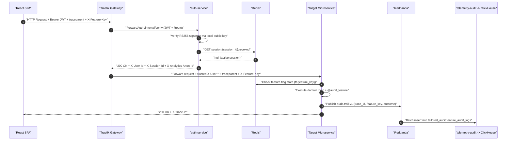
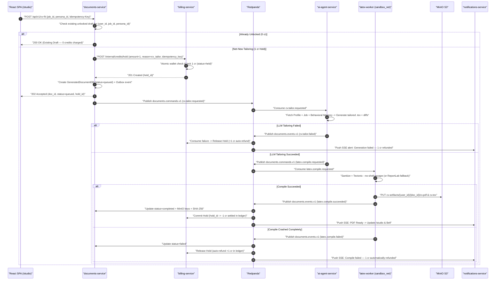
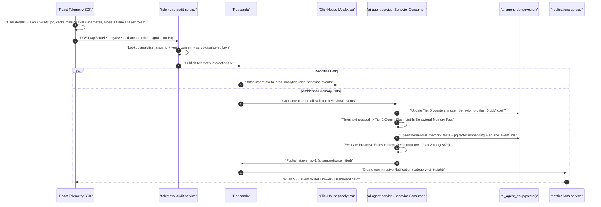
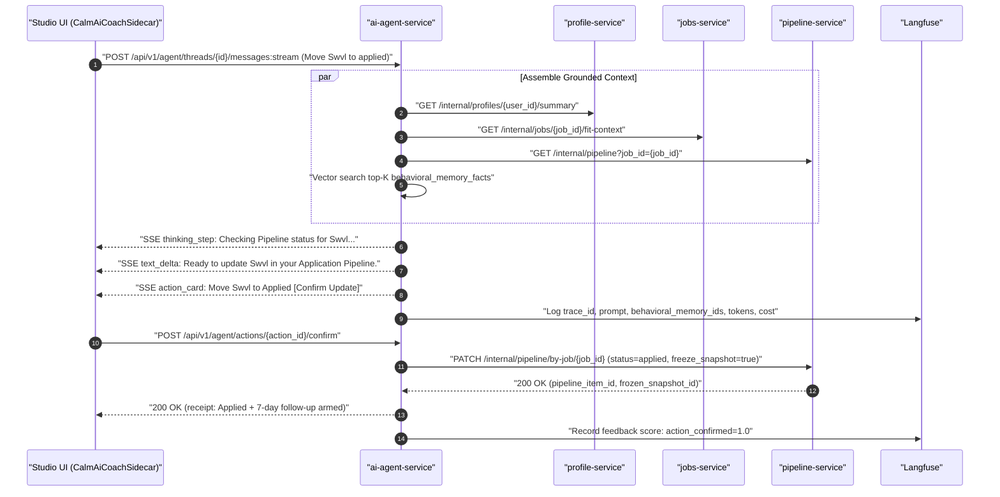

# 01 — System Topology, Service Boundaries & Inter-Service Communication

**Parent Index:** [Architecture Master Index](./README.md)  
**Target Pattern:** Domain Microservices in a Single Monorepo + Shared `tailored_kit` SDK + Redpanda Event Streaming + Traefik Edge Gateway

---

## 1. Runtime Component Responsibility Matrix (12 Components)

Every runtime component owns a strict business boundary, independent deployment unit, and isolated storage footprint. No microservice may read or write another microservice's PostgreSQL database or private Redis keys directly.

| # | Component | Runtime & Stack | Internal Port | Network Placement | Primary Ownership & Strict Boundaries |
| :-: | :--- | :--- | :---: | :--- | :--- |
| 1 | `traefik-gateway` | Traefik v3 | `80`, `443` | `edge_net`, `internal_mesh` | Single public ingress; Let's Encrypt TLS 1.3; OTel root `traceparent` injection; ForwardAuth JWT validation via `auth-service`; Redis-backed per-IP/per-user rate limiting; zero-buffering SSE pass-through; CORS & security headers |
| 2 | `auth-service` | FastAPI + SQLModel + Alembic | `8001` | `internal_mesh`, `data_net` | User registration/login, RS256 keypair rotation & `/.well-known/jwks.json`, ForwardAuth `/internal/verify`, rotating refresh tokens, 6-digit email OTP, Google & LinkedIn OAuth (enforcing sole-login unlink guard), TOTP 2FA + recovery codes, Active Device Sessions & revocation, Workspace Ergonomics preferences (`19_account_security_and_preferences.md`), Privacy Consents, built-in Feature Flag registry, `privacy_vault_db` pseudonym mapping, and GDPR Erasure Saga initiation |
| 3 | `profile-service` | FastAPI + SQLModel + Alembic | `8002` | `internal_mesh`, `data_net` | Master Profile CRUD, multi-persona career tracks (`CareerPersona`), multi-country phone resolution (`get_contact_for_country()`), `TargetLocation` & mobility rules, Education/Languages/Custom Sections, LaTeX CV ingestion parser (migrated from [latex_cv_parser.py](file:///d:/Tailored/backend/app/pipeline/latex_cv_parser.py)), and base `.tex` generation ([latex_template.py](file:///d:/Tailored/backend/app/ai/formatters/latex_template.py)) |
| 4 | `jobs-service` | FastAPI + SQLModel + Alembic | `8003` | `internal_mesh`, `data_net` | Public `/explore` sanitized preview feed, authenticated Radar feed, 5-D multi-persona Zero-Drop fit scorer (replacing/upgrading [evaluator/engine.py](file:///d:/Tailored/backend/app/evaluator/engine.py)), Interest List queue, Hide/Dismiss triage state, URL/JD/screenshot ingestion API, canonical SHA-256 deduplication ([compute_canonical_hash](file:///d:/Tailored/backend/app/models/job.py#L14-L20)), and MinIO upload tickets for JD screenshots |
| 5 | `scraper-worker` | Python Redpanda Consumer + Playwright + BeautifulSoup4 + Apify SDK | — (headless) | `internal_mesh`, `data_net` (egress allowed) | Consumes `jobs.commands.v1`: executes Apify LinkedIn Jobs/Posts ([apify_linkedin.py](file:///d:/Tailored/backend/app/scrapers/apify_linkedin.py)), two-tier Wuzzuf scraping ([wuzzuf_scraper.py](file:///d:/Tailored/backend/app/scrapers/wuzzuf_scraper.py)), corporate careers crawler ([crawler.py](file:///d:/Tailored/backend/app/scrapers/crawler.py)), and job screenshot OCR/vision prep; enforces Apify credit cap; publishes normalized raw postings on `jobs.events.v1` |
| 6 | `documents-service` | FastAPI + SQLModel + Alembic | `8004` | `internal_mesh`, `data_net` | Persistent record of Tailored CVs and Cover Letters, bullet-level diffs & section plans ([cv_fit.py](file:///d:/Tailored/backend/app/schemas/cv_fit.py)), revision history, Saved CVs archive (`11_saved_cvs_and_document_archive.md`), Frozen Application Snapshots (`16_application_detail_and_interview_hub.md`), `.tex`/`.pdf` artifact streaming from MinIO, and async GDPR `.zip` archive assembly |
| 7 | `latex-worker` | Hardened Non-Root Python Consumer + Tectonic + ReportLab | — (headless) | `sandbox_net` (NO internet egress), `data_net` (MinIO/Redpanda only) | Consumes `documents.commands.v1`: unwraps paragraph text macros, enforces visual template structure, runs `tectonic` with `--no-shell-escape` (or ReportLab fallback from [latex_engine.py](file:///d:/Tailored/backend/app/ai/formatters/latex_engine.py)), uploads `.tex` & `.pdf` to MinIO `cv-artifacts`, publishes `documents.compile.succeeded` or `documents.compile.failed` |
| 8 | `pipeline-service` | FastAPI + SQLModel + Alembic | `8005` | `internal_mesh`, `data_net` | Unified multi-channel Application Pipeline CRM ([pipeline_service.py](file:///d:/Tailored/backend/app/pipeline/pipeline_service.py)), stage state machine (`saved -> in_process -> applied -> interview -> archived`), interview round notes, compensation notes, 7-day follow-up reminder checks, and Gmail/mailto Outreach Package generation |
| 9 | `billing-service` | FastAPI + SQLModel + Alembic | `8006` | `internal_mesh`, `data_net` | Optimistic-locked Credit Wallet (`credit_wallets`), immutable credit ledger (`credit_ledger_entries`), regional pack catalog (`EGP`/`SAR`/`AED`/`USD` matching [CREDIT_PACKS](file:///d:/Tailored/frontend/src/context/WorkspaceContext.tsx#L38-L93)), Credit Hold/Commit/Auto-Refund Saga listener, Paymob (Meeza/Wallets/Fawry) & Stripe checkout + signed webhook verification, and PDF invoice storage in MinIO |
| 10 | `ai-agent-service` | FastAPI + LangGraph/PydanticAI + `google-genai` + Anthropic Fallback + Alembic | `8007` | `internal_mesh`, `data_net` | **Dual-Path AI Engine:** (A) Interactive Studio Coach SSE endpoint, Zero-Hallucination metric check, Action/Proposal cards, paid CV & Cover Letter generation orchestrator, JD `JobInsights` extractor ([fast_extractor.py](file:///d:/Tailored/backend/app/ai/extractor/fast_extractor.py)); (B) Background Redpanda behavioral consumer, Tier 0/1 Behavioral Memory distillation (`pgvector`), and Calm Proactive Suggestion Engine |
| 11 | `notifications-service` | FastAPI + SQLModel + Scheduler + Alembic | `8008` | `internal_mesh`, `data_net` | In-app Notifications Inbox & Bell Drawer (`20_notifications_and_alerts_center.md`), 5 signal categories (High-Fit Matches, Follow-Up Nudges, Compile/Refund Status, Credit Alerts, AI Proactive Suggestions), Snooze wakeups, Read/Archive triage, live SSE push via Redis Pub/Sub, and Resend/Postmark transactional & digest email sender |
| 12 | `telemetry-audit-service` | FastAPI + High-Throughput ClickHouse Batch Consumers | `8009` | `internal_mesh`, `data_net` | Accepts batched frontend micro-signal telemetry (`POST /api/v1/telemetry/events`), resolves `user_id -> analytics_anon_id` via cached privacy lookup, strips PII, publishes `telemetry.interactions.v1`, runs async ClickHouse batch writers for `tailored_analytics` and `tailored_audit`, and serves internal/admin Feature Audit query APIs |

---

## 2. Shared Internal Package: `packages/tailored_kit`

Because all 10 Python services + 2 workers live in one monorepo, every cross-cutting guarantee (tracing, feature auditing, JWT context, Redpanda outbox, feature flags) is enforced through one versioned editable package: `packages/tailored_kit`. Adding a new microservice in the future requires importing `tailored_kit` and wiring one FastAPI lifespan hook.

```text
packages/tailored_kit/
├── pyproject.toml
└── tailored_kit/
    ├── __init__.py
    ├── config.py              # BaseSettings helpers, environment & service metadata
    ├── errors.py              # RFC 7807 ProblemDetail exceptions + FastAPI exception handlers
    ├── auth/
    │   ├── context.py         # RequestContext (user_id, session_id, roles, feature_key, trace_id)
    │   ├── dependencies.py    # FastAPI Depends(require_user), Depends(optional_user), Depends(require_internal_service)
    │   └── jwks_client.py     # Cached JWKS + internal service HMAC/header trust verifier
    ├── telemetry_otel/
    │   ├── setup.py           # OpenTelemetry TracerProvider, MeterProvider, OTLP exporter, FastAPI/SQLAlchemy/httpx/Redis instrumentation
    │   └── logging.py         # Structured JSON logging automatically injecting trace_id, span_id, service_name, feature_key
    ├── audit/
    │   ├── decorator.py       # @audit_feature("studio.cv.tailor") emitting structured AuditTrailEvent
    │   ├── middleware.py      # Automatic request-level feature tagging & duration/outcome capture
    │   └── hashing.py         # Deterministic SHA-256 before/after payload hashing (never logs raw CV/PII)
    ├── messaging_redpanda/
    │   ├── envelope.py        # Canonical EventEnvelope Pydantic v2 schema + W3C traceparent header injection/extraction
    │   ├── producer.py        # Async aiokafka producer with idempotence=True, acks="all"
    │   └── consumer.py        # Resilient consumer loop with automatic OTel span link, idempotency table check & DLQ routing
    ├── outbox/
    │   ├── model.py           # SQLModel OutboxEvent mixin/table definition
    │   └── relay.py           # Polling + SKIP LOCKED transactional outbox relay worker
    ├── feature_flags/
    │   └── client.py          # OpenFeature-compatible client reading Redis-cached flags from auth-service with deterministic rollout hashing
    └── http_client/
        └── internal.py        # httpx.AsyncClient wrapper with automatic traceparent, X-Feature-Key, timeout, retry+jitter, and circuit breaker
```

---

## 3. Inter-Service Communication Patterns & Rules

### 3.1 Synchronous vs. Asynchronous Decision Rule

| Pattern | When Used | Mechanism | Examples |
| :--- | :--- | :--- | :--- |
| **Sync Internal REST** | Caller needs immediate data to render a view or validate a precondition before returning HTTP response | Internal `httpx` over `internal_mesh` (`http://<service>:800x/internal/...`) with 1.5s–3s timeouts & circuit breakers | `ai-agent-service` fetching Master Profile from `profile-service`; `pipeline-service` assembling Outreach links from `documents-service`; `jobs-service` calling `auth-service`? (No — JWT claims & Redis handle identity!) |
| **Async Event Streaming** | State changes with multiple downstream listeners, long-running IO/compute, Saga orchestration, or audit/telemetry fan-out | Transactional Outbox -> Redpanda (`*.v1` topics) -> Independent Consumer Groups | `documents.cv.tailor_requested` -> `ai-agent-service` -> `latex-worker`; `billing.credit.refund_requested`; `telemetry.interactions.v1` -> ClickHouse + AI Agent |
| **Real-Time Server Push** | Streaming AI Coach tokens/cards or live inbox alerts | Server-Sent Events (SSE) over HTTPS through Traefik (zero buffering) backed by Redis Pub/Sub for horizontal replica delivery | `POST /api/v1/agent/threads/{id}/messages:stream`; `GET /api/v1/notifications/stream` |

### 3.2 Zero-Trust Internal Communication & Resilience Rules

1. **Network Isolation:** Only `traefik-gateway` sits on `edge_net`. Microservices only bind ports on `internal_mesh` and `data_net`; `latex-worker` sits exclusively on `sandbox_net` (no internet egress) + `data_net`.
2. **Identity Propagation:** Traefik strips any client-supplied `X-User-*` or `X-Internal-*` headers at the edge before forwarding. After ForwardAuth validates the RS256 JWT (including checking Redis session revocation), `auth-service` injects signed/verified headers (`X-User-Id`, `X-Session-Id`, `X-User-Tier`, `X-Identity-Sig` short-lived HMAC).
3. **Trace & Feature Propagation:** Every external and internal call carries W3C `traceparent` and `X-Feature-Key`. `tailored_kit.messaging_redpanda` embeds both into Kafka record headers so asynchronous workers continue the exact same distributed trace.
4. **No Cross-Service Cascading Failures:** Sync service-to-service HTTP clients enforce strict timeouts (`2s` default, `5s` AI context assembly), max `2` idempotent GET retries with exponential jitter, and circuit breakers (`pybreaker`) that fail fast to graceful degradation (e.g., if `ai-agent-service` is down, `jobs-service` falls back to deterministic 5-D scoring and keyword extraction).
5. **Strict Idempotency:** Every mutating command (`POST /cv-fit`, `POST /credits/checkout`, `POST /pipeline`) and every Redpanda consumer enforces an `Idempotency-Key` or `event_id` uniqueness record before mutating balances or state.

---

## 4. End-to-End Sequence Diagrams

### Flow 1: Authenticated Request, Gateway ForwardAuth, Feature Flag & Tracing



---

### Flow 2: Credit-Backed Tailored CV + Sandboxed LaTeX Compile Saga (With Auto-Refund)

Guarantees the promise in [18_plans_credits_and_billing.md](file:///d:/Tailored/frontend/ux_designs/18_plans_credits_and_billing.md): *"Automatic failure refunds (`+1 cr`)"* if LLM generation or PDF compilation fails.



---

### Flow 3: Ambient Behavioral Intelligence Loop (Passive Access When User Is Not Chatting)

Demonstrates how Tailored tracks silent interactions and allows the AI Agent to learn and gently guide without interfering.



---

### Flow 4: Interactive Studio Coach With Cross-Service Action Card Confirmation

Mirrors [CalmAiCoachSidecar.tsx](file:///d:/Tailored/frontend/src/components/common/CalmAiCoachSidecar.tsx) and [workspaceCoachEngine.ts](file:///d:/Tailored/frontend/src/utils/workspaceCoachEngine.ts): the AI never silently mutates Pipeline CRM or Master Profile—it proposes an `ActionCard` or `ProposalItem` and commits only on explicit user confirmation.



---

### Flow 5: GDPR Account Erasure & Crypto-Shredding Saga

Satisfies [19_account_security_and_preferences.md](file:///d:/Tailored/frontend/ux_designs/19_account_security_and_preferences.md) while keeping pseudonymized ClickHouse product analytics intact.

```mermaid
sequenceDiagram
    autonumber
    participant UI as "User (/account)"
    participant Auth as "auth-service"
    participant Vault as "privacy_vault_db"
    participant Redis as "Redis"
    participant RP as "Redpanda"
    participant Svc as "Profile / Jobs / Docs / Pipeline / Billing / AI / Notif"
    participant MinIO as "MinIO S3"

    UI->>Auth: "DELETE /api/v1/account (password/2FA verify + confirm=DELETE)"
    Auth->>Redis: "Revoke all user_sessions immediately"
    Auth->>Auth: "Mark user status=erasing + emit Outbox event"
    Auth->>RP: "Publish identity.lifecycle.v1 (user.erasure.requested)"
    Auth-->>UI: "202 Accepted (Session terminated; erasure executing)"

    par Fan-Out Cleanup Across All Domain Services
        RP->>Svc: "Consume user.erasure.requested"
        Svc->>Svc: "Delete PII, Master Profile, Pipeline notes, AI Memory & Checkpoints, Notifications"
        Svc->>Svc: "Anonymize financial ledger tax records (retain non-PII invoice totals if legally required)"
        Svc->>MinIO: "Delete cv-artifacts/{user_id}/* & user-uploads/{user_id}/*"
        Svc->>RP: "Publish identity.lifecycle.v1 (service.erasure.completed)"
    end

    Auth->>Auth: "All domain services acked (or saga deadline reached)"
    Auth->>Vault: "DELETE FROM identity_pseudonyms WHERE user_id = :uid"
    Auth->>Redis: "DEL anon_map:{user_id}"
    Auth->>Auth: "Hard-delete auth_db user + OAuth + MFA rows -> Emit audit.trail.v1"
```

---

## 5. Resilience & Scalability Guardrails

| Guardrail | Configuration Standard | Purpose |
| :--- | :--- | :--- |
| **Transactional Outbox** | Every PostgreSQL service writes domain mutations and `outbox_events` inside the **same DB transaction** | Eliminates dual-write inconsistencies between Postgres and Redpanda |
| **Consumer Idempotency** | `processed_events(event_id PRIMARY KEY, processed_at)` per consumer DB | Guarantees at-least-once Redpanda delivery causes zero duplicate notifications or double refunds |
| **Dead-Letter Queues (DLQ)** | Max `5` exponential retries -> `<topic>.dlq` with original `trace_id` and error stack | Prevents poison-pill messages (e.g., malformed scraped HTML) from blocking a partition |
| **Rate Limiting (Traefik + Redis)** | Public `/explore`: `30 req/min/IP`; Auth OTP/Login: `5 req/min/IP`; Authenticated API: `120 req/min/user`; AI SSE: `20 turns/min/user` | Protects VPS CPU and LLM/Apify spend from bots or accidental loops |
| **Apify Spend Protection** | Preserves `APIFY_MAX_ITEMS_PER_ACTOR` cap from [config.py](file:///d:/Tailored/backend/app/core/config.py#L38) + daily global token budget in Redis | Prevents runaway external scraping bills |
