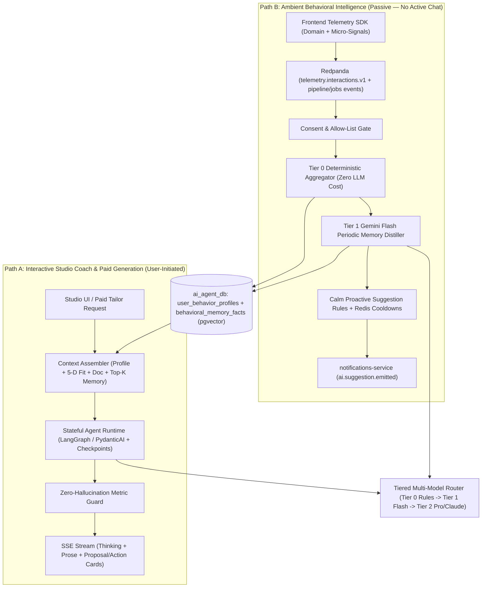

# 04 — AI Agent, Behavioral Telemetry & Ambient Intelligence

**Parent Index:** [Architecture Master Index](./README.md)  
**Key UX Counterparts:** [00_global_ux_foundation_and_ai_chat_pattern.md](file:///d:/Tailored/frontend/ux_designs/00_global_ux_foundation_and_ai_chat_pattern.md), [CalmAiCoachSidecar.tsx](file:///d:/Tailored/frontend/src/components/common/CalmAiCoachSidecar.tsx), [workspaceCoachEngine.ts](file:///d:/Tailored/frontend/src/utils/workspaceCoachEngine.ts)

---

## 1. Dual-Path AI Agent Architecture

`ai-agent-service` operates across two distinct, decoupled execution paths sharing one grounded `ai_agent_db` (`pgvector`) memory store and one Tiered Multi-Model Router:

---

## 2. Frontend Behavioral Telemetry SDK Specification

### 2.1 Transport, Batching & PII-Safety Rules

A lightweight client module (`frontend/src/services/telemetrySdk.ts`) captures explicit domain actions and privacy-safe micro-signals across all routes:

- **Buffer & Flush:** Buffers up to `15` events or `5s` in memory; flushes via `fetch(..., { keepalive: true })` and `navigator.sendBeacon` on `pagehide` / tab switch to `POST /api/v1/telemetry/events`.
- **Context Attachment:** Attaches `session_id`, `route`, `feature_key`, client `trace_id`, and coarse `persona_track` (role title slug).
- **Strict PII Scrubbing:** Client-side and server-side allow-lists reject keys like `email`, `phone`, `raw_cv`, `latex_content`, `message_text`, `notes`, or `password`. Only structural IDs, numeric timings, scroll percentages, skill tags, and categorical enum outcomes leave the browser.
- **Consent Respect:** Before sending `micro_signal` category events, checks Layer 1 `privacy_consents.analytics_micro_signals` cached from `/api/v1/account/privacy`.

### 2.2 Complete Interaction & Behavioral Signal Taxonomy

| Event Name | Category | Trigger Condition | Payload Fields (Allow-Listed) | ClickHouse | AI Agent Consumer |
| :--- | :--- | :--- | :--- | :---: | :---: |
| `ui.radar.searched` | Domain | User runs search / auto-search | `query_tokens_count`, `location_country`, `work_mode`, `source_filter` | Yes | Yes |
| `ui.job.dwelled` | Micro-Signal | Job card/detail open `>= 8s` active tab time | `job_id`, `duration_ms`, `fit_score`, `job_country`, `work_mode`, `normalized_role` | Yes | Yes |
| `ui.jd.scrolled` | Micro-Signal | Scroll depth milestones (`25/50/75/100%`) on JD | `job_id`, `scroll_depth_pct`, `dwell_ms` | Yes | Yes |
| `ui.skill_gap.clicked` | Micro-Signal | User clicks/expands a missing skill chip (`09`) | `job_id`, `skill_token`, `is_mandatory` | Yes | Yes |
| `ui.job.saved_interest` | Domain | Bookmarks job or ingests URL/JD/screenshot | `job_id`, `ingest_origin`, `fit_score`, `persona_id` | Yes | Yes |
| `ui.job.hidden` | Domain | Clicks `X` Hide on Radar card (`08`) | `job_id`, `hide_reason`, `fit_score`, `job_country`, `work_mode` | Yes | Yes |
| `ui.persona.switched` | Domain | Switches active persona via Identity Drawer (`00`) | `from_persona_title`, `to_persona_title`, `route` | Yes | Yes |
| `ui.studio.abandoned` | Micro-Signal | Opens Tailor flow or Out-of-Credits modal and exits without completing | `surface`, `job_id`, `step_reached`, `reason` | Yes | Yes |
| `ui.proposal.resolved` | Domain + AI | Clicks `Apply`, `Skip`, `Refine`, or `Undo` on Proposal Card | `proposal_id`, `resolution`, `refine_preset`, `section_key` | Yes | Yes |
| `ui.studio.manual_undo_loop` | Micro-Signal | `>= 3` consecutive undos or manual reverts within `60s` | `surface`, `section_key`, `undo_count` | Yes | Yes |
| `ui.cmdk.queried` | Micro-Signal | Executes or abandons `Cmd/Ctrl+K` query | `intent_type`, `matched_result`, `latency_ms` | Yes | No (UX analytics only) |
| `ui.checkout.funnel` | Domain | Opens Pack Drawer, selects currency/method, or cancels | `pack_id`, `currency`, `payment_method`, `stage` | Yes | No (Billing analytics only) |

---

## 3. Ambient Behavioral Pipeline (4-Stage Passive Intelligence)

When the user is **not** talking to the AI Coach, `ai-agent-service` runs a dedicated Redpanda consumer group (`ai-behavior-cg`) reading `telemetry.interactions.v1`, `pipeline.events.v1`, and `jobs.events.v1`.

### 3.1 Stage-by-Stage Execution

1. **Stage 1 — Consent & Allow-List Gate:** Resolves `analytics_anon_id` back to `user_id` only inside `ai-agent-service` when `privacy_consents.ai_passive_learning == true`. If paused or opted out, the event is immediately skipped (still kept anonymously in ClickHouse if `analytics_micro_signals == true`).
2. **Stage 2 — Tier 0 Deterministic Behavioral Aggregator (`$0` LLM Cost):** Updates rolling 7-day / 30-day structures in `user_behavior_profiles`:
   - `dominant_locations_json`: Tracks dwell vs. hide ratios per `(country, work_mode)`.
   - `implicit_role_drift_json`: Tracks high-dwell roles (`> 30s`) that differ from the active primary `CareerPersona`.
   - `writing_style_prefs_json`: Tracks Proposal Card accept vs. refine rates by instruction (`"Shorter"`, `"More metrics"`, `"Less formal"`).
3. **Stage 3 — Tier 1 Periodic LLM Memory Distillation (`gemini-2.5-flash`):** Runs **only** when a user accumulates `>= 20` new behavioral signals since `last_distilled_at` (and max once every `12h` per user). Gemini 2.5 Flash summarizes structured Tier 0 counters + recent event summaries into concise, non-invasive `behavioral_memory_facts` embedded via `768`-dim text embeddings into `pgvector`, linking exact `source_event_ids`.
4. **Stage 4 — Calm Proactive Suggestion Engine:** Deterministic rule evaluator triggered after Stage 2/3 updates. Before emitting any suggestion, checks:
   - `privacy_consents.proactive_nudges == true`
   - Redis user cooldown (`ai:nudge:cooldown:{user_id}:global` -> max **2 insights per 7 days**, minimum `48h` apart)
   - Zero duplicate dismissed suggestions in `proactive_suggestions`.

### 3.2 Five Concrete Proactive Behavioral Trigger Recipes

| Rule Key | Passive Trigger Condition (No Chat Required) | Emitted Calm Suggestion & UX Destination | Auto-Mutation? |
| :--- | :--- | :--- | :---: |
| `persona_drift_detected` | User dwells `>= 30s` on `>= 5` MLOps/AI Infra jobs in 14d while primary persona is `"Data Analyst"` | Dashboard Card + Inbox (`ai_insight`): *"You've been exploring MLOps roles lately — spin up a tailored MLOps persona track in Profile?"* -> `/profile` | **No** |
| `writing_style_calibrated` | `>= 4` consecutive `[Shorter]` refinements or long-bullet skips in CV Studio | Updates Behavioral Memory: *"Prefers 1-line punchy quantified bullets (<= 18 words)"* -> Future Studio turns pre-adapt + subtle chip `[Using concise bullet style]` | **No** (style hint only) |
| `location_mobility_shift` | User hides `>= 4` Cairo on-site jobs and dwells on `>= 4` Riyadh/UAE remote/relocation roles | Dashboard / Inbox: *"Seeing more Riyadh & Remote GCC roles in your browsing — enable Riyadh as an active Radar location?"* -> `/profile#locations` | **No** |
| `recurring_skill_gap_bridge` | User clicks missing skill chip (e.g., `Kubernetes`) across `>= 4` high-fit jobs | Studio Starter Chip on next open: *"4 saved roles ask for Kubernetes — highlight your Docker/ECS container orchestration work as a bridge?"* | **No** |
| `abandoned_tailor_recovery` | User clicked `Tailor CV` on a `>= 85%` job, hit pause/abort, and revisited the job `>= 2` times | Single gentle Bell/Dashboard card (max once): *"Swvl (94% match) is still open — preview your 5-D fit gaps before deciding to tailor (1 cr)."* | **No** |

### 3.3 User Transparency & Memory Inspector (`/account`)

To preserve total user trust, Layer 3 memory is **never a hidden black box**:
- In `/account` ([19_account_security_and_preferences.md](file:///d:/Tailored/frontend/ux_designs/19_account_security_and_preferences.md)), users can open the **AI Behavioral Memory** drawer (`GET /api/v1/agent/memory`).
- Displays each learned `behavioral_memory_fact` alongside its human-readable provenance (e.g., *"Learned from 6 Proposal Card edits between Nov 12–Nov 20"*).
- Users can `[Forget this fact]` (`DELETE /api/v1/agent/memory/{fact_id}`), `[Clear All AI Memory]`, or toggle off `ai_passive_learning` / `proactive_nudges` immediately.

---

## 4. Interactive Studio Coach Runtime (LangGraph / PydanticAI)

Powers the Calm 2-Pane Sanctuaries in `/studio` ([12_cv_studio_workbench.md](file:///d:/Tailored/frontend/ux_designs/12_cv_studio_workbench.md)) and `/cover-letters` ([13_cover_letter_studio.md](file:///d:/Tailored/frontend/ux_designs/13_cover_letter_studio.md)).

### 4.1 Grounded Context Assembly & Token Budget (`~8,000` Input Budget)

1. **System Policy & Surface Rules (`~600` tokens):** Enforces anti-fabrication rules, active mode (`Surgical` / `Metrics+` / `Executive`), and output schema.
2. **Master Profile & Active Persona (`~2,000` tokens):** Verified achievements, metrics, projects, skills fetched from `profile-service`.
3. **Target Job & 5-D Fit Breakdown (`~1,200` tokens):** Normalized JD insights, matched/missing skills from `jobs-service`.
4. **Living Document State & Focused Anchor (`~2,200` tokens):** Current LaTeX/Markdown body + exact bullet/paragraph targeted via `↳ Focused: {anchor}`.
5. **Top-K Behavioral Memory Facts (`~400` tokens):** Cosine similarity (`pgvector`) top `5` active `behavioral_memory_facts` for this user.
6. **Recent Thread Messages (`~1,600` tokens):** Sliding window from active `agent_checkpoint_id`.

### 4.2 Zero-Hallucination Metric Interception Pipeline

Before the Coach emits any `ProposalItem` (`proposal_card`) containing numbers, percentages, latencies, or currency figures:
1. A deterministic verifier extracts every quantitative token (`\d+%`, `\$\d+`, `\d+x`, `\d+\s*(ms|s|users|dispatches)`) from `newText`.
2. Each token is checked against the candidate's verified Master Profile (`experience_highlights`, `featured_projects`) and prior user chat turns in the thread.
3. **If unverified:** The runtime intercepts the draft proposal, blocks numeric fabrication, sets `isMetricQuestion = true`, and streams a calm borderless clarification question (`"What real % or latency number did you achieve on this service?"`) paired with a 1-click `[Insert my number ->]` chip (`00 §5.3`), logging `ai.metric.intercepted` to ClickHouse & Langfuse.

### 4.3 Agent Tool Registry

| Tool Name | Access Level | Data Source | Execution Behavior |
| :--- | :--- | :--- | :--- |
| `get_master_profile_evidence` | Read-only | `profile-service` | Searches verified experience bullets, projects, metrics |
| `get_saved_documents` | Read-only | `documents-service` | Lists existing tailored CVs & cover letters (`@Saved CVs`, `@Cover Letters`) -> streams `resource_list` |
| `get_radar_job_matches` | Read-only | `jobs-service` | Ranks top matching jobs (`@Jobs`) -> streams `resource_list` |
| `audit_pipeline_attention` | Read-only | `pipeline-service` | Finds overdue 7d follow-ups & ready packages (`@Pipeline`) -> streams `audit_summary` |
| `propose_document_edit` | Draft-only | `ai_agent_db` | Persists pending `ProposalCard` (`oldText -> newText`, `targetAnchorId`); **never modifies `documents-service` until `[✓ Apply]`** |
| `propose_workspace_action` | Confirmation-gated | `ai_agent_db` | Persists pending `ActionCard` (e.g., move Pipeline stage to `applied`); **executes only on `/actions/{id}/confirm`** |

### 4.4 SSE Streaming Protocol & Turn Branching

- **SSE Event Types:**
  - `thinking_step`: `{"step": "Checked Swvl role in Master Profile · Verified 42% latency metric"}` -> renders/updates the 1-line **Thinking Accordion**.
  - `text_delta`: `{"delta": "Your Master Profile already records..."}` -> streams **100% borderless editorial prose**.
  - `proposal_card` / `action_card` / `resource_list` / `audit_summary`: Structured JSON payloads matching `AiChatMessage` in [CalmAiCoachSidecar.tsx](file:///d:/Tailored/frontend/src/components/common/CalmAiCoachSidecar.tsx#L4-L55).
  - `done`: `{"message_id": "...", "checkpoint_id": "...", "langfuse_trace_id": "..."}`.
- **Turn Branching:** Hovering a past user capsule and clicking `[Edit & Branch from here]` sends `POST /api/v1/agent/threads/{id}/branch` with `parent_checkpoint_id`. The agent forks a new branch in `agent_checkpoints` without destroying earlier history.

---

## 5. Tiered Multi-Model Router & Unit Cost Economics

Grounded in [business_feasibility_analysis.md](file:///d:/Tailored/Documentations/business_feasibility_analysis.md#L102-L114), keeping compute cost below **~0.50 EGP** per complete tailored application preserves `>95%` gross margins on credit packs.

| Tier | Engine / Model | Assigned Tasks | Est. Cost / Task | Fallback Strategy |
| :---: | :--- | :--- | :---: | :--- |
| **Tier 0** | Deterministic Python Rules | Negative keyword filtering, canonical dedup, 5-D scoring math, Tier 0 behavior counters, Zero-Hallucination regex checks, proactive cooldown evaluation | **$0.00** | Always available |
| **Tier 1** | **Google Gemini 2.5 Flash** (`google-genai` Vertex AI) | JD `JobInsights` structured extraction (`fast_extractor`), LaTeX/JD fallback parsing, ambient Behavioral Memory distillation, quick `@` triage summaries | **$0.0003–$0.0008** | Secondary Gemini Flash region -> Mock/Deterministic parser |
| **Tier 2** | **Google Gemini 2.5 Pro** (Primary) / **Claude Sonnet** (Fallback) | Paid 1-cr CV Tailoring (`section_plan`, `bullet_diffs`, `.tex` synthesis), paid 1-cr Cover Letter drafting, complex multi-bullet Studio Coach reasoning | **$0.003–$0.009** | Cross-provider circuit breaker switches to Claude Sonnet via `BaseLLMProvider`, or degrades cleanly to Gemini 2.5 Flash |

- **Free Studio Chat Guardrail:** Because iterative Studio Coach turns cost `0` credits to the user (`00 §4.4`), the router defaults surgical single-bullet rewrites to **Tier 1 (`gemini-2.5-flash`)** and escalates to **Tier 2** only for multi-section structural rewrites or paid `1 cr` initial generations—keeping free chat margins highly sustainable while enforcing per-user daily token soft caps.
