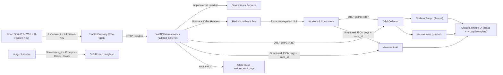

# 05 — Observability, Feature Auditing, AI Evals & Privacy Security

**Parent Index:** [Architecture Master Index](./README.md)  
**Stack:** OpenTelemetry + Grafana Stack (Tempo, Loki, Prometheus) + Self-Hosted Langfuse + ClickHouse Audit Ledger + Privacy Vault

---

## 1. End-to-End Request Tracing Flow

Every single action—whether a fast REST call, an async scrape/compile saga, or a streaming AI Coach turn—shares one correlated W3C `trace_id` and canonical `feature_key` across the entire distributed mesh:



- **Log-to-Trace Correlation:** `tailored_kit.telemetry_otel.logging` injects `trace_id`, `span_id`, `service_name`, and `feature_key` into every JSON log line so Grafana links directly from any error log in Loki to its Tempo waterfall and ClickHouse audit record.

---

## 2. Canonical Feature Registry & Auditing Framework

To answer *"how is feature X performing, how much did it cost, who used it, and did anything break?"* across 12 components, every endpoint and background job maps to a canonical `feature_key`.

### 2.1 Canonical Feature Key Catalog (32 Core Keys)

| Domain | Canonical `feature_key` Keys |
| :--- | :--- |
| **Auth & Security (`03`, `04`, `19`)** | `auth.register`, `auth.login.password`, `auth.login.oauth`, `auth.otp.verify`, `auth.password.reset`, `auth.2fa.enable`, `auth.session.revoke` |
| **Onboarding & Profile (`05`, `17`)** | `onboarding.step.save`, `onboarding.latex_drop.parse`, `profile.master.update`, `profile.persona.create`, `profile.persona.switch` |
| **Discovery & Ingestion (`01`, `02`, `08`, `09`, `10`)** | `explore.public.feed`, `radar.auto_search`, `radar.feed.rank`, `radar.job.hide`, `ingest.url`, `ingest.jd_text`, `ingest.screenshot_ocr`, `interest.job.save` |
| **Studios & Archive (`11`, `12`, `13`)** | `studio.cv.tailor`, `studio.cv.edit`, `studio.cv.compile`, `studio.cv.download`, `studio.cl.draft`, `studio.cl.edit`, `archive.documents.list` |
| **AI Coach & Ambient (`00`, `12`, `13`)** | `ai.coach.chat_turn`, `ai.coach.proposal.resolve`, `ai.coach.action.confirm`, `ai.ambient.memory_distill`, `ai.ambient.nudge_emit` |
| **Pipeline & Billing (`14`, `15`, `16`, `18`)** | `pipeline.item.create`, `pipeline.stage.update`, `pipeline.outreach.dispatch`, `billing.checkout.create`, `billing.webhook.settle`, `billing.credit.auto_refund` |
| **Account, Alerts & GDPR (`19`, `20`)** | `notifications.inbox.read`, `notifications.snooze`, `account.preferences.update`, `account.privacy.update`, `account.gdpr.export`, `account.gdpr.erase` |

### 2.2 `@audit_feature` Decorator & Middleware Contract

`tailored_kit.audit` provides a decorator and FastAPI middleware that automatically captures every feature execution without cluttering business logic:

```python
@router.post("/cv-fit")
@audit_feature(feature_key="studio.cv.tailor", resource_type="generated_document")
async def create_cv_fit(payload: CvFitCreateRequest, ctx: RequestContext = Depends(require_user)):
    ...
```

- **Captured Fields:** `audit_id`, `occurred_at`, `trace_id`, `span_id`, `feature_key`, `service_name`, `action`, `outcome` (`success` | `denied` | `failed` | `refunded`), `actor_user_id_hash` (`SHA-256(user_id + vault_salt)`), `resource_type`, `resource_id`, `before_hash` & `after_hash` (structural payload hashes, zero raw CV/PII), `diff_summary`, `credit_delta`, `duration_ms`, `active_flags_json`, and `error_code`.
- **Non-Blocking Emission:** Audit events publish asynchronously via `audit.trail.v1` -> `telemetry-audit-service` batch writer -> ClickHouse `tailored_audit.feature_audit_logs`.

### 2.3 Operator ClickHouse Feature Audit Queries

**Query 1 — Error Rate, P95 Latency & Credit Net Impact per Feature (Last 24h):**
```sql
SELECT
    feature_key,
    count() AS total_executions,
    countIf(outcome = 'failed') AS failures,
    round(failures / total_executions * 100, 2) AS failure_rate_pct,
    quantile(0.95)(duration_ms) AS p95_ms,
    sum(credit_delta) AS net_credit_delta
FROM tailored_audit.feature_audit_logs
WHERE occurred_at >= now() - INTERVAL 24 HOUR
GROUP BY feature_key
ORDER BY total_executions DESC;
```

**Query 2 — Reconstruct Complete Cross-Service Story for a Single `trace_id`:**
```sql
SELECT
    occurred_at,
    service_name,
    feature_key,
    action,
    outcome,
    resource_type,
    resource_id,
    credit_delta,
    duration_ms,
    error_code
FROM tailored_audit.feature_audit_logs
WHERE trace_id = '4bf92f3577b34da6a3ce929d0e0e4736'
ORDER BY occurred_at ASC;
```

**Query 3 — Audit Automatic Compile-Failure Credit Refunds & Investigate Outliers:**
```sql
SELECT
    toStartOfHour(occurred_at) AS hour,
    countIf(feature_key = 'studio.cv.tailor' AND outcome = 'success') AS tailors_ok,
    countIf(feature_key = 'billing.credit.auto_refund') AS auto_refunds,
    round(auto_refunds / greatest(tailors_ok + auto_refunds, 1) * 100, 2) AS refund_rate_pct
FROM tailored_audit.feature_audit_logs
WHERE occurred_at >= now() - INTERVAL 7 DAY
GROUP BY hour
ORDER BY hour DESC;
```

**Query 4 — Security & Access-Control Audit (Auth Failures, 2FA, Revocations, GDPR Erasures):**
```sql
SELECT occurred_at, feature_key, outcome, actor_user_id_hash, error_code, trace_id
FROM tailored_audit.feature_audit_logs
WHERE feature_key LIKE 'auth.%' OR feature_key LIKE 'account.gdpr.%'
  AND occurred_at >= now() - INTERVAL 24 HOUR
ORDER BY occurred_at DESC
LIMIT 200;
```

---

## 3. AI & Prompt Auditing via Self-Hosted Langfuse

`ai-agent-service` instruments every LLM invocation (Tier 1 Gemini Flash, Tier 2 Gemini Pro/Claude) using the **same `trace_id`** propagated from Traefik, sending telemetry asynchronously to the self-hosted Langfuse server:

1. **Full Prompt & Version Lineage:** Logs `prompt_template_name` + Git SHA/version, `model_tier`, `model_name`, `input_tokens`, `output_tokens`, `thinking_tokens`, `latency_ms`, and `estimated_usd_cost`.
2. **Behavioral Context Provenance:** Attaches `behavioral_memory_fact_ids` injected into the context window and `focused_anchor_id` (`Swvl · Bullet 2`), letting developers debug *why* the coach gave a particular phrasing suggestion.
3. **Zero-Hallucination Audit Tagging:** Marks `metric_interception_triggered = true` whenever the deterministic verifier blocks an unverified quantitative claim.
4. **Closed-Loop Proposal Quality Scoring:** When the user resolves a Proposal Diff Card via `POST /api/v1/agent/proposals/{id}/resolve`, `ai-agent-service` pushes a Langfuse numeric score linked to the exact generation `langfuse_trace_id`:
   - `applied` = `+1.0`
   - `refined` = `+0.5`
   - `skipped` = `0.0`
   - `undone` = `-1.0`

---

## 4. Grafana Dashboards & Alerting Rules

| Dashboard | Data Sources | Core Panels | Critical Alerts |
| :--- | :--- | :--- | :--- |
| **1. Edge & Service SLOs** | Prometheus + Tempo | RPS, P50/P95/P99 latency, 5xx error rates per microservice, Traefik rate-limit hits | 5xx `> 2%` over 5m; any service down `> 60s` |
| **2. Redpanda, Workers & LaTeX** | Prometheus + Loki | Consumer lag per consumer group, DLQ message count, Tectonic vs ReportLab fallback rate, Apify daily item burn | Consumer lag `> 500` for 5m; any DLQ growth `> 0`; LaTeX compile failure `> 10%` |
| **3. Feature Audit & Credits Health** | ClickHouse + Prometheus | Credit holds vs commits vs auto-refunds, Paymob/Stripe webhook latency, top failing `feature_key`s | Auto-refund spike `> 5%`; orphaned `credit_holds` older than `10m` |
| **4. VPS Capacity & AI Cost** | Prometheus + Langfuse | Container RSS vs limits, PostgreSQL connections/cache hit, ClickHouse disk usage, daily LLM spend per tier | VPS RAM `> 85%`; Block volume disk `> 80%`; Daily LLM or Apify spend `> 80%` threshold |

---

## 5. Privacy, Security & GDPR Lifecycle Compliance

### 5.1 4-Tier Data Classification Matrix

| Tier | Examples | Storage Rules | Telemetry & AI Rules |
| :---: | :--- | :--- | :--- |
| **Tier 1: Secret / Auth** | Password hashes (Argon2id), OAuth tokens, TOTP secrets, JWT private keys, Paymob/Stripe keys | Encrypted at rest (`totp_mfa` AES-GCM), Docker secrets / env vault, never logged | Strictly forbidden from ClickHouse, Loki, Tempo, and Langfuse |
| **Tier 2: Direct PII** | Full name, email, multi-country phone numbers, IP prefixes, `privacy_vault_db` mapping | Isolated in `auth_db`, `profile_db`, `privacy_vault_db`; TLS 1.3 + encrypted block storage | Never stored in ClickHouse (`analytics_anon_id` used instead); stripped from public `/explore` |
| **Tier 3: Candidate Career & Docs** | Work history, LaTeX CVs, PDFs, Cover Letters, Pipeline notes, Studio chat threads | User-scoped in `profile_db`, `documents_db`, `pipeline_db`, `ai_agent_db`, MinIO | Processed by Gemini/Claude under zero-training enterprise API terms; never sold or exposed to recruiters |
| **Tier 4: Pseudonymized Telemetry** | `ui.job.dwelled`, `ui.jd.scrolled`, `ui.proposal.resolved`, `feature_audit_logs` | ClickHouse (`analytics_anon_id` or `actor_user_id_hash`) | Safe for long-term product analytics; crypto-shredded from identity on account deletion |

### 5.2 Pseudonymization & Crypto-Shredding Flow

- Every verified account receives a random UUID `analytics_anon_id` stored **solely** in `privacy_vault_db.identity_pseudonyms`.
- ClickHouse `tailored_analytics.user_behavior_events` indexes only `analytics_anon_id`—never `user_id`, email, name, or CV text.
- On GDPR erasure (`DELETE /api/v1/account`), `auth-service` orchestrates deletion of all Tier 1–3 records across every service + MinIO, then **permanently deletes the `identity_pseudonyms` row and Redis `anon_map:{user_id}`**. Without the mapping key, historical ClickHouse events become irreversibly anonymous statistical noise—achieving full GDPR compliance without expensive ClickHouse row mutations.

### 5.3 Application & Container Hardening Checklist

1. **Sandboxed `latex-worker`:** Runs as non-root UID `10001`, read-only root filesystem (`/tmp` scratch `tmpfs`), `cap_drop: [ALL]`, `--no-shell-escape` compiler flag, `30s` subprocess timeout, attached only to `sandbox_net` (`internal: true`, zero internet egress) + `data_net` (MinIO/Redpanda only).
2. **Authentication & Sessions:** Argon2id password hashing, short-lived `15m` RS256 access tokens, `HttpOnly; Secure; SameSite=Lax` rotating refresh tokens with reuse detection (revokes entire token family on theft), and immediate Redis session blocklisting.
3. **Payment Webhook Integrity:** Paymob callbacks validated via HMAC-SHA512 over sorted canonical payload fields; Stripe webhooks validated via `Stripe-Signature` timestamped HMAC + idempotent `payment_orders` lock.
4. **GDPR Export SLA:** `POST /api/v1/account/export` produces an authenticated `.zip` bundle in MinIO `gdpr-exports` (containing `master_profile.json`, `workspace_preferences.json`, `ai_behavioral_memory.json`, all `.tex`/`.pdf` CVs, cover letters, pipeline JSON, and credit ledger CSV) within `< 60s` with a `24h` auto-expiring link.
