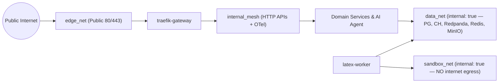

# 06 — Docker Compose, VPS Deployment & MENA Seasonal Scaling

**Parent Index:** [Architecture Master Index](./README.md)  
**Target Hosting:** Multi-Profile Docker Compose on MENA-Adjacent Cloud VPS + Detached Block Storage + Reversible Vertical/Worker Scaling

---

## 1. Target Monorepo Directory Layout

```text
Tailored/
├── packages/
│   └── tailored_kit/                  # Shared SDK (OTel, Redpanda, Outbox, @audit_feature, JWKS, Feature Flags)
├── services/
│   ├── auth-service/                  # Identity, OAuth, OTP, 2FA, Sessions, Preferences, Privacy, Flags, GDPR
│   ├── profile-service/               # Master Profile, Personas, LaTeX CV Parser, Base Templates
│   ├── jobs-service/                  # Explore, Radar, 5-D Multi-Persona Scorer, Interest List
│   ├── scraper-worker/                # Apify LinkedIn, Wuzzuf, Playwright, JD Screenshot OCR consumer
│   ├── documents-service/             # Tailored CVs, Cover Letters, Frozen Snapshots, GDPR ZIPs
│   ├── latex-worker/                  # Hardened Tectonic + ReportLab ATS sandboxed compiler
│   ├── pipeline-service/              # Pipeline CRM, Interview Rounds, 7d Follow-ups, Outreach Composer
│   ├── billing-service/               # Credit Wallet, Hold/Commit/Refund Saga, Paymob & Stripe, Invoices
│   ├── ai-agent-service/              # Studio Coach SSE, Multi-Model Router, Ambient Behavioral Consumer
│   ├── notifications-service/         # Inbox, Snooze, Digest Emails, Live SSE Push
│   └── telemetry-audit-service/       # Telemetry Batch API + ClickHouse Analytics & Audit Writers
├── frontend/                          # Existing React + Vite SPA + new telemetrySdk.ts
├── infra/
│   ├── compose/
│   │   ├── compose.infra.yml          # Traefik, PostgreSQL+pgvector, Redpanda, ClickHouse, Redis, MinIO
│   │   ├── compose.core.yml           # auth, profile, jobs, documents, pipeline, billing, notifications, telemetry
│   │   ├── compose.ai.yml             # ai-agent-service (interactive + ambient consumer)
│   │   ├── compose.workers.yml        # scraper-worker, latex-worker
│   │   └── compose.observability.yml  # OTel Collector, Tempo, Loki, Prometheus, Grafana, Langfuse
│   ├── traefik/                       # Dynamic routing, TLS, ForwardAuth, rate-limit, SSE middleware
│   ├── postgres/init/                 # Logical DB & least-privilege role creation SQL
│   ├── clickhouse/init/               # DDL for tailored_analytics & tailored_audit
│   ├── observability/                 # OTel, Tempo, Loki, Prometheus, Grafana dashboards
│   └── scripts/                       # Off-site backups, restore drill, DLQ replay, Alembic runner
├── Documentations/
│   └── architecture/                  # This blueprint suite
└── docker-compose.yml                 # Root compose file importing infra/compose/*.yml profiles
```

---

## 2. Multi-Profile Docker Compose Container Inventory

Compose profiles allow running lean local development setups (`--profile infra --profile core`) or full production stacks (`--profile infra --profile core --profile ai --profile workers --profile observability`).

| Container | Profile | Base Image / Build | Mem Limit | CPU Cap | Networks | Healthcheck | Block Volume Mount |
| :--- | :--- | :--- | :---: | :---: | :--- | :--- | :--- |
| `traefik-gateway` | `infra` | `traefik:v3.2` | `256M` | `0.5` | `edge_net`, `internal_mesh` | `traefik healthcheck` | `/mnt/tailored-data/traefik-certs` |
| `postgres` | `infra` | `pgvector/pgvector:pg16` | `2.0G` | `2.0` | `data_net` | `pg_isready` | `/mnt/tailored-data/postgres` |
| `redpanda` | `infra` | `redpandadata/redpanda` | `1.5G` | `1.5` | `data_net` | `rpk cluster health` | `/mnt/tailored-data/redpanda` |
| `clickhouse` | `infra` | `clickhouse/clickhouse-server:24-alpine` | `1.5G` | `1.5` | `data_net` | `clickhouse-client -q "SELECT 1"` | `/mnt/tailored-data/clickhouse` |
| `redis` | `infra` | `redis:7-alpine` | `384M` | `0.5` | `data_net` | `redis-cli ping` | `/mnt/tailored-data/redis` |
| `minio` | `infra` | `minio/minio:latest` | `512M` | `0.5` | `data_net` | `/minio/health/live` | `/mnt/tailored-data/minio` |
| `auth-service` | `core` | Python 3.12 Slim | `384M` | `0.5` | `internal_mesh`, `data_net` | `GET /health` | — |
| `profile-service` | `core` | Python 3.12 Slim | `256M` | `0.5` | `internal_mesh`, `data_net` | `GET /health` | — |
| `jobs-service` | `core` | Python 3.12 Slim | `384M` | `0.75` | `internal_mesh`, `data_net` | `GET /health` | — |
| `documents-service` | `core` | Python 3.12 Slim | `384M` | `0.5` | `internal_mesh`, `data_net` | `GET /health` | — |
| `pipeline-service` | `core` | Python 3.12 Slim | `256M` | `0.5` | `internal_mesh`, `data_net` | `GET /health` | — |
| `billing-service` | `core` | Python 3.12 Slim | `256M` | `0.5` | `internal_mesh`, `data_net` | `GET /health` | — |
| `notifications-service` | `core` | Python 3.12 Slim | `256M` | `0.5` | `internal_mesh`, `data_net` | `GET /health` | — |
| `telemetry-audit-service` | `core` | Python 3.12 Slim | `384M` | `0.75` | `internal_mesh`, `data_net` | `GET /health` | — |
| `ai-agent-service` | `ai` | Python 3.12 Slim | `768M` | `1.0` | `internal_mesh`, `data_net` | `GET /health` | — |
| `scraper-worker` | `workers` | Playwright Python | `1.0G` | `1.0` | `internal_mesh`, `data_net` | Worker heartbeat file | — |
| `latex-worker` | `workers` | Tectonic + ReportLab | `768M` | `1.0` | `sandbox_net`, `data_net` | Worker heartbeat file | — |
| `otel-collector` | `observability` | `otel/opentelemetry-collector-contrib` | `256M` | `0.5` | `internal_mesh`, `data_net` | `/health` | — |
| `tempo` + `loki` + `prometheus` + `grafana` | `observability` | Grafana OSS Suite | `1.8G` total | `1.5` | `internal_mesh`, `data_net` | Service `/ready` | `/mnt/tailored-data/{tempo,loki,prom,grafana}` |
| `langfuse` | `observability` | `langfuse/langfuse:2` | `768M` | `0.75` | `internal_mesh`, `data_net` | `GET /api/public/health` | Uses `langfuse_db` in Postgres |

---

## 3. Four Segmented Docker Networks



1. **`edge_net`:** Public bridge exposing only ports `80` and `443` on `traefik-gateway`. Zero databases or backend containers attach here.
2. **`internal_mesh`:** Service-to-service HTTP/SSE communication and OTel/Grafana scraping.
3. **`data_net` (`internal: true`):** Houses PostgreSQL, Redpanda, ClickHouse, Redis, and MinIO—blocked from outbound internet access.
4. **`sandbox_net` (`internal: true`):** Isolates `latex-worker` (`read_only: true`, non-root UID, `--no-shell-escape`) so untrusted LaTeX inputs can never exfiltrate secrets or probe external hosts.

---

## 4. Attached Block Storage & Backup/Restore Strategy

All stateful volumes mount onto an independently resizable Cloud Block Volume (`/mnt/tailored-data/`) separate from the VPS root OS disk:

```text
/mnt/tailored-data/
├── postgres/          # PG16 + pgvector cluster
├── clickhouse/        # Analytical & Feature Audit tables
├── redpanda/          # Event partitions & logs
├── redis/             # AOF persistence snapshot
├── minio/             # cv-artifacts, user-uploads, invoices, gdpr-exports
├── traefik-certs/     # ACME Let's Encrypt certificates
└── observability/     # tempo/, loki/, prometheus/, grafana/
```

### Automated Off-Site Backups (Cloudflare R2 / Backblaze B2)

- **PostgreSQL:** Hourly WAL archiving (`pgBackRest` or `wal-g`) + nightly logical `pg_dump` per database (`auth_db`, `privacy_vault_db`, `profile_db`, `billing_db`, etc.) encrypted with `age` before upload. RPO `<= 15 minutes`.
- **ClickHouse:** Nightly incremental snapshot via `clickhouse-backup` pushed to R2/B2 (`30d` off-site retention).
- **MinIO (`cv-artifacts`, `invoices`):** Continuous `mc mirror` sync every `15m` to R2/B2.
- **Monthly Automated Restore Drill:** Ephemeral test container restores latest encrypted dump and asserts row counts + MinIO SHA-256 integrity checksums.

---

## 5. MENA Seasonal Vertical Scaling & Growth Playbook

Directly aligned with seasonality patterns in [business_feasibility_analysis.md](file:///d:/Tailored/Documentations/business_feasibility_analysis.md#L44-L72):

| Stage | Season / Active User Band | Topology & VPS Sizing | Memory Budget Tuning | Key Action |
| :--- | :--- | :--- | :--- | :--- |
| **Stage 0: Local Dev** | Solo Engineering | Laptop Docker Desktop (`infra` + `core` + optional `ai`) | `~4–6 GB RAM` | Run `observability` only when debugging traces/AI |
| **Stage 1: Off-Peak Launch** | Launch / Ramadan / Dec Slump (`0 – 5k` users) | **1 MENA-adjacent Cloud VPS** (e.g., Hetzner/DO **8 vCPU / 16 GB RAM** or **4 vCPU / 8 GB RAM** without heavy local obs) + 100 GB Block Volume | PG `2G`, CH `1.5G`, RP `1.5G`, Services `3.5G`, Obs `2.8G` | Single-node Docker Compose; low fixed burn (`~$25–$55/mo`) |
| **Stage 2: MENA Peak Surge** | **Jun–Aug (3M+ MENA Graduates)** & **Jan–Mar (Q1 Corporate Hiring)** (`5k – 25k` users) | **Reversible Vertical VPS Resize** -> **16 vCPU / 32 GB RAM** (zero migration: detach/attach block volume or live upgrade) + `docker compose up --scale latex-worker=3 --scale scraper-worker=2 --scale ai-agent-service=2` | PG `6G`, CH `4G`, RP `3G`, AI/Workers `8G` | Instant vertical scale-up for surge; scale back down to Stage 1 during off-peak months |
| **Stage 3: Two-VPS Split** | `25k – 60k+` active users | **App VPS** (Traefik + Core + AI + Workers) + **Data/Obs VPS** (PG + ClickHouse + Redpanda + MinIO + Grafana/Langfuse) connected over private WireGuard / Cloud VPC | Full host RAM dedicated to DB caches & analytical scans | Only `DATABASE_URL`, `REDPANDA_BROKERS`, `CH_HOST` env vars change—zero code edits |
| **Stage 4: Kubernetes Ready** | Multi-region / `>60k` users | **k3s / GKE / EKS** using existing stateless service Dockerfiles, healthchecks, Redis SSE Pub/Sub, and externalized block/S3 state | Horizontal Pod Autoscaler on Redpanda lag & CPU | Zero architectural refactoring required |

---

## 6. CI/CD Pipeline & Zero-Downtime Rolling Deployment

1. **Test & Build (GitHub Actions):** Detects changed `services/*` or `packages/tailored_kit/` -> runs `pytest` unit/contract tests + `ruff` + `mypy` -> builds multi-stage Docker images tagged with Git SHA -> pushes to GHCR.
2. **Pre-Deploy Schema Gate:** Runs `alembic upgrade head` **backward-compatibly** (additive migrations first, column drops in subsequent deploy) for each updated service against its own isolated DB.
3. **Traefik Healthcheck-Gated Swap:** Docker Compose pulls new digest and performs rolling `--no-deps` service replacement; Traefik routes traffic only after `GET /health` (verifying DB + Redpanda/Redis reachability) passes `3` consecutive checks, while graceful `SIGTERM` drains active SSE/HTTP requests for `25s`.
