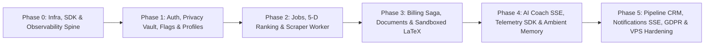

# 07 — Phased Migration & Implementation Roadmap

**Parent Index:** [Architecture Master Index](./README.md)  
**Strategy:** Strangler-Fig Incremental Extraction From `backend/app/` + `frontend/src/` Cutover Gates

---

## 1. Existing Codebase Asset Migration Map

Zero existing engineering work is discarded. Every validated module in `d:/Tailored/backend/app/` maps deterministically into `packages/tailored_kit` or its target microservice:

| Existing Prototype File (`backend/app/`) | Destination Package / Microservice | Migration Action & Modernization Notes |
| :--- | :--- | :--- |
| [core/config.py](file:///d:/Tailored/backend/app/core/config.py) & [core/database.py](file:///d:/Tailored/backend/app/core/database.py) | `packages/tailored_kit/` | Split settings per service; replace SQLite fallback + `ALTER TABLE` startup hacks with strict PostgreSQL + per-service Alembic |
| [models/profile.py](file:///d:/Tailored/backend/app/models/profile.py), [schemas/user_profile.py](file:///d:/Tailored/backend/app/schemas/user_profile.py), [pipeline/latex_cv_parser.py](file:///d:/Tailored/backend/app/pipeline/latex_cv_parser.py), [api/routes/profiles.py](file:///d:/Tailored/backend/app/api/routes/profiles.py) | `services/profile-service/` | Add `user_id` UUID scoping, optimistic locking `version`, `base_cv_templates`, and Outbox emissions (`profile.events.v1`) |
| [ai/formatters/latex_template.py](file:///d:/Tailored/backend/app/ai/formatters/latex_template.py) | `services/profile-service/` + `services/documents-service/` | Base `.tex` synthesis stays in `profile-service`; tailoring section guards shared cleanly via `tailored_kit` or `documents-service` |
| [models/job.py](file:///d:/Tailored/backend/app/models/job.py), [schemas/search_request.py](file:///d:/Tailored/backend/app/schemas/search_request.py), [pipeline/query_generator.py](file:///d:/Tailored/backend/app/pipeline/query_generator.py), [pipeline/ingestion_engine.py](file:///d:/Tailored/backend/app/pipeline/ingestion_engine.py), [pipeline/job_search_service.py](file:///d:/Tailored/backend/app/pipeline/job_search_service.py), [pipeline/job_discovery_pipeline.py](file:///d:/Tailored/backend/app/pipeline/job_discovery_pipeline.py), [api/routes/jobs.py](file:///d:/Tailored/backend/app/api/routes/jobs.py) | `services/jobs-service/` | Separate global `jobs` catalog from per-user `job_fit_scores` and `user_job_interactions` (Interest + Hide); add `/explore` public route |
| [evaluator/engine.py](file:///d:/Tailored/backend/app/evaluator/engine.py) & [evaluator/metrics.py](file:///d:/Tailored/backend/app/evaluator/metrics.py) | `services/jobs-service/` (`ranking/`) | Upgrade 3-metric evaluator to the full 5-D Multi-Persona Zero-Drop algorithm (`35/20/20/15/10` weights) matching [fitEngine.ts](file:///d:/Tailored/frontend/src/utils/fitEngine.ts) |
| [scrapers/base.py](file:///d:/Tailored/backend/app/scrapers/base.py), [apify_linkedin.py](file:///d:/Tailored/backend/app/scrapers/apify_linkedin.py), [wuzzuf_scraper.py](file:///d:/Tailored/backend/app/scrapers/wuzzuf_scraper.py), [crawler.py](file:///d:/Tailored/backend/app/scrapers/crawler.py), [mock_scrapers.py](file:///d:/Tailored/backend/app/scrapers/mock_scrapers.py), [pipeline/url_job_fetcher.py](file:///d:/Tailored/backend/app/pipeline/url_job_fetcher.py) | `services/scraper-worker/` | Convert synchronous blocking calls into Redpanda `jobs.commands.v1` async consumer with Apify Redis budget caps |
| [ai/providers/*](file:///d:/Tailored/backend/app/ai/providers/gemini_provider.py), [ai/extractor/*](file:///d:/Tailored/backend/app/ai/extractor/fast_extractor.py), [schemas/job_insights.py](file:///d:/Tailored/backend/app/schemas/job_insights.py), [pipeline/batch_extractor.py](file:///d:/Tailored/backend/app/pipeline/batch_extractor.py), [ai/tailor/*](file:///d:/Tailored/backend/app/ai/tailor/cv_fit_service.py), [ai/cover_letter/*](file:///d:/Tailored/backend/app/ai/cover_letter/cover_letter_service.py) | `services/ai-agent-service/` | Wrap LLM calls in Tiered Router + Langfuse telemetry; decouple file writing into MinIO + Redpanda commands; add Coach SSE + Ambient Memory |
| [ai/formatters/latex_engine.py](file:///d:/Tailored/backend/app/ai/formatters/latex_engine.py) (+ Linux `tectonic` binary replacing Windows `bin/tectonic.exe`) | `services/latex-worker/` | Run inside hardened non-root `sandbox_net` container (`--no-shell-escape`), streaming `.tex`/`.pdf` to MinIO + publishing compile outcome |
| [models/document.py](file:///d:/Tailored/backend/app/models/document.py), [schemas/cv_fit.py](file:///d:/Tailored/backend/app/schemas/cv_fit.py), [api/routes/cv_fit.py](file:///d:/Tailored/backend/app/api/routes/cv_fit.py), [api/routes/cover_letter.py](file:///d:/Tailored/backend/app/api/routes/cover_letter.py) | `services/documents-service/` | Add `document_versions`, `frozen_application_snapshots`, `gdpr_export_jobs`, Credit Hold hooks, and MinIO streaming |
| [models/pipeline.py](file:///d:/Tailored/backend/app/models/pipeline.py), [pipeline/pipeline_service.py](file:///d:/Tailored/backend/app/pipeline/pipeline_service.py), [api/routes/pipeline.py](file:///d:/Tailored/backend/app/api/routes/pipeline.py) | `services/pipeline-service/` | Add `interview_round_notes`, `outreach_dispatches`, `follow_up_due_at` scheduler, and `pipeline.events.v1` outbox |
| [models/document_models.py](file:///d:/Tailored/backend/app/models/document_models.py) & [models/domain_models.py](file:///d:/Tailored/backend/app/models/domain_models.py) | Retired | Backward-compatibility shims removed once services own isolated schemas |

---

## 2. Six Incremental Implementation Phases & Verification Gates

### Phase 0: Foundation, Monorepo & Infrastructure Spine
- **Deliverables:** Create `packages/tailored_kit/` (OTel, JSON logging, `@audit_feature`, Redpanda envelope/producer/consumer, Outbox relay, JWKS auth, Feature Flags); configure `infra/compose/compose.infra.yml` & `compose.observability.yml`; initialize Traefik, Postgres (`pgvector` + 10 DB init scripts), Redpanda topics + DLQs, ClickHouse DDL, Redis, MinIO buckets, Grafana Tempo/Loki/Prometheus, and Langfuse.
- **Verification Gate:** Synthetic test request passes through Traefik -> stub service -> Outbox -> Redpanda -> ClickHouse; **one unified `trace_id`** appears simultaneously in Grafana Tempo, Loki logs, `tailored_audit.feature_audit_logs`, and Langfuse.

### Phase 1: Auth, Privacy Vault, Feature Flags & Master Profiles
- **Deliverables:** Build `auth-service` (`auth_db` + `privacy_vault_db`: register, RS256 JWKS + ForwardAuth, rotating refresh tokens, 6-digit OTP, Google/LinkedIn OAuth with sole-login unlink guard, TOTP 2FA, Active Sessions, Workspace Ergonomics, Privacy Consents, Feature Flags). Extract `profile-service` (`profile_db` + `LatexCvParser` + base `.tex` synthesis).
- **Verification Gate:** End-to-end integration test verifies OAuth + password unlink guard (`400` blocked -> set password -> unlink succeeds), ForwardAuth blocks revoked sessions within `1s` via Redis, `user.verified` publishes onto `identity.lifecycle.v1`, and onboarding + LaTeX CV drop saves cleanly to `profile_db`.

### Phase 2: Job Discovery, 5-D Multi-Persona Ranking, Scraper Worker & Interest List
- **Deliverables:** Build `jobs-service` (`jobs_db`: public `/explore`, 5-D multi-persona Zero-Drop ranker, Interest List, `X` Hide triage, URL/JD/screenshot ingest) + `scraper-worker` (`jobs.commands.v1`: Apify LinkedIn, two-tier Wuzzuf, Playwright, Vision OCR prep) + `ai-agent-service` Stage 1 JD `JobInsights` extractor (`fast_extractor`).
- **Verification Gate:** Triggering `POST /api/v1/jobs/auto-search` dispatches async scrape -> deduplicates via `canonical_hash` -> extracts `JobInsights` -> ranks all jobs across multiple personas with zero dropped jobs; `/explore` leaks zero PII or recruiter emails.

### Phase 3: Billing/Credit Saga, Documents Service & Sandboxed LaTeX Worker
- **Deliverables:** Build `billing-service` (`billing_db`: optimistic-locked wallet, EGP/SAR/AED/USD packs, Paymob + Stripe adapters & signed webhooks, Credit Hold/Commit/Auto-Refund Saga, MinIO PDF invoices) + `documents-service` (`documents_db` + version timeline) + hardened `latex-worker` on `sandbox_net` (`tectonic --no-shell-escape` + ReportLab fallback).
- **Verification Gate:**
  1. First tailor charges `1 cr` hold -> Tectonic compiles PDF to MinIO -> settles `-1 cr`; second visit shows `already_unlocked` (`0 cr`).
  2. Simulated LaTeX/LLM crash triggers `documents.compile.failed` -> `billing-service` automatically refunds `+1 cr` with audit ledger entry.
  3. Sandbox verification test proves `latex-worker` cannot open outbound internet sockets.

### Phase 4: Calm AI Coach Studio, Telemetry SDK & Ambient Behavioral Intelligence
- **Deliverables:** Complete `ai-agent-service` Studio Coach runtime (LangGraph/PydanticAI, Postgres checkpoint branching, Tiered Model Router, Zero-Hallucination metric interception, SSE streaming matching [CalmAiCoachSidecar.tsx](file:///d:/Tailored/frontend/src/components/common/CalmAiCoachSidecar.tsx) + Proposal/Action cards + Langfuse scoring) + `telemetry-audit-service` + frontend `telemetrySdk.ts` + Ambient Behavioral Consumer (`user_behavior_profiles`, `behavioral_memory_facts` `pgvector`, Calm Proactive Suggestion Engine + `/account` AI Memory Inspector).
- **Verification Gate:**
  1. Simulated unverified metric prompt triggers `ai.metric.intercepted` (`isMetricQuestion=true`) instead of hallucinating numbers.
  2. Clicking `[✓ Apply]` vs `[Skip]` records `+1.0` / `0.0` scores in Langfuse.
  3. Replaying `>= 20` passive dwell/hide events in Redpanda without any chat session distills a grounded `behavioral_memory_fact` and emits a cooldown-checked suggestion; toggling off consent suppresses future ambient distillation.

### Phase 5: Pipeline CRM, Notifications SSE Center, GDPR Erasure & Production Hardening
- **Deliverables:** Build `pipeline-service` (`pipeline_db`: multi-channel CRM, interview rounds, 7-day follow-up scheduler, Gmail/mailto outreach composer, Frozen Application Snapshots) + `notifications-service` (`notifications_db`: Inbox, Quick Drawer, Snooze, Resend/Postmark email digests, Redis Pub/Sub live SSE) + GDPR `.zip` archive builder & Crypto-Shredding erasure saga + MENA peak load test & VPS vertical resize drill.
- **Verification Gate:**
  1. Moving a pipeline item to `applied` freezes `frozen_application_snapshots` in `documents_db` and arms a `7-day` follow-up job.
  2. Executing `DELETE /api/v1/account` wipes PII, CVs, AI Memory, and `privacy_vault_db` mapping while ClickHouse retains zero-PII anonymized telemetry.
  3. Backup/restore drill recovers Postgres, ClickHouse, and MinIO cleanly on a fresh block volume.

---

## 3. Frontend Cutover Map (`frontend/src/`)

| Frontend Module | Current Prototype Behavior | Target Live Backend Cutover | Cutover Phase |
| :--- | :--- | :--- | :---: |
| [WorkspaceContext.tsx](file:///d:/Tailored/frontend/src/context/WorkspaceContext.tsx) | Holds mock `CREDIT_PACKS`, in-memory `creditLedger`, `notifications`, `sessions`, `pendingIntent`, and `DEFAULT_SAMPLE_JOBS` fallback | Hydrates from `auth-service` (`/account/preferences`, `/account/sessions`), `billing-service` (`/credits/*`), `notifications-service` (REST + SSE), and `flags` | Phases 1, 3, 5 |
| New `services/telemetrySdk.ts` | Not yet implemented | Batches domain + micro-signal events to `POST /api/v1/telemetry/events` (`sendBeacon`) | Phase 4 |
| [services/profileApi.ts](file:///d:/Tailored/frontend/src/services/profileApi.ts) | Talks to legacy `/api/v1/profiles` with `SAMPLE_PROFILE` local fallback | Routes via Traefik JWT to `profile-service` (`/profiles/me`, `/parse-latex`, `/personas`) | Phase 1 |
| [services/jobsApi.ts](file:///d:/Tailored/frontend/src/services/jobsApi.ts) & [fitEngine.ts](file:///d:/Tailored/frontend/src/utils/fitEngine.ts) | Talks to `/api/v1/jobs` + computes fit locally on client | `jobs-service` owns canonical 5-D scoring, `/explore`, `/interest`, and `/jobs/{id}/hide`; client `fitEngine.ts` kept only for instant offline preview | Phase 2 |
| [services/cvFitApi.ts](file:///d:/Tailored/frontend/src/services/cvFitApi.ts) & [services/coverLetterApi.ts](file:///d:/Tailored/frontend/src/services/coverLetterApi.ts) | Client-side LaTeX fallback synthesis + legacy `/cv-fit` & `/cover-letter` | `documents-service` async Credit Hold + status polling/SSE updates + MinIO downloads | Phase 3 |
| [utils/workspaceCoachEngine.ts](file:///d:/Tailored/frontend/src/utils/workspaceCoachEngine.ts) | Deterministic client-side keyword replies for `@Pipeline`, `@Saved CVs`, etc. | Replaced by live SSE stream from `ai-agent-service` (`/agent/threads/{id}/messages:stream` + `/proposals/{id}/resolve` + `/actions/{id}/confirm`) | Phase 4 |
| [services/pipelineStorage.ts](file:///d:/Tailored/frontend/src/services/pipelineStorage.ts) | Hybrid `localStorage` (`tailored_application_pipeline_v1`) + legacy `/pipeline` | Full server source-of-truth via `pipeline-service` (`/pipeline/*`, `/rounds`, `/outreach`) with one-time guest migration sync | Phase 5 |
