# 08 — C4 Architecture Diagrams (System Context, Container & Per-Service Components)

**Parent Index:** [Architecture Master Index](./README.md)  
**Scope:** Complete C4 Model (`Level 1: System Context`, `Level 2: Container`, and `Level 3: Component` diagrams for all 12 runtime services/workers plus `packages/tailored_kit`)

---

## 1. C4 Level 1 — System Context Diagram

Shows **Tailored** as a single platform, the **actors** who interact with it, and all **external systems** it depends on.

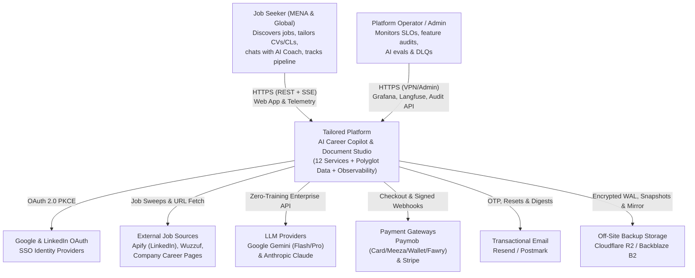

---

## 2. C4 Level 2 — Container Diagram (Entire System Topology)

Shows every deployable container, its network segment (`edge_net`, `internal_mesh`, `data_net`, `sandbox_net`), and the communication channels between them.

```mermaid
flowchart TB
    SPA["React + Vite SPA\n(Browser: Telemetry SDK + SSE Client)"]

    subgraph EdgeNet["edge_net (Public 80/443)"]
        Traefik["traefik-gateway\nTraefik v3.2 (TLS 1.3, ForwardAuth,\nRate Limit, OTel Root Span, SSE)"]
    end

    subgraph InternalMesh["internal_mesh (Service-to-Service HTTP/SSE & OTel)"]
        Auth["auth-service :8001\nFastAPI"]
        Profile["profile-service :8002\nFastAPI"]
        Jobs["jobs-service :8003\nFastAPI"]
        Docs["documents-service :8004\nFastAPI"]
        Pipeline["pipeline-service :8005\nFastAPI"]
        Billing["billing-service :8006\nFastAPI"]
        AiAgent["ai-agent-service :8007\nFastAPI + LangGraph/PydanticAI"]
        Notif["notifications-service :8008\nFastAPI + Scheduler"]
        Telemetry["telemetry-audit-service :8009\nFastAPI + Batch Consumers"]
        Scraper["scraper-worker\nPlaywright + Apify + BS4"]
    end

    subgraph SandboxNet["sandbox_net (internal: true — NO Internet Egress)"]
        Latex["latex-worker\nNon-root Tectonic + ReportLab"]
    end

    subgraph DataNet["data_net (internal: true — Zero Outbound Internet)"]
        Redpanda["Redpanda Broker\n11 Topics + DLQs"]
        PG["PostgreSQL 16 + pgvector\n10 Logical DBs"]
        CH["ClickHouse 24\ntailored_analytics + tailored_audit"]
        Redis["Redis 7\nSessions, Rate Limits, Cache, Pub/Sub"]
        MinIO["MinIO S3\ncv-artifacts, user-uploads, invoices, gdpr-exports"]
    end

    subgraph ObsStack["observability Profile"]
        OTel["otel-collector :4317"]
        Tempo["Grafana Tempo (Traces)"]
        Loki["Grafana Loki (Logs)"]
        Prom["Prometheus (Metrics)"]
        Grafana["Grafana UI"]
        Langfuse["Self-Hosted Langfuse (AI Audit)"]
    end

    SPA -->|"HTTPS REST + SSE"| Traefik
    Traefik -->|"ForwardAuth /internal/verify"| Auth
    Traefik -->|"Trusted X-User-* + traceparent"| Auth & Profile & Jobs & Docs & Pipeline & Billing & AiAgent & Notif & Telemetry

    Auth & Profile & Jobs & Docs & Pipeline & Billing & AiAgent & Notif & Telemetry -->|"Logical DB"| PG
    Auth & Jobs & Billing & AiAgent & Notif & Telemetry & Scraper -->|"Cache / Locks / PubSub"| Redis
    Jobs & Docs & Billing & Scraper & Latex -->|"Objects"| MinIO
    Telemetry -->|"Batch Inserts"| CH

    Auth & Profile & Jobs & Docs & Pipeline & Billing & AiAgent & Notif & Telemetry -->|"Outbox Events"| Redpanda
    Redpanda -->|"Consumer Groups"| Scraper & Latex & AiAgent & Telemetry & Notif & Billing & Docs & Jobs & Profile

    Traefik & Auth & Profile & Jobs & Docs & Pipeline & Billing & AiAgent & Notif & Telemetry & Scraper & Latex -->|"OTLP :4317"| OTel
    OTel --> Tempo & Prom
    InternalMesh -->|"JSON Logs + trace_id"| Loki
    Tempo & Loki & Prom --> Grafana
    AiAgent -->|"Prompts, Tokens, Eval Scores"| Langfuse
```

---

## 3. Shared Cross-Cutting Foundation: `packages/tailored_kit`

Every Python microservice and worker imports `tailored_kit` so tracing, auth, auditing, outbox publishing, and resilience work identically everywhere.

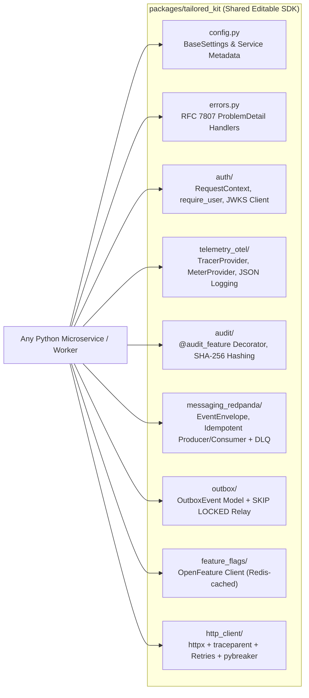

---

## 4. C4 Level 3 — Component Diagrams (All 12 Services & Workers)

### 4.1 `traefik-gateway` (Edge API Gateway)

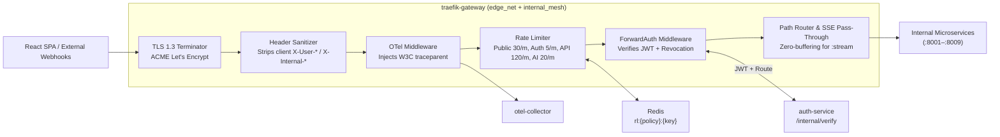

---

### 4.2 `auth-service` (`:8001`)

Owns identity, sessions, workspace ergonomics (Layer 1), privacy consents, feature flags, pseudonym vault, and GDPR erasure coordination.

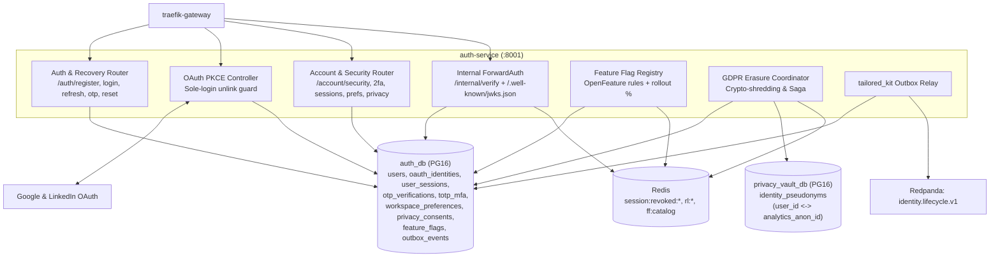

---

### 4.3 `profile-service` (`:8002`)

Owns Master Career Identity (Layer 2), multi-persona tracks, multi-country phone resolution, and base LaTeX templates.

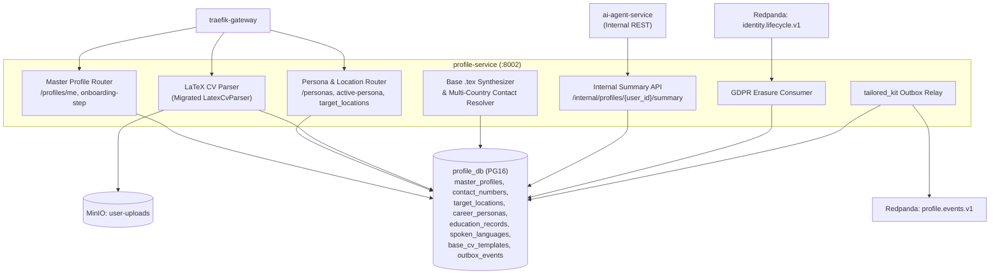

---

### 4.4 `jobs-service` (`:8003`)

Owns public `/explore` feed, Radar feed, 5-D multi-persona Zero-Drop fit scoring, Interest List, and URL/JD/screenshot ingestion.

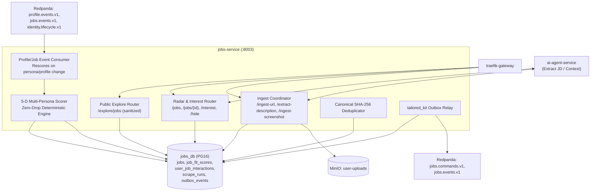

---

### 4.5 `scraper-worker` (Headless Async Worker)

Executes external scraping (Apify LinkedIn, Wuzzuf, company pages, Playwright) and screenshot OCR prep with spend protection.

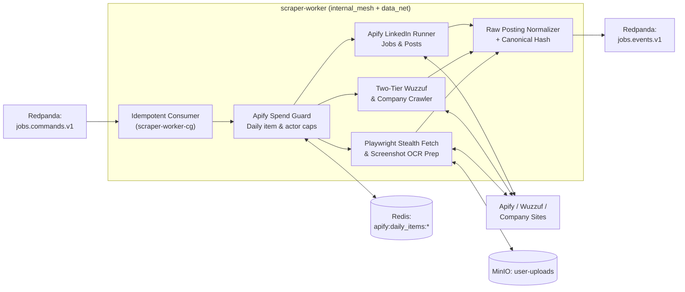

---

### 4.6 `documents-service` (`:8004`)

Owns Tailored CVs, Cover Letters, version history (`Cmd+Z`), Frozen Application Snapshots, MinIO streaming, and GDPR `.zip` export assembly.

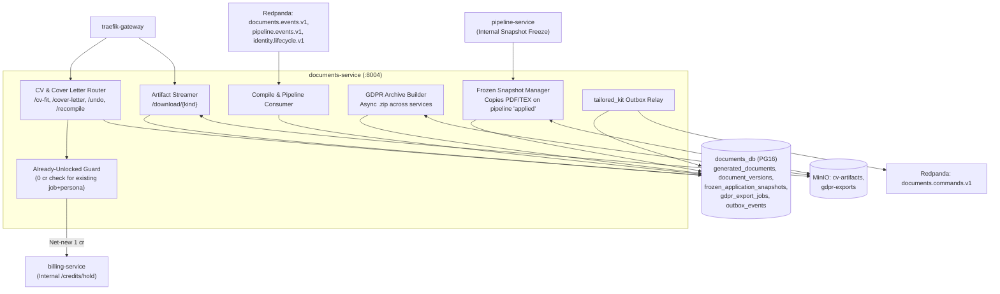

---

### 4.7 `latex-worker` (Sandboxed Compiler Worker)

Hardened non-root compiler with **no internet egress** (`sandbox_net`) that renders `.tex` via Tectonic (`--no-shell-escape`) with ReportLab ATS fallback.

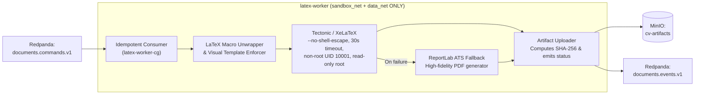

---

### 4.8 `pipeline-service` (`:8005`)

Owns the multi-channel Application Pipeline CRM, interview round notes, 7-day follow-up state machine, and Gmail/`mailto:` outreach composer.

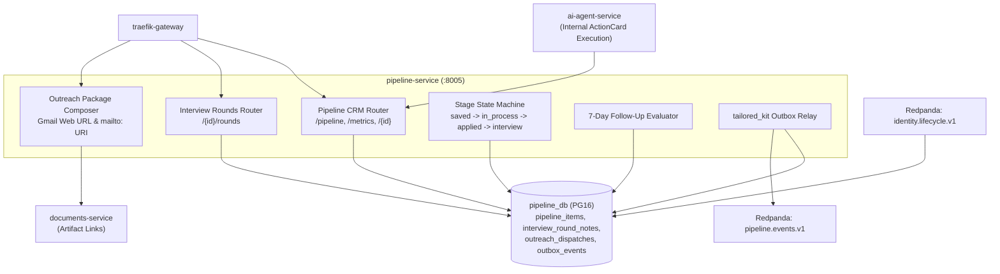

---

### 4.9 `billing-service` (`:8006`)

Owns optimistic-locked Credit Wallets, immutable credit ledger, regional packs (`EGP`/`SAR`/`AED`/`USD`), Paymob/Stripe webhooks, and the Credit Hold/Commit/Auto-Refund Saga.

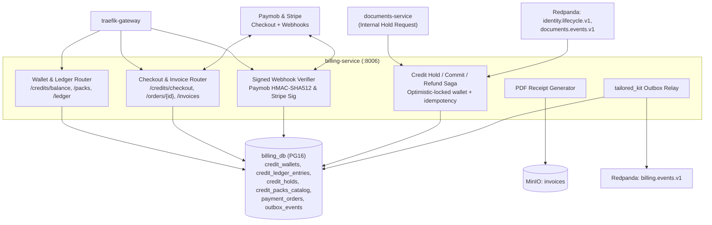

---

### 4.10 `ai-agent-service` (`:8007`)

Dual-Path AI Engine: **(A)** Interactive Studio Coach SSE + Paid CV/CL Generation + JD Extractor, and **(B)** Passive Ambient Behavioral Consumer + `pgvector` Memory + Calm Proactive Suggestions.

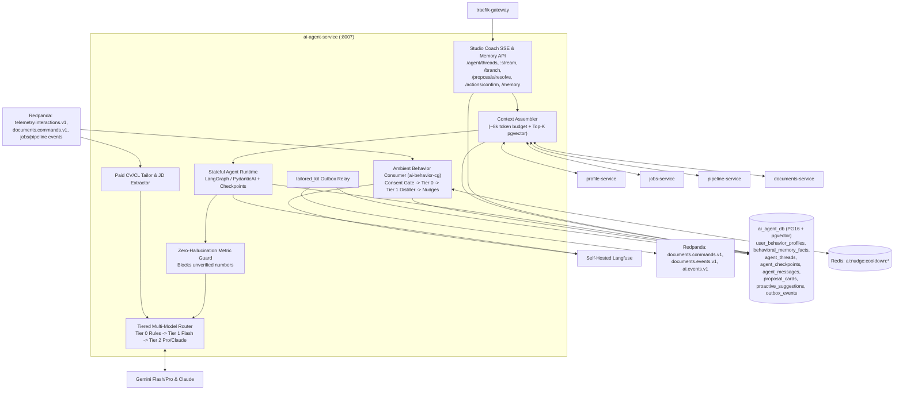

---

### 4.11 `notifications-service` (`:8008`)

Owns the signal-focused Inbox & Bell Drawer, snooze wakeups, live SSE push via Redis Pub/Sub, and transactional/digest emails.

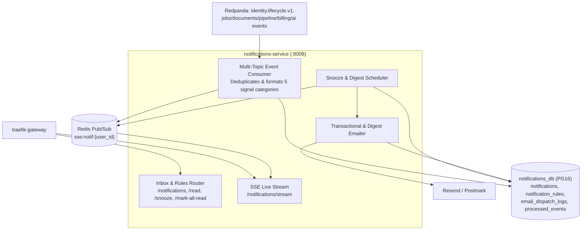

---

### 4.12 `telemetry-audit-service` (`:8009`)

Owns batched frontend micro-signal ingestion, PII scrubbing, pseudonym lookup, high-throughput ClickHouse batch writers, and admin Feature Audit query APIs.

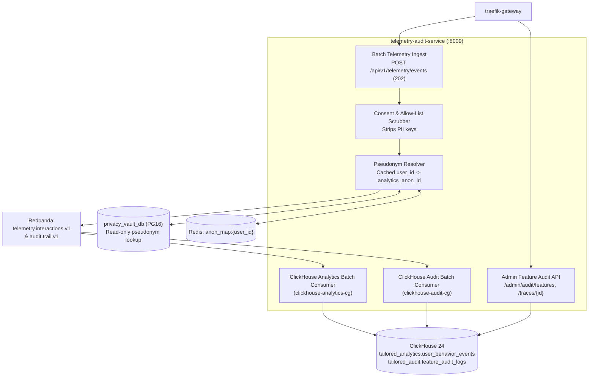

---

## 5. Quick Mapping: Services, Stores & Event Topics

| Component | Owned Database / Store | Produces to Redpanda | Consumes from Redpanda |
| :--- | :--- | :--- | :--- |
| `traefik-gateway` | Redis (rate limits) | — | — |
| `auth-service` | `auth_db`, `privacy_vault_db`, Redis | `identity.lifecycle.v1`, `audit.trail.v1` | `identity.lifecycle.v1` (erasure acks) |
| `profile-service` | `profile_db`, MinIO | `profile.events.v1`, `audit.trail.v1` | `identity.lifecycle.v1` |
| `jobs-service` | `jobs_db`, MinIO | `jobs.commands.v1`, `jobs.events.v1`, `audit.trail.v1` | `profile.events.v1`, `jobs.events.v1`, `identity.lifecycle.v1` |
| `scraper-worker` | Redis, MinIO | `jobs.events.v1` | `jobs.commands.v1` |
| `documents-service` | `documents_db`, MinIO | `documents.commands.v1`, `audit.trail.v1` | `documents.events.v1`, `pipeline.events.v1`, `identity.lifecycle.v1` |
| `latex-worker` | MinIO (`cv-artifacts`) | `documents.events.v1` | `documents.commands.v1` |
| `pipeline-service` | `pipeline_db` | `pipeline.events.v1`, `audit.trail.v1` | `identity.lifecycle.v1` |
| `billing-service` | `billing_db`, MinIO (`invoices`) | `billing.events.v1`, `audit.trail.v1` | `identity.lifecycle.v1`, `documents.events.v1` |
| `ai-agent-service` | `ai_agent_db` (`pgvector`), Redis | `documents.commands.v1`, `documents.events.v1`, `ai.events.v1`, `audit.trail.v1` | `telemetry.interactions.v1`, `documents.commands.v1`, `jobs.events.v1`, `pipeline.events.v1`, `profile.events.v1`, `identity.lifecycle.v1` |
| `notifications-service` | `notifications_db`, Redis Pub/Sub | `audit.trail.v1` | `identity.lifecycle.v1`, `jobs.events.v1`, `documents.events.v1`, `pipeline.events.v1`, `billing.events.v1`, `ai.events.v1` |
| `telemetry-audit-service` | ClickHouse (`tailored_analytics`, `tailored_audit`), Redis | `telemetry.interactions.v1` | `telemetry.interactions.v1`, `audit.trail.v1`, `ai.events.v1` |
