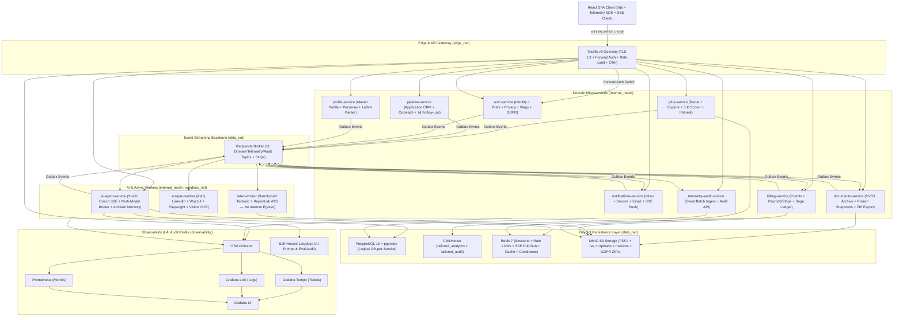

# Tailored — Complete Backend, AI Agent & Distributed System Architecture Suite

**Document Suite Version:** 2.0.0  
**Target Platform:** Tailored AI Career Copilot (MENA & Global)  
**Scope:** End-to-End Microservices Topology, Logical DB-per-Service Schemas, Redpanda Event Mesh, Behavioral Telemetry, Ambient AI Agent Intelligence, OpenTelemetry + Langfuse + ClickHouse Auditing, Docker VPS Deployment & Migration Plan  
**Status:** Architecture Blueprint (Review Before Phase 0 Scaffolding)

---

## 1. Executive Summary & Architectural Philosophy

Tailored is an AI-powered job discovery, multi-persona fit scoring, and document tailoring copilot built specifically for **job seekers** across MENA (Egypt, KSA, UAE) and global remote markets. This architecture suite transitions Tailored from its current FastAPI + SQLite/Postgres prototype ([main.py](file:///d:/Tailored/backend/app/main.py)) and client-side workspace state ([WorkspaceContext.tsx](file:///d:/Tailored/frontend/src/context/WorkspaceContext.tsx)) into a **scalable, fully traceable, feature-auditable Domain Microservices architecture**.

Every architectural choice preserves Tailored's four foundational product principles established across [master_architecture_decisions_and_logic.md](file:///d:/Tailored/Documentations/master_architecture_decisions_and_logic.md), [business_feasibility_analysis.md](file:///d:/Tailored/Documentations/business_feasibility_analysis.md), and the 22 Calm UX specifications ([ux_designs/README.md](file:///d:/Tailored/frontend/ux_designs/README.md)):

1. **Candidate Copilot & Zero-Drop Guarantee:** No fetched job is silently discarded; every opportunity is scored across 5 dimensions against all active career personas and ranked transparently.
2. **Calm Two-Pane Studio & Explicit AI Chat Shape:** Backend SSE streams, Proposal Diff Cards, Action Cards, Thinking Accordions, and Zero-Hallucination metric interceptions mirror the exact contract in [CalmAiCoachSidecar.tsx](file:///d:/Tailored/frontend/src/components/common/CalmAiCoachSidecar.tsx) and [00_global_ux_foundation_and_ai_chat_pattern.md](file:///d:/Tailored/frontend/ux_designs/00_global_ux_foundation_and_ai_chat_pattern.md).
3. **Pay-As-You-Go Credit Integrity:** Discovery, scraping, 5-D scoring, and iterative AI Studio refinements are always **Free (`0 cr`)**. Credit deductions (`1 cr` CV, `1 cr` Cover Letter) execute inside an atomic **Hold -> Commit / Auto-Refund Saga** so compile or LLM failures automatically return credits with full ledger provenance.
4. **Ambient AI Intelligence Without Intrusion:** The AI Agent passively consumes privacy-safe behavioral events from Redpanda—even when the user is not chatting—to maintain a grounded Behavioral Preference Memory and emit calm, rate-limited suggestions without ever mutating profiles or spending credits autonomously.
5. **Solo-Architect Maintainability & MENA Seasonal Elasticity:** All services live in a single monorepo sharing the `tailored_kit` Python SDK and deploy via multi-profile Docker Compose behind Traefik on a single Cloud VPS with detached block storage—scaling vertically during MENA hiring peaks (June–August graduations, January–March Q1 hiring) and cleanly splitting onto multi-VPS or Kubernetes later without rewriting application code.

---

## 2. High-Level System Topology (C4 Container View)

---

## 3. Microservices Directory & UX Route Ownership

| # | Service / Worker | Container Name | Port | Owned Store / DB | Core Responsibilities | UX Specs Served (`frontend/ux_designs/`) |
| :-: | :--- | :--- | :---: | :--- | :--- | :--- |
| 1 | **Traefik Gateway** | `traefik-gateway` | `80/443` | Redis (rate limits) | TLS termination, ForwardAuth JWT verification, route dispatch, SSE unbuffered streaming, OTel root span injection | `00` Global Edge |
| 2 | **Auth & Identity Service** | `auth-service` | `8001` | `auth_db`, `privacy_vault_db`, Redis | Email/password, RS256 JWKS, rotating refresh tokens, 6-digit OTP, Google/LinkedIn OAuth (unlink guard), TOTP 2FA, Active Sessions, Workspace Ergonomics, Privacy Consents, Feature Flags, GDPR Erasure coordinator | `03`, `04`, `19`, `00` |
| 3 | **Profile Service** | `profile-service` | `8002` | `profile_db` | Master Profile CRUD, multi-persona tracks, multi-country phone resolution, target locations, education/languages/custom sections, LaTeX CV parser, base `.tex` synthesis | `05`, `17`, `00`, `01` |
| 4 | **Jobs & Scoring Service** | `jobs-service` | `8003` | `jobs_db`, MinIO (`user-uploads`) | Public `/explore` feed, authenticated Radar feed, 5-D multi-persona Zero-Drop scoring, Interest List queue, hide/triage actions, URL/JD/screenshot ingest coordinator, canonical SHA-256 dedup | `01`, `02`, `07`, `08`, `09`, `10` |
| 5 | **Scraper Worker** | `scraper-worker` | — | Consumer (`jobs.commands.v1`) | Async Apify LinkedIn Jobs/Posts, two-tier Wuzzuf scraper, company crawler, Playwright stealth fetch, job screenshot OCR/vision dispatch | `01`, `08`, `10` |
| 6 | **Documents Service** | `documents-service` | `8004` | `documents_db`, MinIO (`cv-artifacts`, `gdpr-exports`) | Tailored CV & Cover Letter storage, bullet diff & version history, Saved CVs archive, Frozen Application Snapshots, PDF/LaTeX download streaming, GDPR `.zip` archive builder | `11`, `12`, `13`, `14`, `16`, `19` |
| 7 | **LaTeX Worker** | `latex-worker` | — | Consumer (`documents.commands.v1`), MinIO | Sandboxed non-root Tectonic/XeLaTeX (`--no-shell-escape`, zero internet egress) + ReportLab high-fidelity ATS PDF fallback | `11`, `12`, `14` |
| 8 | **Pipeline CRM Service** | `pipeline-service` | `8005` | `pipeline_db` | Unified multi-channel Pipeline CRM, interview round notes, 7-day follow-up state, Gmail/mailto outreach package composer | `07`, `14`, `15`, `16` |
| 9 | **Billing & Credits Service** | `billing-service` | `8006` | `billing_db`, MinIO (`invoices`) | Optimistic-locked Credit Wallet, EGP/SAR/AED/USD packs, Credit Hold/Commit/Auto-Refund Saga, Paymob (Meeza/Wallets/Fawry) + Stripe checkout & webhooks, PDF receipts | `06`, `18`, `00` |
| 10 | **AI Agent Service** | `ai-agent-service` | `8007` | `ai_agent_db` (`pgvector`), Redis | Studio Coach (LangGraph/PydanticAI + SSE), Tiered Multi-Model Router, paid CV/CL tailoring, JD extractor, Zero-Hallucination metric check, Ambient Behavioral Consumer, Behavioral Memory & Calm Proactive Suggestions | `00`, `07`, `12`, `13`, `19` |
| 11 | **Notifications Service** | `notifications-service` | `8008` | `notifications_db`, Redis Pub/Sub | Signal-focused Inbox & Quick Drawer, snooze scheduler, read/archive state, live SSE push stream, transactional email & digest delivery | `04`, `07`, `20`, `00` |
| 12 | **Telemetry & Audit Service** | `telemetry-audit-service` | `8009` | ClickHouse (`tailored_analytics`, `tailored_audit`), Redis | Batched frontend interaction ingestion, pseudonymization lookup, Redpanda -> ClickHouse batch consumers for analytics & immutable feature audits, internal audit query API | `00`–`21` (All) |

---

## 4. Architectural Decision Records (ADR-101 to ADR-114)

Continuing directly from `ADR-001` through `ADR-009` in [master_architecture_decisions_and_logic.md](file:///d:/Tailored/Documentations/master_architecture_decisions_and_logic.md#L243-L256):

| ADR ID | Decision Topic | Choice Made | Rationale | Alternatives Considered & Rejected |
| :--- | :--- | :--- | :--- | :--- |
| **ADR-101** | System Decomposition | Domain Microservices from Day 1 in a Single Monorepo (`services/*` + `packages/tailored_kit`) | Gives strict domain ownership, independent deployability/scaling of AI/Scrapers/LaTeX, and clean team expansion without multi-repo CI friction | Modular monolith (couples deploys/scaling of heavy workers); Multi-repo (high coordination overhead) |
| **ADR-102** | Event Backbone & Sync Transport | Redpanda (Kafka-compatible) + Internal REST/OpenAPI + SSE via Traefik | Durable replayable event log lets Telemetry, AI Agent Memory, Audit, and Notifications consume identical events independently while keeping sync APIs simple | RabbitMQ (no native event replay); gRPC (extra Protobuf boilerplate for Python services); WebSockets (sticky-session complexity behind proxies) |
| **ADR-103** | Database Isolation Pattern | Logical DB-per-Service on PostgreSQL (`auth_db`, `profile_db`, etc.) with least-privilege roles & separate Alembic trees | Preserves ACID guarantees and zero cross-DB joins while fitting cleanly on a VPS; splitting any DB to a dedicated server requires only changing `DATABASE_URL` | Shared single DB schema (tight coupling); 10 separate Postgres containers locally (excessive RAM waste) |
| **ADR-104** | Analytical & Vector Storage | ClickHouse (`tailored_analytics` + `tailored_audit`) + `pgvector` inside `ai_agent_db` + MinIO S3 | ClickHouse handles millions of behavioral/audit rows with sub-second column aggregations; `pgvector` keeps AI memory vectors ACID-consistent with facts; MinIO keeps PDFs cloud-portable | Postgres-only for telemetry (slow analytical scans, table bloat); standalone Qdrant container (extra ops for early scale) |
| **ADR-105** | Hosting & Seasonal Scaling | Multi-profile Docker Compose on Cloud VPS behind Traefik + detached block storage volumes | Supports MENA seasonal surges (Jun–Aug, Jan–Mar) via reversible vertical CPU/RAM upgrades and horizontal worker scaling before needing Kubernetes | Day-1 Kubernetes (high idle overhead for early launch); Managed serverless (higher fixed baseline cost, cold starts on LaTeX) |
| **ADR-106** | Auth & Identity | Custom FastAPI `auth-service` (RS256 JWT + JWKS, ForwardAuth, rotating refresh, OTP, OAuth, TOTP 2FA, Sessions) | Full UX parity with Calm Auth specs (`03`, `04`, `19`) including sole-login OAuth unlink guard and zero per-MAU SaaS tax | Authentik/Keycloak (heavy RAM, hard UX customization); Clerk/Auth0 (recurring MAU fee, external lock-in) |
| **ADR-107** | Behavioral Tracking Granularity | Domain Actions + Privacy-Safe Behavioral Micro-Signals (dwell, scroll depth, gap clicks, aborts, undo loops) | Feeds rich user intent to ClickHouse analytics & AI Agent personalization without recording sensitive CV text or keystrokes | Explicit actions only (misses hesitation/intent signals); DOM session replay (high storage, high PII risk) |
| **ADR-108** | AI Ambient Intelligence Scope | Ambient Behavioral Memory + Calm Proactive Suggestions (Zero Auto-Mutations, Rate-Limited) | AI learns quietly from user behavior and surfaces helpful nudges without hijacking focus, rewriting CVs unasked, or burning credits | Silent-only memory (misses proactive coaching value); Semi-autonomous Radar rewrites (breaks transparency & user trust) |
| **ADR-109** | AI Agent Runtime & Routing | Structured Runtime (LangGraph/PydanticAI + Postgres Checkpointer) + Tiered Router (Rules -> Flash -> Pro/Claude) | Enables turn branching, human-in-the-loop Action Cards, SSE streaming, and 95%+ gross margins via Flash/Rules offloading | Zero-framework loop (harder checkpointing/branching); Single frontier model everywhere (burns unit margin) |
| **ADR-110** | Observability & Feature Auditing | OpenTelemetry W3C `traceparent` + `X-Feature-Key` -> Grafana Stack (Tempo/Loki/Prom) + Self-Hosted Langfuse + ClickHouse Audit Ledger | Every request, async Redpanda hop, SQL query, and LLM call shares one `trace_id` across infra traces, AI evals, and business feature audits | Managed SaaS observability (cost escalates with telemetry volume); SigNoz-only (weaker AI prompt/eval workflows than Langfuse) |
| **ADR-111** | Privacy & GDPR Erasure | Pseudonymized Analytics (`privacy_vault_db` mapping) + Crypto-Shredding + `/account` AI Memory Inspector | Deleting the `user_id <-> analytics_anon_id` vault record + PII/CVs/AI memory fulfills GDPR erasure while preserving anonymized behavioral datasets | Full ClickHouse row mutations on delete (slow, breaks analytical continuity); No opt-out (violates user trust) |
| **ADR-112** | Cross-Cutting Code & Rollout | Shared `packages/tailored_kit` SDK + Built-In OpenFeature-Compatible Feature Flag Registry (`auth_db` + Redis) | Zero duplicated telemetry/auth/outbox code when adding new microservices; instant feature flag kill-switches & percentage rollouts with zero extra containers | Separate Flagsmith container (extra VPS RAM); Per-service boilerplate copy-paste (drift & audit gaps) |
| **ADR-113** | Reliable Credit Billing | Credit Hold -> Async Generation/Compile -> Commit or Automatic Refund Saga + Transactional Outbox | Guarantees users never lose a credit if Tectonic/LaTeX or Gemini fails, matching the transparent ledger UX in `18_plans_credits_and_billing.md` | Upfront non-refundable deduction (erodes trust); Post-charge billing (abuse risk) |
| **ADR-114** | LaTeX Execution Security | Isolated `latex-worker` on `sandbox_net` (`internal: true`), non-root UID, `--no-shell-escape`, resource ulimits | Prevents SSRF or malicious LaTeX payload execution (`\write18`) from reaching internal services, metadata APIs, or the internet | Running `tectonic` inside API container (blocks event loop, huge RCE/SSRF blast radius) |

---

## 5. Architecture Suite Navigation

| Document | Focus Area | Link |
| :--- | :--- | :--- |
| **01** | **System Topology & Inter-Service Communication** (12 components, `tailored_kit` SDK, 5 sequence diagrams, Zero-Trust mesh) | [01_system_topology_and_communication.md](./01_system_topology_and_communication.md) |
| **02** | **Database & Storage Architecture** (9 PostgreSQL schemas, 3-Layer User Profile, ClickHouse DDL, Redis keyspace, MinIO buckets) | [02_database_and_storage_architecture.md](./02_database_and_storage_architecture.md) |
| **03** | **API Gateway & Redpanda Event Contracts** (Complete REST/SSE catalog mapped to 22 UX specs, 11 Redpanda topics, Outbox & DLQ) | [03_api_and_event_contracts.md](./03_api_and_event_contracts.md) |
| **04** | **AI Agent & Ambient Behavioral Intelligence** (Telemetry SDK taxonomy, 4-stage passive pipeline, LangGraph/PydanticAI coach, Zero-Hallucination check, Model Router) | [04_ai_agent_and_behavioral_intelligence.md](./04_ai_agent_and_behavioral_intelligence.md) |
| **05** | **Observability, Feature Auditing & Privacy** (OTel `traceparent` + `X-Feature-Key`, Grafana, Langfuse, ClickHouse SQL audit queries, GDPR Crypto-Shredding) | [05_observability_auditing_and_privacy.md](./05_observability_auditing_and_privacy.md) |
| **06** | **Docker Compose, VPS Deployment & MENA Scaling** (Monorepo layout, 5 Compose profiles, 4 segmented networks, block volumes, vertical/split scaling playbook) | [06_docker_vps_deployment_and_scaling.md](./06_docker_vps_deployment_and_scaling.md) |
| **07** | **Phased Migration & Implementation Roadmap** (Existing `backend/app/` asset map, Phases 0–5 with verification gates, frontend cutover map) | [07_phased_migration_and_implementation_roadmap.md](./07_phased_migration_and_implementation_roadmap.md) |
