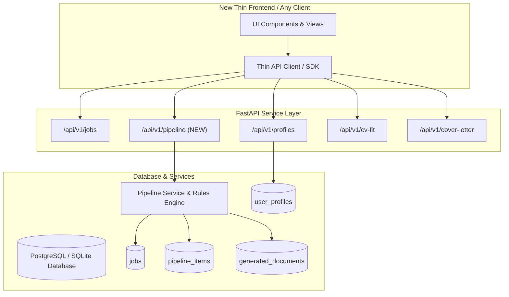
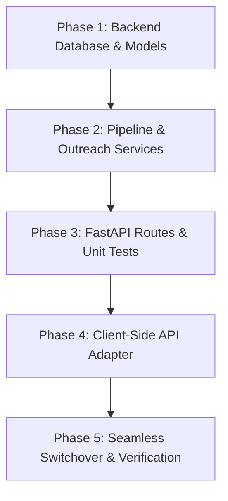

# Tailored - Backend Service Migration Plan
**Document Version:** 1.0  
**Target:** Decouple Business Logic from Frontend & Promote to Backend Services  
**Scope:** Application Pipeline, Outreach Orchestration, Persona State, and Server-Side Aggregation

---

## 1. Executive Summary & Architectural Motivation

Currently, the Tailored application has a rich FastAPI + SQLModel backend for core NLP, scraping, CV tailoring, and profile extraction. However, as the application evolved, several critical business features were implemented entirely inside the React frontend:
1. **The Application Pipeline** is stored in browser `localStorage` (`tailored_application_pipeline_v1`).
2. **Pipeline Eligibility Guardrails** (disallowing LinkedIn/Wuzzuf listings, allowing recruiter posts) are enforced client-side in `pipelineStorage.ts`.
3. **Outreach & Email Dispatch Orchestration** (Gmail URL generation, outreach template synthesis, attachment linking) is computed in `ApplicationPipelinePage.tsx`.
4. **Active Profile & Persona Selection State** is stored in browser session/local storage.
5. **Job Deduplication & Persona Ranking** during discovery crawls is handled in React memory.

### Architectural Goal
By migrating these services into the backend, the backend becomes the **single source of truth**. Any frontend (modern React, Next.js, mobile app, or CLI) can simply query clean REST APIs without needing to duplicate complex state machines, regexes, or local storage handlers.



---

## 2. Target Database Schema Enhancements

### 2.1 Table: `pipeline_items`
Stores candidate applications across the funnel lifecycle.

```python
# backend/app/models/pipeline.py
from datetime import datetime
from typing import Optional
from sqlmodel import SQLModel, Field, Relationship

class PipelineItemBase(SQLModel):
    profile_id: int = Field(foreign_key="user_profiles.id", index=True)
    job_id: int = Field(foreign_key="jobs.id", index=True)
    status: str = Field(default="saved", index=True)  # saved, in_process, applied, interview, archived
    recruiter_email: Optional[str] = Field(default=None)
    notes: Optional[str] = Field(default=None)
    tailored_cv_doc_id: Optional[str] = Field(default=None, foreign_key="generated_documents.doc_id")
    cover_letter_doc_id: Optional[str] = Field(default=None)
    saved_at: datetime = Field(default_factory=datetime.utcnow)
    applied_at: Optional[datetime] = Field(default=None)

class PipelineItemDB(PipelineItemBase, table=True):
    __tablename__ = "pipeline_items"

    id: Optional[int] = Field(default=None, primary_key=True)
    created_at: datetime = Field(default_factory=datetime.utcnow)
    updated_at: datetime = Field(default_factory=datetime.utcnow)
```

### 2.2 Table: `user_profiles` (State Extension)
Extend `UserProfileDB` to persist the user's active persona selection across devices:

```python
# Added to user_profiles table
active_persona_id: Optional[str] = Field(default=None)
```

---

## 3. Backend Service Architecture & New Modules

### 3.1 Pipeline Service (`backend/app/pipeline/pipeline_service.py`)
Encapsulates all pipeline lifecycle operations and eligibility rules.

```python
class PipelineService:
    @staticmethod
    def is_eligible_for_pipeline(job: JobDB) -> bool:
        """
        Enforces pipeline business rule:
        - LinkedIn job listings and Wuzzuf listings cannot enter the pipeline.
        - Recruiter posts and custom description extractions are allowed.
        """
        src = (job.source_type or "").lower()
        url = (job.url or "").lower()

        is_linkedin_listing = ("linkedin" in src and "post" not in src)
        is_wuzzuf_listing = (src == "wuzzuf" or "wuzzuf.net" in url)

        if is_linkedin_listing or is_wuzzuf_listing:
            return False

        is_recruiter_post = (
            "post" in src or
            "recruiter" in src or
            "custom" in src or
            "/posts/" in url or
            "/feed/update/" in url or
            "activity" in url
        )
        return is_recruiter_post

    def add_to_pipeline(self, profile_id: int, job_id: int, initial_status: Optional[str] = None) -> PipelineItemDB:
        ...

    def update_status(self, item_id: int, new_status: str) -> PipelineItemDB:
        ...

    def link_documents(self, item_id: int, cv_doc_id: Optional[str] = None, cl_doc_id: Optional[str] = None) -> PipelineItemDB:
        ...

    def get_pipeline(self, profile_id: int, status: Optional[str] = None, search: Optional[str] = None) -> List[PipelineItemResponse]:
        ...

    def get_metrics(self, profile_id: int) -> PipelineMetricsResponse:
        ...
```

### 3.2 Outreach Orchestration Service (`backend/app/pipeline/outreach_service.py`)
Generates structured outreach packages ready for 1-click dispatch.

- **Inputs:** `pipeline_item_id`, `candidate_profile_id`
- **Outputs:**
  - `to_email`: Resolved recruiter email
  - `subject`: `Application for {Role} - {Candidate Name}`
  - `body_markdown`: Tailored cover letter or default high-impact outreach pitch
  - `gmail_web_url`: Pre-encoded `https://mail.google.com/mail/?view=cm&fs=1&to=...`
  - `mailto_url`: Pre-encoded `mailto:...`
  - `cv_download_url`: `/api/v1/cv-fit/{doc_id}/download/pdf`
  - `cover_letter_download_url`: `/api/v1/cover-letter/{doc_id}/download`

---

## 4. REST API Specification (New Endpoints)

### 4.1 Application Pipeline Endpoints (`/api/v1/pipeline`)

| Method | Endpoint | Request Body | Response | Description |
| :--- | :--- | :--- | :--- | :--- |
| `GET` | `/api/v1/pipeline` | Query: `profile_id`, `status`, `q` | `List[PipelineItemResponse]` | Lists pipeline items with enriched job and doc metadata |
| `POST` | `/api/v1/pipeline` | `PipelineCreateRequest` | `PipelineItemResponse` | Adds an eligible job to the pipeline (400 if ineligible) |
| `GET` | `/api/v1/pipeline/{id}` | - | `PipelineItemResponse` | Fetches single pipeline item |
| `PATCH` | `/api/v1/pipeline/{id}` | `PipelineUpdateRequest` | `PipelineItemResponse` | Updates status (`applied`, `interview`, etc.), notes, email |
| `DELETE` | `/api/v1/pipeline/{id}` | - | `{"success": true}` | Removes item from pipeline |
| `GET` | `/api/v1/pipeline/metrics` | Query: `profile_id` | `PipelineMetricsResponse` | Total, In Process, Applied, With Email counts |
| `GET` | `/api/v1/pipeline/{id}/outreach` | - | `OutreachPackageResponse` | Generates Gmail & Mailto dispatch URLs and attachments |

### 4.2 Auto-Action Endpoints (Pipeline Shortcuts)
| Method | Endpoint | Description |
| :--- | :--- | :--- |
| `POST` | `/api/v1/pipeline/{id}/tailor-cv` | Directly tailors a CV against this pipeline item's job and persona, automatically linking `tailored_cv_doc_id` |
| `POST` | `/api/v1/pipeline/{id}/cover-letter` | Directly generates a cover letter and links it to the pipeline item |

---

## 5. Migration Execution Phases



### Phase 1: Models & Database Migration
1. Create `backend/app/models/pipeline.py` with SQLModel schema.
2. Update `backend/app/core/database.py` to auto-migrate `pipeline_items` table and new columns.
3. Add foreign key relationships to `jobs`, `user_profiles`, and `generated_documents`.

### Phase 2: Core Services Implementation
1. Implement `backend/app/pipeline/pipeline_service.py` with strict eligibility checks.
2. Implement `backend/app/pipeline/outreach_service.py` with URL encoders and template composers.
3. Add server-side recruiter email regex extractor into `jobs` and `pipeline` pipeline.

### Phase 3: API Routing & Automated Tests
1. Create `backend/app/api/routes/pipeline.py` and register in `backend/app/main.py`.
2. Write unit and integration tests in `backend/tests/test_pipeline_api.py`:
   - Adding recruiter post -> success (201).
   - Adding LinkedIn listing -> rejected (400 Bad Request).
   - Updating status to `applied` sets `applied_at` timestamp.
   - Linking tailored CV doc updates relationship.
   - Generating outreach package returns valid Gmail and Mailto URLs.

### Phase 4: Frontend Service Adapter
1. Replace `localStorage` operations in `frontend/src/services/pipelineStorage.ts` with asynchronous calls to `/api/v1/pipeline`.
2. Keep the interface of `PipelineStorage` identical so existing components work immediately during transition without breaking.

### Phase 5: Verification & Cleanup
1. Run full regression test suite (`pytest backend/tests` and frontend build).
2. Verify cross-browser and cross-session persistence (opening an incognito window still displays the candidate's pipeline items from the database).

---

## 6. Risk Analysis & Mitigation

| Risk | Impact | Mitigation Strategy |
| :--- | :--- | :--- |
| **Data loss for existing localStorage items** | High | Provide a one-time automatic migration snippet in the frontend that checks `localStorage.getItem('tailored_application_pipeline_v1')` and POSTs existing items to `/api/v1/pipeline/batch-import` on startup. |
| **Ineligible jobs submitted via API** | Medium | Server-side validation via `PipelineService.is_eligible_for_pipeline` strictly throws `HTTP 400 Bad Request` with an explanatory message. |
| **Database latency on pipeline list** | Low | Join `pipeline_items` with `jobs` and `generated_documents` using eager loading or SQLModel indexed lookups. |

