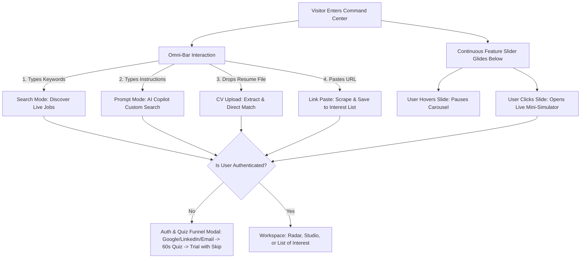

# Design & Engineering Specification: The Command Center Landing Experience (Approach 3)

**Document Type:** UX Prompt & Structural Specification  
**Architecture:** Approach 3 — The Universal Command Center with Continuous Feature Slider  
**Status:** Living Design Specification  
**Design Tokens:** Semantic Structure Only (Typography & Color Palette Unspecified / Deferred)

---

## 1. System Vision & Design Philosophy

The **Command Center** landing page is an ultra-minimalist, high-utility entry point inspired by modern developer and AI interfaces (such as Linear, Raycast, and Perplexity). Instead of burying the product behind marketing copy, it places a **single Universal Omni-Bar** at the center of the user's attention, supported by a **continuous, auto-sliding feature showcase** directly underneath.

* **Primary Anchor:** One centralized omni-bar that seamlessly handles four input modalities without requiring the user to switch tabs manually.
* **Secondary Anchor:** A non-intrusive, continuously sliding horizontal carousel showcasing the three core value pillars in action.
* **Semantic Styling Rule:** Colors and typography are specified using semantic tokens (`--surface-bg`, `--surface-card`, `--accent-primary`, `--text-primary`, etc.) so that the exact visual theme and font family can be finalized independently.

---

## 2. The Universal Omni-Bar (4 Input Modes)

The bar sits prominently in the hero section. It features an intelligent input parser that automatically detects the input type or allows the user to explicitly select a modality via inline affordances.

```
┌────────────────────────────────────────────────────────────────────────────────────────────────────────┐
│  [ 📎 Upload CV ]  |  Type a role, paste a link, or ask the AI copilot...               [ ⚡ Execute ↵ ] │
│                                                                                                        │
│  Mode Indicators / Action Pills:                                                                      │
│  [ 🔍 1. Search Roles ]   [ 💬 2. AI Prompt ]   [ 📄 3. CV Ingestion ]   [ 🔗 4. Paste Job Link ]     │
└────────────────────────────────────────────────────────────────────────────────────────────────────────┘
```

### 2.1 Mode 1: Search (Structured Role & Location Discovery)
* **Trigger:** User types job titles, technologies, or locations (e.g., *"Senior Backend Engineer in Cairo"*, *"Remote PyTorch roles"*).
* **Behavior:**
  - Auto-suggest dropdown surfaces popular roles and locations matching active feeds from LinkedIn and Wuzzuf.
  - Submitting triggers the search filter and cascades down into the ranked Job Radar feed.

### 2.2 Mode 2: Natural Language Prompt (AI Career Copilot)
* **Trigger:** User inputs an instruction or complex career preference (e.g., *"Find hybrid roles in Riyadh where I can leverage my Swvl microservice experience"*, *"Show me companies hiring for ML Ops that don't require 10+ years"*).
* **Behavior:**
  - The bar parses intent via the backend query generator and LLM router.
  - Returns a ranked, curated list of opportunities addressing the specific semantic constraint.

### 2.3 Mode 3: CV Upload (Resume Parsing & Direct Match)
* **Trigger:** 
  - Drag-and-dropping a file (`.pdf`, `.tex`, `.docx`) directly onto the bar.
  - Clicking the inline attachment icon `[ 📎 Upload CV ]`.
* **Behavior:**
  - Shows an inline upload progress ring directly inside the bar.
  - Extracts personal facts, skills taxonomy, and career personas.
  - Immediately unlocks a personalized radar feed showing real-time match percentages against the uploaded resume.

### 2.4 Mode 4: Link Pasting (Dedicated External Extraction & Interest List)
* **Trigger:** User pastes any external URL starting with `http://` or `https://` (e.g., LinkedIn job posting, Wuzzuf detail page, Greenhouse/Lever careers link).
* **Behavior:**
  - The bar instantly recognizes URL syntax and switches to **"Ingest & Analyze Mode"**.
  - Calls `POST /api/v1/jobs/ingest-url` to stealthily scrape full job requirements and run SHA-256 canonical deduplication.
  - Automatically saves the job into the candidate's persistent **"List of Interest"** and calculates fit against their active profile.

---

## 3. The Continuously Sliding Feature Showcase

Positioned immediately below the Omni-Bar, this element replaces static cards with a **smooth, continuous horizontal slideshow (infinite carousel / glide loop)** that displays Tailored's three core pillars in action.

### 3.1 Carousel Mechanics & Motion Rules
* **Continuous Motion:** Slides slowly and smoothly from right to left in a seamless infinite marquee loop.
* **Interaction Overrides:**
  - **Hover to Pause:** Hovering over any slide pauses the motion, allowing the user to read details or inspect micro-interactions.
  - **Click to Expand / Interact:** Clicking a slide expands a modal or drops down a live interactive simulation.
  - **Manual Swipe / Drag:** Supports horizontal swipe on touch devices and cursor drag on desktop.
  - **Progress Indicators:** Minimalist pill indicators beneath the track indicating the active slide.

```
◀  [ Slide 1: Multi-Source Radar ]  ──►  [ Slide 2: 5-D Match Engine ]  ──►  [ Slide 3: Surgical CV Studio ]  ▶
                              ( Continuously gliding right-to-left )
```

---

### 3.2 Slide 1: Multi-Source Job Discovery & Stealth Radar
* **Visual Concept:** A high-speed multi-channel stream demonstrating how jobs are gathered and cleaned.
* **Component Anatomy:**
  - **Top Badges:** Source logos for LinkedIn (via stealth Apify actors) and Wuzzuf (deep details fetcher).
  - **Streaming Job Teasers:** Animated stream of cards showing incoming roles with company name, location, and posted time.
  - **Deduplication Visual:** A mini visual indicator showing two identical cross-posted listings merging into a single canonical entry with a SHA-256 verified badge.
  - **Summary Metric:** *"Scraping 1,400+ fresh regional opportunities daily • Zero duplicate noise."*

---

### 3.3 Slide 2: Candidate-Centric 5-Dimensional Fit Engine
* **Visual Concept:** An explainable evaluation visual showing how candidate capabilities are matched without false rejections.
* **Component Anatomy:**
  - **Radial Gauge:** A prominent circular score badge ($0\text{--}100\%$, e.g., `94% Fit`).
  - **Dimension Breakdown Bars:**
    1. *Technical Skills Overlap (35%)* — Mandatory vs. Nice-to-Have tags.
    2. *Role & Title Alignment (20%)* — Persona proximity.
    3. *Experience Proximity (20%)* — Continuous seniority curve without knockouts.
    4. *Project & Impact Relevance (15%)* — Proof of execution.
    5. *Location & Mobility Fit (10%)* — Work mode compatibility.
  - **Constructive Framing Pill:** *"💡 Gap Strategy: Role asks for 5 years in AWS; your hands-on Docker/ECS deployments offset stated years."*
  - **Summary Metric:** *"Zero Disqualification • Evaluated against all active career personas."*

---

### 3.4 Slide 3: Surgical ATS CV Studio & AI Bullet Tailoring
* **Visual Concept:** A real-time document engineering preview showing surgical before/after bullet optimization.
* **Component Anatomy:**
  - **Side-by-Side Diff Inspector:**
    - Baseline bullet with red strikethrough (generic wording).
    - Tailored bullet with green highlight (injected target keywords, quantified metrics).
  - **LaTeX & PDF Preview Canvas:** A crisp, ATS-compliant formatted resume segment updating in real-time.
  - **Conversational AI Prompt Bubble:** *"I tailored 4 bullets to emphasize Swvl dynamic pricing and verified zero hallucinations against your master record."*
  - **Summary Metric:** *"Zero-Hallucination Verified • One-Click ATS LaTeX & PDF Export."*

---

## 4. Layout Architecture & Structural Tokens

To allow colors and typography to be defined later, the interface is governed by structural geometry and semantic tokens.

### 4.1 Structural Dimensions
* **Hero Container:** Maximum width `1200px`, horizontally centered, vertical padding `80px 24px`.
* **Universal Omni-Bar:** Width `100%`, maximum width `840px`, height `64px`, border-radius `12px` to `16px`.
* **Continuous Slider Track:** Width `100vw` or contained `1280px`, slide card width `420px`, slide height `280px`, gap between slides `24px`.
* **Elevation & Borders:** Semantic `--border-subtle` ($1\text{px}$ solid), `--shadow-elevated` on the floating bar.

### 4.2 Semantic Design Token Registry (Theme-Agnostic)

| Semantic Token | Functional Role | Theme Mapping (Deferred) |
| :--- | :--- | :--- |
| `--surface-canvas` | Main page background | To be assigned (e.g. dark obsidian or clean light) |
| `--surface-card` | Slide cards and container backgrounds | Distinct layer above canvas |
| `--surface-input` | Background of the Omni-Bar | Subtle contrast with border outline |
| `--border-subtle` | Resting card borders and dividers | Subtle stroke |
| `--border-focus` | Active/focused Omni-Bar outline | High contrast or subtle glow |
| `--text-primary` | Main titles and input text | High contrast typography |
| `--text-secondary` | Subtext, placeholders, and labels | Muted typography |
| `--accent-action` | Execution button & primary badges | Brand action color |
| `--diff-addition` | Tailored CV additions & match tags | Positive indicator |
| `--diff-removal` | Replaced baseline text | Strikethrough / negative indicator |

---

## 5. User Interaction & State Transitions



---

## 6. Comprehensive Generation Prompt (For Design Systems & Visual Rendering)

*The following prompt can be used directly for UI prototyping tools, AI image renderers, or design system builders to create visual mockups of this exact layout:*

> **UI Design Brief:**  
> "A modern, high-precision desktop web UI mockup for the landing page of an AI career copilot platform named 'Tailored'.  
> 
> **Layout & Hierarchy:**  
> - Centered hero section featuring a prominent, floating Universal Omni-Bar in the middle of the screen.  
> - Inside the Omni-Bar: An attachment icon for '[Upload CV]', a clean text cursor with placeholder 'Search roles, paste a job URL, or ask your career copilot...', an input mode selector row underneath, and an action execute button '[Execute ↵]'.  
> - Directly below the Omni-Bar: A sleek, continuous horizontal carousel / slideshow displaying three feature cards in a smooth slide sequence:  
>   1. *Card 1 (Discovery Engine):* Real-time streaming job cards with source logos for LinkedIn and Wuzzuf, with a deduplication badge.  
>   2. *Card 2 (5-Dimension Match Engine):* A circular match score gauge (94% Fit) with breakdown bars for skills overlap, title alignment, and experience proximity.  
>   3. *Card 3 (Surgical CV Studio):* An interactive side-by-side bullet point diff comparing baseline text with highlighted ATS-tailored achievements, accompanied by a clean PDF preview canvas.  
> 
> **Styling Constraints:**  
> - Maintain clean visual hierarchy, generous whitespace, and pixel-perfect card layouts.  
> - Keep color palette and typography strictly semantic (focused on structural balance, subtle borders, card elevation, and contrast rather than specific fixed brand colors).  
> - Modern developer/productivity tool aesthetic (comparable to Linear, Raycast, or Perplexity)."

