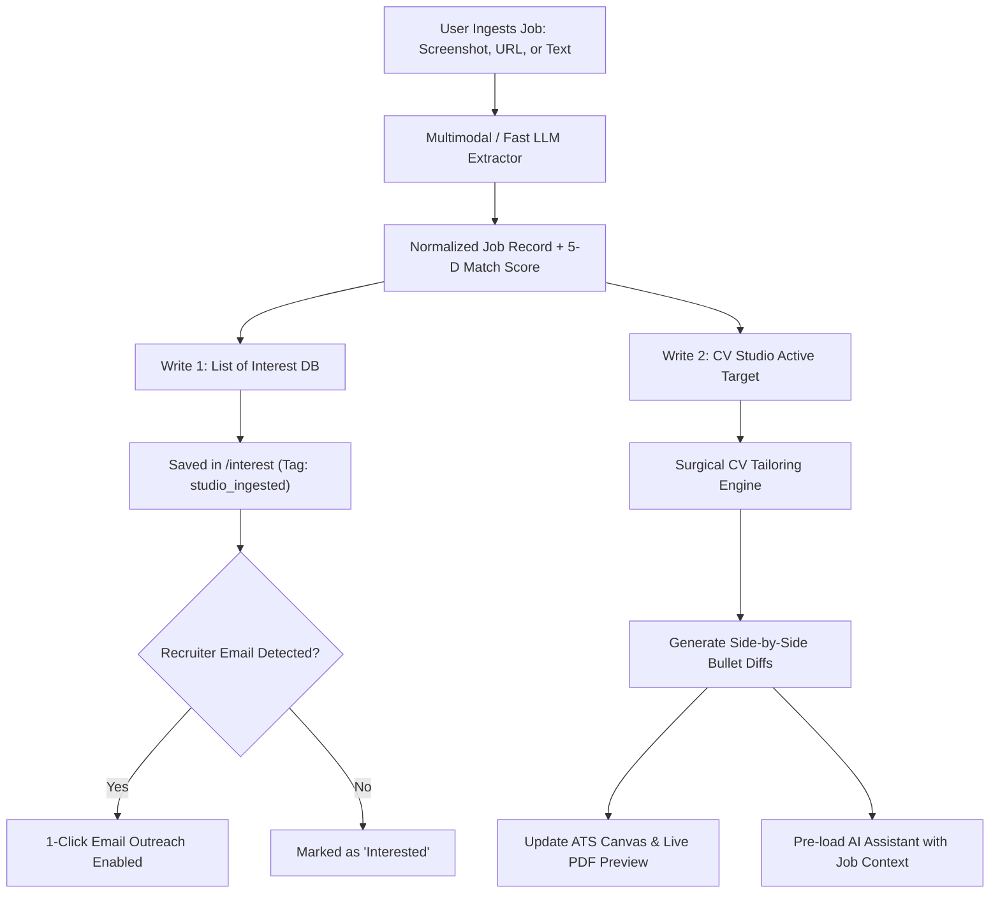

# CV Studio Workbench & Multi-Modal Ingestion — UX Architecture Specification

**Document Version:** 1.0.0  
**Target:** Master UX Specification for the CV Studio Workspace  
**Scope:** 3-Panel Pro Layout, Multi-Modal Ingestion (Screenshot / Text / Link), Dual-Write Sync to List of Interest, and Conversational AI Assistant  
**Design Constraint:** Pure UX Architecture (Information hierarchy, layout wireframes, input modalities, state transitions, and data routing). Visual styling, colors, and typography are excluded.

---

## 1. System Philosophy: The Workbench & Ingestion Gateway

The **CV Studio** is the primary document engineering workbench in Tailored. It serves a dual operational role:
1. **The Surgical ATS Engineering Workbench:** A 3-panel professional workspace where candidates inspect side-by-side bullet point diffs, preview compiled ATS LaTeX/PDF resumes, and converse with an AI copilot to refine their narrative with zero hallucinations.
2. **An On-The-Fly Multi-Modal Ingestion Gateway:** Candidates do not need to leave the studio to target a new role. They can drop a **screenshot**, paste a **raw job description**, or enter an **external URL** directly inside the studio.

### The Mandatory Dual-Write Rule:
Whenever a new job is ingested inside CV Studio (via screenshot, description, or link):
* **Write 1 (Target Focus):** It is immediately parsed, normalized, scored against the candidate's active profile, and loaded as the active target in CV Studio, triggering real-time bullet point tailoring.
* **Write 2 (List of Interest Persistence):** It is concurrently saved into the candidate's persistent **"List of Interest" (`/interest`)** with its calculated match score, extracted recruiter contact, and an ingestion source tag (`studio_screenshot`, `studio_link`, or `studio_text_paste`).

---

## 2. Global Workbench Information Architecture (The 3-Panel Pro Layout)

```
┌────────────────────────────────────────────────────────────────────────────────────────────────────────────────────────────────────────┐
│ TOP BAR: [← Radar]  Swvl — Lead Data Scientist  [Match: 94%]  [Target Persona: AI Engineer ▾]  [📋 Copy TeX]  [📥 PDF]  [✉ Outreach]  │
├───────────────────────────────┬────────────────────────────────────────────────────────┬───────────────────────────────────────────────┤
│       PANEL 1: CONTEXT,       │                  PANEL 2: ATS CANVAS                   │             PANEL 3: AI ASSISTANT             │
│      INGESTION & HISTORY      │                  & SURGICAL DIFFS                      │                  CHAT DRAWER                  │
│          (22% Width)          │                    (48% Width)                         │                  (30% Width)                  │
├───────────────────────────────┼────────────────────────────────────────────────────────┼───────────────────────────────────────────────┤
│ ┌───────────────────────────┐ │ View Mode: [✨ Surgical Diffs] [📄 PDF] [💻 LaTeX]     │ 🤖 Career Copilot Active                      │
│ │ 📥 TARGET A NEW JOB       │ │ ────────────────────────────────────────────────────── │ Context: Master Profile + Swvl Spec           │
│ │ Drop screenshot, paste    │ │ PROFILE SUMMARY:                                       │                                               │
│ │ link, or raw text...      │ │ \textbf{Lead Data Scientist} Experienced in dynamic    │ "I tailored 4 bullets to highlight Swvl's     │
│ └───────────────────────────┘ │ routing algorithms and ML microservice deployments...  │ dynamic pricing and latency reductions."      │
│                               │                                                        │                                               │
│ 🏢 CURRENT TARGET JOB         │ WORK EXPERIENCE:                                       │ Quick Action Prompt Chips:                    │
│ Swvl • Cairo (Hybrid)         │ Swvl — Lead Data Scientist (2022 – Present)            │ [⚡ Quantify with Numbers]                    │
│ Fit Score: 94%                │ • Built routing microservices in Python                │ [🎯 Inject Missing AWS Keyword]              │
│ Added to: [List of Interest ✓]│ + Architected Swvl dynamic pricing API using           │ [📏 Condense to 1 Page]                       │
│                               │   FastAPI and PyTorch, reducing latency by 42%.        │ [🛡 Audit Zero Hallucinations]               │
│ Mandatory Skills Checklist:   │   [Injected: FastAPI, PyTorch]                         │ ───────────────────────────────────────────── │
│ [✓ Python] [✓ FastAPI]        │                                                        │ 💡 Proposed Update for Bullet #2:             │
│ [✓ PyTorch] [✓ PostgreSQL]    │ [ + Add Custom Bullet ]  [ ↺ Revert to Base ]          │ - Built data pipelines for Swvl routes        │
│                               │ ────────────────────────────────────────────────────── │ + Engineered PyTorch pipeline cutting compute │
│ ───────────────────────────── │ Keyword Coverage: 5/5 Mandatory Skills Matched (100%)  │   costs by 35%                                │
│ 📑 TAILORED DRAFT HISTORY     │ Page Budget: 92% filled (Fits safely on 1 ATS page)    │ [ Accept & Apply ]      [ Discard ]           │
│ • Draft 2 (AI Rephrased) *Now │                                                        │ ───────────────────────────────────────────── │
│ • Draft 1 (Initial Tailor)    │                                                        │ Type custom instruction to copilot...         │
│ • Base Profile (Canonical)    │                                                        │ [                                    ] [Send] │
└───────────────────────────────┴────────────────────────────────────────────────────────┴───────────────────────────────────────────────┘
```

---

## 3. The Multi-Modal Job Ingestion Dock (Inside Panel 1)

Located at the top of the left panel, the **Ingestion Dock** allows the user to switch or inject target jobs instantly without navigating away from the workspace.

```
┌────────────────────────────────────────────────────────────────────────┐
│                        MULTI-MODAL INGESTION DOCK                      │
├────────────────────────────────────────────────────────────────────────┤
│  Tabs: [ 📷 Screenshot ]  [ 🔗 Job URL ]  [ 📝 Paste Description ]     │
├────────────────────────────────────────────────────────────────────────┤
│                                                                        │
│  [ 📷 Drag & Drop Job Screenshot here, or click to upload / Ctrl+V ]   │
│  "Extracts requirements from LinkedIn/Wuzzuf posts or mobile captures" │
│                                                                        │
│  Status Indicator:                                                     │
│  ✓ Concurrently saves to your 'List of Interest'                       │
│                                                                        │
│  [ Ingest & Tailor CV ⚡ ]                                             │
└────────────────────────────────────────────────────────────────────────┘
```

### 3.1 Ingestion Modality Specifications

#### Modality A: Screenshot Upload & Clipboard Paste (Multimodal Vision)
* **Trigger:** 
  - Drag-and-dropping an image file (`.png`, `.jpg`, `.jpeg`, `.webp`).
  - Clicking the upload file picker.
  - **Direct Clipboard Paste:** User presses `Ctrl+V` (or `Cmd+V`) anywhere inside the Studio with an image in their clipboard (e.g., from a quick screenshot tool).
* **Processing Workflow:**
  1. The client displays an instant scanning pulse: *"Analyzing screenshot with multimodal vision..."*.
  2. Calls `POST /api/v1/jobs/ingest-screenshot`.
  3. The vision model extracts: `job_title`, `company_name`, `location`, `work_mode`, `recruiter_email`, `mandatory_skills`, and `responsibilities`.
  4. Triggers the **Dual-Write Engine** (saves to List of Interest + updates Studio canvas).

#### Modality B: Direct Job URL Paste
* **Trigger:** User pastes any URL starting with `http://` or `https://` (LinkedIn posting, Wuzzuf detail page, Greenhouse, Lever, Workday).
* **Processing Workflow:**
  1. Calls `POST /api/v1/jobs/ingest-url`.
  2. Stealth crawler fetches full deep job specifications.
  3. Canonical SHA-256 deduplication runs to link existing records.
  4. Triggers the Dual-Write Engine.

#### Modality C: Raw Text Paste
* **Trigger:** User pastes unformatted text copied from an email, Slack, or job board ($>120$ characters).
* **Processing Workflow:**
  1. Calls `POST /api/v1/jobs/extract-description`.
  2. Fast LLM structures the text into standard job requirements.
  3. Triggers the Dual-Write Engine.

---

## 4. The Dual-Write Synchronization Engine

Every job ingested inside CV Studio automatically executes this synchronized state progression:



### Synchronized Data Attributes Saved to "List of Interest":
* `job_id`: Unique identifier (or existing ID if duplicate).
* `company_name` & `job_title`.
* `source_type`: Tagged specifically as `studio_screenshot`, `studio_link`, or `studio_paste`.
* `overall_fit_score`: Calculated against candidate's active persona (e.g. `94%`).
* `recruiter_email`: Stored if detected from screenshot or text.
* `saved_at`: Current timestamp.
* `status`: Set to `in_process` (since tailoring has commenced).

---

## 5. Panel 2: The ATS Canvas & Surgical Diff Inspector (Detailed UX)

Panel 2 is the primary document stage. It provides three synchronized view modes:

### 5.1 View Mode 1: Surgical Diffs (Interactive Editor)
* **Visual Presentation:** Displays the resume section-by-section.
* **Diff Highlighting:**
  - Red strikethrough for removed generic text (`- Managed backend tasks`).
  - Green bold highlighting for injected target keywords and quantified metrics (`+ Architected Swvl pricing API using FastAPI, reducing calculation latency by 42% [Injected: FastAPI]`).
* **Micro-Actions on Hover (Per Bullet):**
  - `[✏ Inline Edit]`: Opens an inline text editor to tweak phrasing directly with keyboard.
  - `[↺ Revert to Base]`: Discards tailoring for this specific bullet, restoring canonical master profile text.
  - `[💬 Ask AI to Rephrase]`: Sends this specific bullet to the AI Assistant drawer for targeted rewriting.

### 5.2 View Mode 2: High-Fidelity ATS PDF Preview
* **Visual Presentation:** Renders the resume visually matching standard executive LaTeX formatting (centered name, contact header, bold narrative summary, chronological experience, and categorized skill rows).
* **Live Re-compilation:** Any accepted diff or manual edit re-renders the document in $< 1.5\text{ seconds}$.

### 5.3 View Mode 3: Raw LaTeX Source Code
* **Visual Presentation:** Monaco-style code editor displaying clean, un-nested `.tex` source code.
* **Action:** `[Copy Raw LaTeX]` button with clipboard feedback.

### 5.4 Bottom Compliance & Audit Bar
* **ATS Keyword Coverage Gauge:** Displays `X of Y Mandatory Skills Matched` with real-time percentage (e.g., `5/5 Skills (100%)`).
* **Page Budget Budget Indicator:** Warns if content will overflow onto a second page:
  - Green: `92% Page Filled (Optimal 1-Page ATS length)`.
  - Amber / Red: `112% Overflow (Will spill onto Page 2) [Auto-Condense Button]`.

---

## 6. Panel 3: The Conversational AI Assistant Drawer (Detailed UX)

The AI Assistant is not a generic chatbot; it is a **context-aware ATS document engineering specialist**.

### 6.1 Context Awareness
The assistant continuously holds two reference objects in memory:
1. The candidate’s **Master Profile** (immutable factual truth).
2. The active **Job Requirements** (from the active Swvl job or newly ingested screenshot).

### 6.2 Quick-Action Prompt Chips (One-Tap Shortcuts)
Positioned above the chat input:
* `[⚡ Quantify with Numbers]`: Prompts the candidate: *"How much did route latency drop after your FastAPI deployment? (e.g., 20%, 40%)"* $\rightarrow$ injects the metric.
* `[🎯 Inject Missing Keywords]`: Scans the job spec for unmatched skills (e.g., *AWS ECS*) and suggests which past project to add them to.
* `[📏 Condense to 1 Page]`: Surgically shortens bullet points without losing technical depth.
* `[🛡 Audit Zero Hallucinations]`: Cross-checks every claim in the tailored CV against the master profile to verify complete factual alignment.

### 6.3 The "Inline Diff Proposal" Card
When the user asks the assistant to adjust text, the AI does **not** dump a wall of plain text. It returns an actionable UI card:

```
┌────────────────────────────────────────────────────────────────────────┐
│ 💡 Proposed Update: Experience Bullet #2                               │
│                                                                        │
│ - Developed Python services for route scheduling                       │
│ + Engineered distributed PyTorch pipelines for Swvl, cutting route     │
│   calculation latency by 42% and cloud compute cost by 18%             │
│                                                                        │
│ Injected Keywords: [PyTorch] [Latency Optimization]                    │
│ Compliance Check: ✓ Verified against Master Profile Swvl Entry        │
│                                                                        │
│ [ Accept & Apply to Canvas ✓ ]                   [ Discard ✕ ]         │
└────────────────────────────────────────────────────────────────────────┘
```

* Clicking `[Accept & Apply to Canvas]`:
  1. Instantly updates the text in Panel 2.
  2. Updates the live PDF preview.
  3. Increments the version history tree (`Draft 2 (AI Rephrased)`).
  4. Shows a green toast: *"✓ Bullet updated & PDF re-compiled"*.

---

## 7. Top Bar & Final Mile Export Actions

Located along the top navigation bar of CV Studio:
1. `[← Back to Radar]`: Returns to the Job Radar with active filters preserved.
2. **Active Job Pill:** `Swvl — Lead Data Scientist` + `[Match: 94%]`. Clicking it opens a quick drawer showing the full job description.
3. **Active Persona Switcher:** Dropdown allowing the user to switch between personas (e.g. *Senior AI Engineer* vs. *Data Analyst*). Switching immediately re-tailors the CV against that persona.
4. **Export Actions:**
   - `[📋 Copy LaTeX]`: Copies clean `.tex` code to system clipboard.
   - `[📥 Download PDF]`: Downloads compiled ATS-compliant PDF.
   - `[✉ Dispatch Outreach / Move to Pipeline]`: 
     - If a recruiter email was detected (from screenshot, link, or text), opens the **Email Outreach Modal** with pre-filled recruiter email, tailored cover letter pitch, and attached PDF.
     - Advances pipeline status to `in_process`.

---

## 8. State Transitions & Edge Case Handling

1. **Blurry or Partial Screenshot:**
   - If an uploaded screenshot has illegible text or cut-off sections, the system displays an inline warning:  
     *"We extracted Job Title and Company, but description text is incomplete. [Paste full description text to improve score]"*.
   - Never fails silently or produces a blank screen.
2. **Duplicate Ingestion Handling:**
   - If a link or screenshot of a job that already exists in the "List of Interest" is dropped, the system detects the canonical SHA-256 key:  
     *"This job is already in your List of Interest. Switched to existing record and loaded latest draft."*
3. **Offline & Interrupted Sessions:**
   - Every character typed and diff accepted auto-saves locally and syncs to `PATCH /api/v1/cv-fit/{doc_id}`.
   - If the user accidentally closes the tab, reopening `/cv-studio` immediately restores their exact workspace state.

