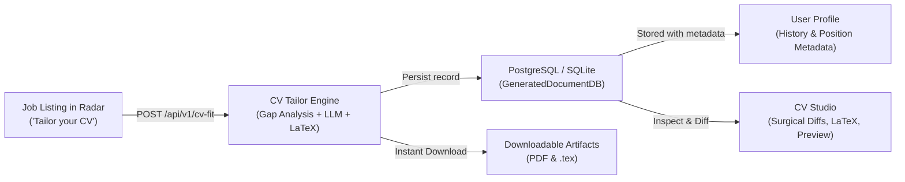

# CV Tailor Module & CV Studio Wiring Plan

This document specifies the complete end-to-end architecture, API contracts, database schema updates, UI/UX interaction flows, and step-by-step implementation phases for wiring the **CV Tailor Module**, one-click tailoring in **Job Radar**, document persistence in **User Profile**, and the interactive **CV Studio**.

---

## 1. System Overview & Core Requirements



### Key Deliverables:
1. **One-Click Tailoring in Job Listing**: Replace the placeholder in `JobDetailPane` with a live "Tailor your CV" action that initiates multi-stage tailoring, shows progress, and delivers instant PDF & TeX downloads.
2. **Automated Base LaTeX Synthesis**: Synthesizes a clean, ATS-compliant LaTeX resume directly from the user's verified `UserProfile` and `CareerPersona`, eliminating manual `.tex` file management.
3. **User Profile Persistence**: Persist each tailored CV in the database linked to `profile_id`, preserving position title, company name, full job description, extracted competencies, match score, bullet diffs, and compile status.
4. **Interactive CV Studio Module**: Complete the third major workspace module (`cv-studio`) with a 3-pane interface: document history, surgical diff viewer (with AI rationale and zero-hallucination verification badges), raw LaTeX code viewer, and job metadata inspector.

---

## 2. Architecture & Data Contracts

### 2.1 Database Schema Extensions (`GeneratedDocumentDB`)
In `backend/app/models/document.py`, extend `GeneratedDocumentDB` to link directly to the candidate's profile and capture full job metadata:

```python
class GeneratedDocumentDB(SQLModel, table=True):
    __tablename__ = "generated_documents"

    id: Optional[int] = DBField(default=None, primary_key=True)
    doc_id: str = DBField(index=True, unique=True)
    doc_type: str = DBField(default="tailored_cv", index=True)  # "tailored_cv" | "cover_letter"
    
    # User Profile & Persona linkage
    profile_id: Optional[int] = DBField(default=None, foreign_key="user_profiles.id", index=True)
    persona_id: Optional[str] = DBField(default=None, index=True)

    # Job & Ingestion metadata
    job_id: Optional[int] = DBField(default=None, index=True)
    job_title: Optional[str] = None
    company_name: Optional[str] = None
    company_website_url: Optional[str] = None
    company_about_text: Optional[str] = None
    job_description_text: Optional[str] = None
    location: Optional[str] = None
    location_type: Optional[str] = None
    fit_score: Optional[float] = None
    parsed_skills_json: Optional[str] = None

    # Status & Mode
    status: str = DBField(default="completed")
    generation_mode: Optional[str] = DBField(default="llm")
    tailoring_applied: bool = DBField(default=False)
    
    # Artifact paths & verification hashes
    artifact_folder: Optional[str] = None
    generated_tex_path: Optional[str] = None
    generated_pdf_path: Optional[str] = None
    generated_tex_sha256: Optional[str] = None
    generated_pdf_sha256: Optional[str] = None
    compile_status: str = DBField(default="pending")  # "ok" | "failed" | "not_installed"
    
    # Base CV reference
    base_cv_tex_sha256: Optional[str] = None
    user_comments: Optional[str] = None
    
    # Full analysis & review notes JSON
    raw_metadata_json: Optional[str] = None
    
    created_at: datetime = DBField(default_factory=utc_now)
    updated_at: datetime = DBField(default_factory=utc_now)
```

### 2.2 API Schema Extensions (`backend/app/schemas/cv_fit.py`)
Update `CvFitCreateRequest` and `CvFitDetailResponse` to seamlessly accept `profile_id` and return complete diff and job metadata:

```python
class CvFitCreateRequest(BaseModel):
    profile_id: Optional[int] = Field(default=None, description="Active user profile ID")
    persona_id: Optional[str] = Field(default=None, description="Active career persona ID")
    base_cv_latex: Optional[str] = Field(default=None, description="Original LaTeX. If omitted, synthesized from profile.")
    job_id: Optional[int] = Field(default=None, description="Database ID of discovered job")
    job_title: Optional[str] = None
    company_name: Optional[str] = None
    job_description_text: Optional[str] = None
    company_about_text: Optional[str] = None
    company_website_url: Optional[str] = None
    location: Optional[str] = None
    fit_score: Optional[float] = None
    parsed_skills: List[str] = Field(default_factory=list)
    user_comments: Optional[str] = None

class CvFitDetailResponse(BaseModel):
    doc_id: str
    profile_id: Optional[int] = None
    persona_id: Optional[str] = None
    job_id: Optional[int] = None
    status: str
    generation_mode: Optional[str] = None
    tailoring_applied: bool = False
    job_title: Optional[str] = None
    company_name: Optional[str] = None
    company_website_url: Optional[str] = None
    company_about_text: Optional[str] = None
    job_description_text: Optional[str] = None
    location: Optional[str] = None
    fit_score: Optional[float] = None
    parsed_skills: List[str] = Field(default_factory=list)
    user_comments: Optional[str] = None
    compile_status: str
    base_cv_tex_sha256: str
    tailored_latex_content: Optional[str] = None
    base_latex_content: Optional[str] = None
    bullet_diffs: List[Dict[str, Any]] = Field(default_factory=list)
    notes: List[str] = Field(default_factory=list)
    errors: List[str] = Field(default_factory=list)
    files: List[CvFitFileDescriptor] = Field(default_factory=list)
    created_at: datetime
    updated_at: datetime
```

---

## 3. Automated Base LaTeX Synthesis from Profile

To ensure a seamless user experience where any user with a profile can immediately tailor their CV without manually editing `.tex` source code:

1. **`backend/app/ai/formatters/latex_template.py`**:
   - Takes a `UserProfile` and `CareerPersona`.
   - Generates an elegant, ATS-friendly LaTeX string:
     - Header: Name, Location, Phone, Email, LinkedIn, GitHub.
     - Section: Executive Career Summary.
     - Section: Technical Competencies & Tools (grouped by category).
     - Section: Professional Experience (Company, Role, Dates, and discrete `\item` bullet points).
     - Section: Featured Engineering Projects.
     - Section: Education & Spoken Languages.
   - Escapes special LaTeX characters (`&`, `%`, `$`, `#`, `_`, `{`, `}`).
2. **Fallback Integration in `CvFitService`**:
   - If `payload.base_cv_latex` is not supplied or empty, load the candidate's profile via `payload.profile_id`, assemble the Pydantic profile, and synthesize the base `.tex` on the fly.

---

## 4. UI/UX Interaction Design

### 4.1 "Tailor your CV" Button in `JobDetailPane`
- Located in the sticky actions bar alongside "Apply on LinkedIn / Wuzzuf".
- **States**:
  1. **Idle**:
     - Label: `✨ Tailor your CV`
     - Action: Triggers `POST /api/v1/cv-fit`.
  2. **Tailoring in Progress**:
     - Animated progress badge cycling through stages:
       * *Step 1/3: Analyzing role & competency gaps...*
       * *Step 2/3: Surgically rewriting bullet points...*
       * *Step 3/3: Compiling ATS LaTeX & PDF...*
  3. **Tailored (Completed)**:
     - Button changes to `✓ Tailored (Actions)` with dropdown or modal:
       * 📄 **Download PDF**
       * 📝 **Download LaTeX (.tex)**
       * 🔬 **Inspect in CV Studio**
     - Inline success card appears above actions showing match boost, bullet diff highlights, and one-click download buttons.

### 4.2 Storage in User Profile ("Tailored Applications" View)
- Accessible from `Header`, `ActivePersonaBar`, or `Sidebar`:
- Tab/Drawer in Profile: **"Tailored Documents & Applications"**:
  - Displays each generated CV in chronological order.
  - Cards show:
    * **Job Title & Company**: e.g., `Lead Data Scientist • Swvl (Cairo, Hybrid)`
    * **Ingestion & Tailoring Date**: Timestamp
    * **Job Description Excerpt**: Expandable to read the full target job description.
    * **Extracted Skills & Fit Score**: Match percentage badge.
    * **Tailored Bullet Count**: e.g. `3 bullets rephrased`.
    * **Quick Actions**:
      - `[Download PDF]`
      - `[Download .tex]`
      - `[Open in CV Studio]`

### 4.3 CV Studio Workspace (`CVStudioPage.tsx`)
A dedicated full-page workspace view (`currentView === 'cv-studio'`):

```
+-----------------------------------------------------------------------------------------------+
| TOP BAR: [Back to Radar]  [Selected Doc: Swvl - Lead Data Scientist]  [Download PDF] [Download .tex] |
+------------------------+------------------------------------------+---------------------------+
| LEFT PANE:             | CENTER PANE: (Tabs: Diff | Preview | TeX)| RIGHT PANE:               |
| Tailored History       |                                          | Target Job Intelligence   |
|                        | [Surgical Diff View]                     |                           |
| • Swvl - Lead DS (94%) |  - Original: Built APIs and database...  | Title: Lead Data Scientist|
| • Noon - ML Eng (89%)  |  + Tailored: Architected high-throughput | Company: Swvl             |
| • Fawry - Analyst(87%) |    FastAPI microservices handling 14k    | Location: Cairo (Hybrid)  |
|                        |    req/sec; slashed p99 latency by 42%   | Fit Score: 94.2%          |
| [Search documents...]  |                                          |                           |
|                        |  [Rationale: Emphasized FastAPI & scale] | Extracted Skills:         |
|                        |                                          | [Python] [FastAPI] [SQL]  |
|                        | [PDF Preview / LaTeX Source Editor]      |                           |
|                        |  \documentclass{article}...              | Full Job Description:     |
|                        |                                          | "Swvl is seeking a..."    |
+------------------------+------------------------------------------+---------------------------+
```

---

## 5. Step-by-Step Implementation Roadmap

### Phase 1: Backend Data Model, Synthesis & API Wiring
1. **Extend `GeneratedDocumentDB`** in `backend/app/models/document.py`:
   - Add `profile_id`, `persona_id`, `location`, `fit_score`, `parsed_skills_json`.
   - Fix `company_about_text` attribute bug.
2. **Implement `latex_template.py`** in `backend/app/ai/formatters/`:
   - Construct clean ATS LaTeX document directly from `UserProfile` + `CareerPersona`.
   - Add unit tests for LaTeX escaping and syntax validity.
3. **Enhance `CvFitService`** in `backend/app/ai/tailor/cv_fit_service.py`:
   - Accept `profile_id` and auto-synthesize base LaTeX if not supplied.
   - Extract and return structured `bullet_diffs` (original bullet vs tailored bullet + rationale).
   - Filter `list_cv_fits` by optional `profile_id`.
   - Fix `get_cv_fit` to return complete response without 500 error.
4. **Update API Routes** in `backend/app/api/routes/cv_fit.py`:
   - Support `profile_id` parameter on `GET /api/v1/cv-fit`.
   - Expose `GET /api/v1/profiles/{profile_id}/tailored-cvs`.

### Phase 2: Frontend API Client & State Management
1. **Create `frontend/src/services/cvFitApi.ts`**:
   - `tailorCv(req)`: Calls `POST /api/v1/cv-fit`.
   - `listCvFits(profileId)`: Calls `GET /api/v1/cv-fit?profile_id=...`.
   - `getCvFit(docId)`: Calls `GET /api/v1/cv-fit/{docId}`.
   - `getDownloadUrl(docId, kind)`: Generates direct URL for PDF or .tex.
2. **Add Global CV State**:
   - Manage tailored documents list, active document selection, and loading states across Radar, Profile, and Studio.

### Phase 3: Job Listing Wiring (`JobDetailPane`)
1. **Wire "Tailor your CV" Action**:
   - Connect button in `JobDetailPane.tsx` to `cvFitApi.tailorCv()`.
   - Implement animated multi-step tailoring status.
2. **Deliver Downloadable Artifacts**:
   - On completion, render one-click "Download PDF" and "Download LaTeX" buttons.
   - Provide an "Inspect in CV Studio" button that navigates directly into CV Studio with the tailored document loaded.

### Phase 4: User Profile Document Storage & History
1. **Add "Tailored Applications" Section**:
   - Integrate into candidate profile drawer or Quiz Funnel modal.
   - Display card/table view with position, company, date, description, fit score, and download links.

### Phase 5: CV Studio Dedicated Workspace (`CVStudioPage`)
1. **Build `CVStudioPage.tsx`**:
   - Navigation support in `App.tsx` (`currentView: 'home' | 'radar' | 'cv-studio'`).
   - Left pane: Document history selector with badges.
   - Center pane: Surgical diff viewer with before/after highlight, formatted preview, and raw `.tex` source code viewer.
   - Right pane: Full job intelligence inspector with full job description and competency match breakdown.
2. **Update Sidebar & Header**:
   - Update `WORKSPACE_MODULES` badge with dynamic count of generated CVs.
   - Allow seamless jumping between Radar, Studio, and Profile.

---

## 6. Verification & Acceptance Criteria
- [x] User opens any job in Job Radar -> clicks "Tailor your CV" -> sees animated progress -> receives direct download buttons for PDF and .tex.
- [x] Clicking "Download PDF" downloads the compiled PDF (or clean ATS PDF preview); clicking "Download .tex" downloads the raw LaTeX code.
- [x] Tailored CV is automatically stored in `GeneratedDocumentDB` with `profile_id`, position, company, and full job description.
- [x] User can view all previously generated CVs with position and description metadata in their User Profile.
- [x] User can click "Open in CV Studio" or select "CV Studio" from the Sidebar to inspect side-by-side surgical bullet diffs, the original job description, and raw LaTeX code.
- [x] Zero hallucinations: Tailoring preserves verified facts from the candidate's master profile without inventing skills.
