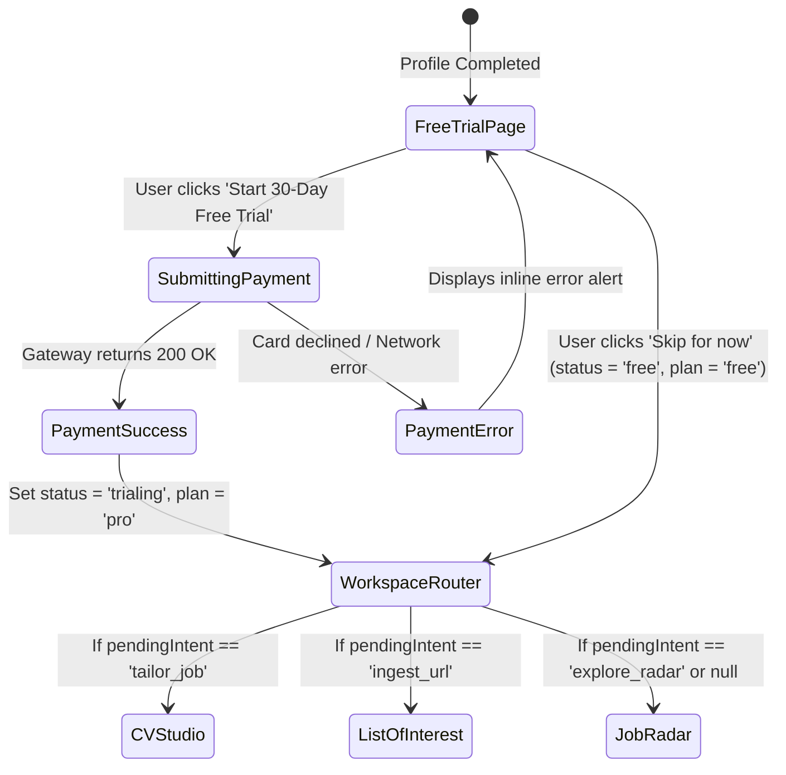

# Free Trial Gate & Fulfillment Routing — UX Architecture Plan

**Document Version:** 1.0.0  
**Target:** UX Blueprint for the Post-Profile Conversion Gate & Destination Router  
**Position in Funnel:** Step 3 of 3 (Auth $\rightarrow$ 6-Page Profile Funnel $\rightarrow$ **Free Trial Gate** $\rightarrow$ **Fulfillment Destination**)  
**Design Constraint:** Pure UX Structure (Layout, Fields, Decision Trees, State Transitions, and Intent Preservation). Visual styling, colors, and typography are excluded.

---

## 1. Executive UX Philosophy: The Ethical High-Converting Paywall

Immediately after completing the 6-page Profile Funnel, the candidate has invested 2–3 minutes establishing their career baseline. Their perceived value and motivation are at peak levels.

This page serves as the commercial gateway for **Tailored Pro**, but adheres to three strict ethical UX rules:
1. **Zero Dark Patterns:** Pricing terms, billing dates, and trial duration are displayed transparently. No hidden charges or difficult cancellation loops.
2. **The Prominent Escape Hatch:** An explicit, clearly legible **"Skip for now & continue with Free Plan"** button ensures that users who do not wish to provide payment details are never blocked from experiencing the product.
3. **Preserved Intent (The Fulfillment Guarantee):** Whether the user starts the trial or skips, the system **never dumps them onto a generic blank dashboard**. It preserves the exact action that triggered their sign-up from the Landing Page (e.g., tailoring a specific Swvl job, inspecting a pasted link, or running a search).

---

## 2. Page Wireframe & Information Hierarchy

```
┌──────────────────────────────────────────────────────────────────────────────────────────────────┐
│                                    TOP CONFIRMATION BANNER                                       │
│  "✓ Profile Saved: Mostafa Ibrahim — Senior AI Engineer (Cairo, Riyadh, Remote)"                 │
├──────────────────────────────────────────────────────────────────────────────────────────────────┤
│                                    HERO VALUE PROPOSITION                                        │
│  "Start Your 30-Day Free Trial of Tailored Pro"                                                  │
│  "Month 1: $0.00 (Free) • Month 2: $19.99/mo • Cancel anytime in 1 click before Day 30"         │
├────────────────────────────────────────────────┬─────────────────────────────────────────────────┤
│           COLUMN 1: THE VALUE MATRIX           │        COLUMN 2: SECURE CHECKOUT FORM           │
│                                                │                                                 │
│  What Your 30-Day Pro Trial Unlocks:           │  Payment Details (Billed $0.00 Today)           │
│                                                │                                                 │
│  ✓ Unlimited Surgical ATS CV Tailoring         │  Name on Card                                   │
│    (Precision bullet diffs & LaTeX compiler)   │  [ Mostafa Ibrahim                            ] │
│                                                │                                                 │
│  ✓ Interactive CV Studio AI Assistant          │  Card Number                                    │
│    (Chat with AI to rephrase & inject metrics) │  [ 4242 •••• •••• 4242                   💳 ]   │
│                                                │                                                 │
│  ✓ Automated Daily Discovery Sweeps            │  Expiry Date               CVC / CVV            │
│    (Crawl LinkedIn & Wuzzuf while you sleep)   │  [ MM / YY ]               [ CVC ]             │
│                                                │                                                 │
│  ✓ 1-Click Direct Recruiter Email Outreach     │  Country / Region          Postal / ZIP Code    │
│    (Auto-formatted pitches via Gmail/mailto)   │  [ Egypt                 ▾] [ 11511 ]          │
│                                                │                                                 │
│  ✓ Multi-Country Contact Numbers Registry      │  [ 🔒 256-Bit Encrypted via Stripe / Paddle ]   │
│    (Automatic +20 / +966 phone pairing)        │                                                 │
│                                                │  PRIMARY ACTION:                                │
│  Free Tier Comparison:                         │  [ Start 30-Day Free Trial (Pay $0.00) 🚀 ]     │
│  • Free tier includes: 3 tailored CVs/month,   │                                                 │
│    standard radar search, manual copy-paste.   │  THE ESCAPE HATCH:                              │
│                                                │  👉 [ Skip for now & continue with Free Plan ]  │
├────────────────────────────────────────────────┴─────────────────────────────────────────────────┤
│                                       TRANSPARENCY FOOTNOTE                                      │
│  "No commitment. We will email you a reminder on Day 27. Cancel anytime in Account Settings."    │
└──────────────────────────────────────────────────────────────────────────────────────────────────┘
```

---

## 3. Data Fields & Interactive Controls

### 3.1 Affirmation Header
* **Component:** Non-editable status badge.
* **Content:** Displays the user’s name, primary target role, and active search cities captured in the profile funnel.
* **UX Purpose:** Validates that their effort was not lost and grounds the trial offer in their specific career context.

### 3.2 Pricing & Billing Summary Card
* **Amount Due Today:** `$0.00` (prominently featured).
* **Next Billing Date:** Automatically formatted as current date $+ 30\text{ days}$ (e.g. *"December 17, 2026: $19.99/month"*).
* **Annual Billing Switcher (Optional Micro-Control):**
  - Toggle: `[ Billed Monthly: $19.99/mo ]` vs. `[ Billed Annually: $14.99/mo (Save 25%) ]`.

### 3.3 Payment Input Form (Stripe Elements / Paddle Inline)
* **Name on Card:** Single-line text input (pre-populated with `full_name`).
* **Card Number:** Formatted card number input with automatic card-brand detection (Visa, Mastercard, Amex).
* **Expiry Date:** Month/Year input (`MM/YY`).
* **Security Code (CVC):** 3 or 4-digit code with tooltip explanation.
* **Country & Postal Code:** Location verification for regional tax compliance.
* **Security Indicator:** Visual SSL badge: *"Bank-grade 256-bit encryption. Payment info never touches Tailored servers."*

### 3.4 The Dual Action Triggers

| Trigger | Label | Interaction & Visual Weight | System Outcome |
| :--- | :--- | :--- | :--- |
| **Primary CTA** | `[ Start 30-Day Free Trial 🚀 ]` | Primary high-emphasis button. Displays spinner on submit. | Authorizes `$0.00` transaction via gateway. Activates Pro trial (`status: trialing`). Routes to destination. |
| **Secondary CTA** | `👉 [ Skip for now & continue with Free Plan ]` | Distinct, non-deceptive text link or ghost button beneath primary CTA. | Bypasses payment completely. Activates Free Plan (`status: free`). Routes to destination. |

---

## 4. The Intent Preservation & Fulfillment Router

The critical UX mechanism of this page is the **Fulfillment Router**. The system captures the user's initial trigger on the Landing Page in a transient session key (`pendingIntent`) and executes it immediately after the trial gate:

```
┌──────────────────────────────────────────────────────────────────────────────────────────────────┐
│                                   INTENT PRESERVATION LOGIC                                      │
└────────────────────────────────────────────────┬─────────────────────────────────────────────────┘
                                                 │
                                                 ▼
                             Did user arrive with a Pending Intent?
                                                 │
                 ┌───────────────────────────────┼───────────────────────────────┐
                 │                               │                               │
                 ▼                               ▼                               ▼
       [ INTENT: TAILOR_JOB ]          [ INTENT: INGEST_URL ]         [ INTENT: EXPLORE_RADAR ]
    User clicked "Tailor CV" on      User pasted an external job      User arrived via general search
     a specific Swvl/Noon job         link in the Omni-Bar             or clicked "Explore Radar"
                 │                               │                               │
                 ▼                               ▼                               ▼
    ROUTE TO: CV STUDIO             ROUTE TO: LIST OF INTEREST      ROUTE TO: JOB RADAR
    • Path: `/cv-studio`            • Path: `/interest`             • Path: `/radar`
    • Pre-loads selected job        • Displays newly scraped job    • Displays live feed re-ordered
    • Generates first bullet diff   • Shows calculated 5-D score      by calculated 5-D Match Scores
    • Shows live ATS LaTeX preview  • Ready for 1-click tailoring   • All cards show real fit %
```

### Routing Scenarios in Detail:

#### Scenario A: Direct Job Tailoring (`pendingIntent.type = "tailor_job"`)
* **Trigger:** Guest clicked `[⚡ Tailor CV]` on the "Swvl — Lead Data Scientist" job on the landing page.
* **Fulfillment:**
  1. Profile Funnel completes $\rightarrow$ User chooses Trial or Skip.
  2. Router directs user straight to **CV Studio (`/cv-studio?job_id=101`)**.
  3. The system executes `POST /api/v1/cv-fit/tailor` in the background.
  4. The user sees their master profile bullets transformed into ATS-optimized bullet points specifically for Swvl!

#### Scenario B: External Link Ingestion (`pendingIntent.type = "ingest_url"`)
* **Trigger:** Guest pasted `https://www.linkedin.com/jobs/view/...` into the Omni-Bar.
* **Fulfillment:**
  1. Router directs user to **List of Interest (`/interest?highlight=job_id`)**.
  2. The job card appears at the top of their list with a glowing green badge: *"✓ Successfully fetched and scored: 91% Match!"*.
  3. Action buttons: `[⚡ Tailor CV in Studio]` or `[✉ Send Outreach]`.

#### Scenario C: General Discovery (`pendingIntent.type = "explore_radar"`)
* **Trigger:** Guest searched for "Senior Data Scientist in Cairo" or clicked "Explore Radar".
* **Fulfillment:**
  1. Router directs user to **Job Radar (`/radar`)**.
  2. The feed is re-ranked: every job card now displays real calculated match percentages ($94\%$, $88\%$, $72\%$) calculated against their newly built profile.

---

## 5. Post-Action State Machine & Feedback Toasts



### Visual Feedback Toasts Upon Arrival at Workspace:

* **For Trial Activated Users:**  
  `Toast (Success):` *"🎉 30-Day Pro Trial Active! You have unlimited CV tailoring, AI Studio Assistant, and daily sweeps."*
* **For Free Plan Users (Skipped):**  
  `Toast (Neutral):` *"Welcome to Tailored Free Tier! You have 3 tailored CVs remaining this month. Upgrade anytime in Plans."*

---

## 6. Edge Cases & Resilience Rules

1. **Card Decline / Validation Failure:**
   - Inline alert: *"Your card could not be authorized. Please check details or [Skip for now to continue free]."*
   - The user is **never stuck**; the skip option remains readily available even after a failed card attempt.
2. **Session Interruption (User Closes Tab on Paywall):**
   - The user profile is already saved in the database.
   - Upon next sign-in, the system detects `onboarding_completed: true` and `subscription_status: null`.
   - It prompts with a lightweight modal: *"Complete your trial setup or continue on Free Tier? [Start Trial] [Continue Free]"*.
3. **Repeat Sign-Up Abuse Prevention:**
   - If an account is created with an email or payment fingerprint that previously used a free trial, the system gracefully falls back to: *"Your trial for this account has already concluded. [Subscribe to Pro for $19.99] or [Continue with Free Plan]"*.

