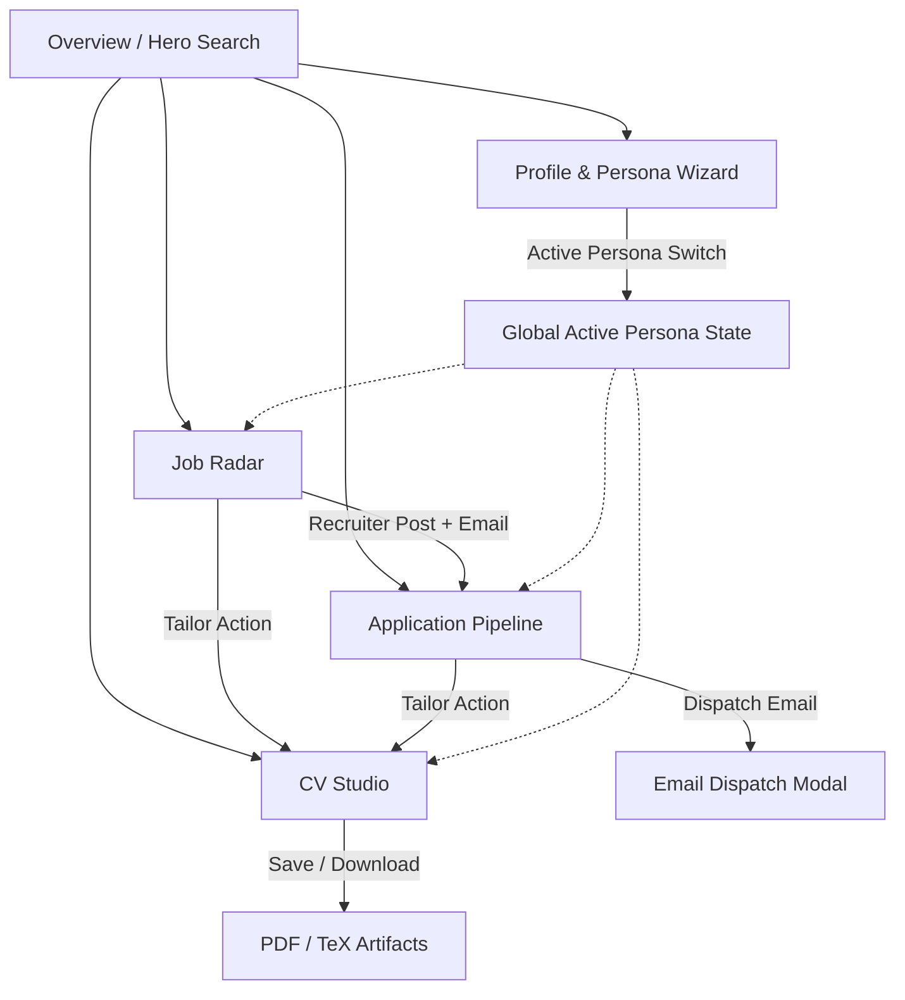

# Tailored - Frontend Feature Parity Specification & Functional Master Checklist
**Document Version:** 1.0  
**Target:** Reference Blueprint for Building a New UI Without Feature Regressions  
**Purpose:** Use this document as an exhaustive specification and checklist to guarantee 100% functional parity with the original Tailored application.

---

## 1. Global Application Architecture & State Model

### 1.1 Navigation & Layout Hierarchy
The application is structured into four primary modules accessible from the global top navigation, hamburger drawer, and hero switcher:
1. **Candidate Profile & Persona Wizard** (`QuizWizard`)
2. **Job Radar & Ingestion Engine** (`JobRadarPage`)
3. **Application Pipeline & Outreach Dispatch** (`ApplicationPipelinePage`)
4. **CV Studio & Surgical Diff Inspector** (`CVStudioPage`)



### 1.2 Global State Contracts
Any new frontend must track the following top-level state:
- `currentProfile`: The active `FullProfileResponse` containing personal information, target locations, education, certifications, and career personas.
- `activePersonaId`: The identifier of the selected persona (e.g. `ai_engineer_track`, `data_scientist_track`). All tailoring, job matching scores, and CV synthesis adapt to this active persona.
- `notification`: Transient toast messages (`✓ Marked as Applied`, `✓ LaTeX copied`, etc.) that auto-dismiss after 3–4 seconds.

---

## 2. Module 1: Candidate Profile & Persona Wizard (`QuizWizard`)

The Profile Wizard manages the candidate's canonical career dataset.

### 2.1 Resume Ingestion & Parsing
- [ ] **LaTeX File / Text Upload**: Allows uploading `.tex`, `.pdf`, `.docx` files or pasting raw LaTeX source code.
- [ ] **Automated Section Extraction**: Calls `POST /api/v1/profiles/parse-latex` or `/upload-resume` to extract:
  - Personal info (name, email, phone, LinkedIn, GitHub, portfolio).
  - Residence & mobility (current city, target cities, relocation, remote preference).
  - Experience history (companies, roles, dates, achievements).
  - Projects (name, summary, tech stack tags).
  - Education (institution, degree, graduation year, GPA).
  - Certifications (name, issuer, date).
- [ ] **Sample Profile Pre-fill**: One-click demo button that immediately loads a complete multi-persona candidate profile (`SAMPLE_PROFILE`).

### 2.2 7-Step Guided Wizard Funnel
1. **Step 1: Career Personas**
   - Candidate can define 1 to $N$ distinct personas (e.g. "Senior AI Engineer", "Data Scientist", "Fullstack Architect").
   - Each persona has: `persona_id`, `persona_name`, `target_title`, `summary_bio`, `is_primary` toggle.
   - Persona switching instantly re-contextualizes the entire application.
2. **Step 2: Personal Information**
   - Full name, primary email.
   - Contact numbers with type label (`Mobile`, `Work`).
   - Clean URLs for LinkedIn, GitHub, Personal Portfolio (with auto-stripping of `https://` in display headers).
3. **Step 3: Location & Mobility**
   - Current city, country, address.
   - Target locations with willingness to relocate and remote work preferences.
4. **Step 4: Education & Certifications**
   - Multi-entry education items (institution, degree, field of study, graduation year, optional GPA/grade).
   - Multi-entry certifications (issuer, certificate title, date, credential link).
5. **Step 5: Skills & Tools Taxonomy**
   - Categorized into 5 distinct pools:
     1. Core Competencies & Domain
     2. Programming Languages & Core
     3. Frameworks & Libraries
     4. MLOps, Cloud & Platforms
     5. Databases & Vector Stores
6. **Step 6: Experience & Projects**
   - Chronological roles with company, location, date ranges (`2022 -- Present`).
   - Achievements supporting special directives:
     - `[Role Summary]` prefix for team and scope overview.
     - `[Stack: Python, Docker, ...]` inline tags for project technology stacks.
   - Projects with name, summary, and comma-separated tech stack tags.
7. **Step 7: Custom Sections & Review**
   - Dynamic custom sections (e.g. Publications, Patents, Honors, Languages).
   - Language proficiency pairs (`Language: Proficiency`).
   - Final review and save action (`Create New` or `Update Active Profile`).

---

## 3. Module 2: Job Radar & Ingestion Engine (`JobRadarPage`)

The Job Radar acts as the intelligent opportunity scanner and match evaluator.

### 3.1 Job Sourcing & Discovery
- [ ] **Multi-Channel Feeds**:
  - LinkedIn Job Listings (`source_type: linkedin` / `linkedin_apify`).
  - Wuzzuf Listings (`source_type: wuzzuf`).
  - Recruiter Posts (`source_type: recruiter_post` / `linkedin_posts`).
  - Custom Pasted Extractions (`source_type: custom_post` / `description_paste`).
- [ ] **Live Recrawl / Discovery Trigger**: Button to trigger discovery pipeline (`POST /api/v1/jobs/auto-search`) using active persona keywords and target locations.
- [ ] **Source-Specific Recrawl**: Ability to refresh an individual source (e.g. only Wuzzuf or only LinkedIn).

### 3.2 Ingestion from Hero & Top Bar
- [ ] **Dual-Mode Input Detection**:
  - If input begins with `http://` or `https://` -> treated as a URL.
  - If input is multi-line or long unformatted text (> 120 characters) -> treated as a raw Job Description.
- [ ] **URL Ingestion**: Calls `POST /api/v1/jobs/ingest-url`. Handles Wuzzuf detail pages and LinkedIn recruiter post URLs (via Apify actor).
- [ ] **Raw Description Extraction**: Calls `POST /api/v1/jobs/extract-description`. Extracts job title, company, recruiter email, required skills, and fit score. Automatically opens the job in the Pipeline.

### 3.3 Match Scoring & Radar Filtering
- [ ] **Fit Score Badge**: Prominently displayed percentage score calculated against the active persona:
  - 🟢 **High Match ($\ge 85\%$)**: Green badge with star icon.
  - 🟡 **Moderate Match ($70\% - 84\%$)**: Yellow/Amber badge.
  - 🔴 **Low Match ($< 70\%$)**: Red badge.
- [ ] **Filter Controls**:
  - Filter by Source (All, LinkedIn Jobs, Wuzzuf, Recruiter Posts).
  - Filter by Location / Work Type (All, Remote, Hybrid, On-site).
  - Minimum Fit Score Slider ($50\% - 95\%$).
  - Search query input (fuzzy match across title, company, skills).

### 3.4 Job Detail Pane & Pipeline Eligibility Rules
- [ ] **Detailed Job Breakdown**:
  - Company name, job title, location, location type, posted date.
  - Recruiter contact email pill (if detected).
  - Required skills tags with match highlighting against candidate skills.
  - Key responsibilities list.
  - Full original raw job description.
- [ ] **CRITICAL: Pipeline Eligibility Enforcement**:
  - **Standard Job Listings (LinkedIn & Wuzzuf)**:
    - ❌ **CANNOT** be added to the Application Pipeline.
    - Render **ONLY** external apply link: `Apply on LinkedIn ↗` or `Apply on Wuzzuf ↗`.
    - No "Add to Pipeline" button must appear.
  - **Recruiter Posts & Custom Extractions**:
    - ✅ **CAN** be added to the Application Pipeline.
    - **If email is present**: Displays 2 action buttons:
      1. `Open Original Post ↗` (opens external URL).
      2. `Send Email Application ✉` (adds job to pipeline, navigates to Pipeline page, and immediately opens the Email Dispatch modal).
    - **If no email is present**: Displays:
      1. `Open Original Post ↗`.
      2. `Add to Pipeline 📌`.
- [ ] **"Tailor CV in Studio" Action**: Pre-populates CV Studio with this job's requirements and opens Studio.

---

## 4. Module 3: Application Pipeline & Email Dispatch Engine (`ApplicationPipelinePage`)

The Application Pipeline manages high-value applications requiring direct recruiter outreach.

### 4.1 Funnel Status Stages
Every pipeline entry transitions through five strictly defined stages:
1. `saved`: Opportunity identified and saved for review.
2. `in_process`: Tailoring in progress (CV tailored or cover letter drafted, awaiting dispatch).
3. `applied`: Outreach email dispatched or marked as sent.
4. `interview`: Recruiter contacted candidate / interview scheduled.
5. `archived`: Process finished or closed.

### 4.2 Metrics & Overview Bar
- [ ] **Real-time Counter Cards**:
  - **Total Pipeline Items**: Total count.
  - **In Process**: Items currently being tailored.
  - **Applied / Sent**: Items successfully dispatched.
  - **With Direct Email**: Count of jobs where recruiter email was extracted.

### 4.3 Pipeline Table & Item Actions
- [ ] **Inline Recruiter Email Management**: Displays recruiter email with quick inline editing pencil to correct or enter an email.
- [ ] **Document Status Indicators**:
  - **Tailored CV**: Shows `Not Tailored` (with quick `Tailor CV` button) OR `Tailored` (with `View in Studio` and `Download PDF` actions).
  - **Cover Letter**: Shows `Not Drafted` (with `Generate` button) OR `Drafted` (with `Preview & Edit` modal action).
- [ ] **Status Selector**: Instant dropdown to change status (`saved` -> `in_process` -> `applied` -> `interview` -> `archived`).
- [ ] **Direct Dispatch Button**: Opens the Email Dispatch Modal.
- [ ] **Delete Action**: Removes the job from the pipeline.

### 4.4 Email Dispatch Modal (Zero-Friction Application Delivery)
- [ ] **Recipient ("To")**: Pre-populated with recruiter email.
- [ ] **Subject Line**: Auto-generated format: `Application for {Role} - {Candidate Name}`.
- [ ] **Outreach Body**:
  - Automatically loads the tailored Cover Letter body if generated.
  - If no cover letter exists, loads an executive outreach pitch pre-filled with candidate name, email, and phone number.
  - Fully editable textarea before dispatch.
- [ ] **Attachment Verification Cards**:
  - **Tailored ATS CV Card**: Shows document name, ready state, and `Download PDF` button.
  - **Cover Letter Card**: Shows download as `.txt` button.
- [ ] **1-Click Dispatch Options**:
  - **"Open in Gmail Web"**: Launches `https://mail.google.com/mail/?view=cm&fs=1&to={to}&su={subject}&body={body}` in a new tab.
  - **"Open in Default Mail Client"**: Triggers `mailto:{to}?subject={subject}&body={body}`.
  - **"Copy Email Text"**: Copies complete email (To, Subject, Body) to system clipboard with visual confirmation feedback.
  - **"Mark as Applied & Close"**: Automatically sets pipeline item status to `applied`, records `applied_at` timestamp, and closes modal.

### 4.5 Cover Letter Modal
- [ ] Dedicated markdown editor modal to review, edit, and save cover letter adjustments before dispatch.

---

## 5. Module 4: CV Studio & Surgical Diff Inspector (`CVStudioPage`)

The CV Studio is the interactive ATS document engineering workbench.

### 5.1 Document History & Navigation
- [ ] Left sidebar listing all generated CV fits with search filtering, creation timestamps, target roles, and company names.
- [ ] One-click switching between different tailored versions.

### 5.2 Interactive High-Fidelity CV Preview
- [ ] Renders an ATS-compliant resume visually matching `cv(1)(1).tex` formatting:
  - Header: Centered candidate name, target role title, phone, email, LinkedIn, and GitHub links.
  - Profile: Target title in bold followed by justified narrative summary.
  - Experience: Role, company, right-aligned dates (`2022 -- Present`), location, bold achievement titles, nested stack tags.
  - Projects: Name, tech stack, summary bullet points.
  - Technical Skills: Grouped into categorized rows with bold category headings.
  - Education & Certifications: Degrees, institutions, right-aligned graduation years, GPA, certification issuer.
  - Languages: Language and proficiency pairs.

### 5.3 Surgical Bullet Diff Inspector
- [ ] Visual diff list comparing baseline bullet points against tailored bullet points:
  - Red / strikethrough styling for baseline wording.
  - Green / bold styling for tailored action verbs, matched skills, and quantified metrics.
  - Pill tags listing specific matched skills injected into each bullet point.

### 5.4 Self-Critique Audit Log
- [ ] Displays compiler status (`ok`, `fallback_pdf`, `compile_warning`).
- [ ] Parses and renders self-critique engine notes:
  - Highlights `[Self-Critique Auto-Fix]` corrections.
  - Highlights `[Self-Critique Summary]` scores and compliance ratings.

### 5.5 Document Export
- [ ] **"Copy LaTeX Source"**: Copies clean `.tex` code to clipboard.
- [ ] **"Download .tex"**: Downloads raw LaTeX document.
- [ ] **"Download .pdf"**: Downloads compiled ATS-optimized PDF.

---

## 6. LaTeX Generation & Formatting Guardrails (Critical Rules)

When generating or editing LaTeX documents on the client or backend, these rules **must never be broken**:

### 6.1 Profile Summary Single-Line Overflow Rule
> [!CAUTION]
> Never wrap the Profile narrative in `\text{...}` inside `\begin{justify}`!
> `\text{...}` creates a restricted horizontal box (`\hbox`) in LaTeX that prohibits line breaks and forces the entire paragraph onto a single line overflowing the page margin.

- **Correct Profile LaTeX Format:**
  ```latex
  \begin{justify}
  \textbf{Senior AI Engineer} Experienced in building resilient machine learning systems...
  \vspace{-15pt}
  \end{justify}
  ```

### 6.2 Anti-Split Pagination Guardrails
- Every major section must be preceded by `\needspace{6\baselineskip}` or `\needspace{7\baselineskip}`.
- Experience entries and Project headings must be wrapped in `\begin{samepage} ... \end{samepage}` to prevent awkward page splits where a job title appears at the bottom of page 1 and its bullet points on page 2.

### 6.3 Mandatory Sections Rule
Every valid Tailored CV must contain all four mandatory sections:
1. `Header & Contact Info`
2. `Profile / Professional Summary`
3. `Technical Skills`
4. `Education`

---

## 7. Quality Assurance & Feature Parity Acceptance Checklist

Use this checklist during final review of any new frontend:

| Category | Test Case | Expected Result | Pass/Fail |
| :--- | :--- | :--- | :--- |
| **Profile** | Upload `.tex` or `.pdf` resume | Form fields populate correctly with extracted skills, experience, and contact data | [ ] |
| **Profile** | Switch active career persona | Target title and bio update globally across Radar, Studio, and Pipeline | [ ] |
| **Job Radar** | View LinkedIn Job listing | Only `Apply on LinkedIn` external link is shown. No pipeline button. | [ ] |
| **Job Radar** | View Wuzzuf Job listing | Only `Apply on Wuzzuf` external link is shown. No pipeline button. | [ ] |
| **Job Radar** | View Recruiter Post with email | Shows `Open Original Post` AND `Send Email Application` buttons. | [ ] |
| **Job Radar** | Click `Send Email Application` | Ingests job into pipeline, opens Pipeline page, and displays Email Dispatch modal. | [ ] |
| **Pipeline** | Paste raw job description | Extracts title, company, recruiter email, and adds item to pipeline. | [ ] |
| **Pipeline** | Click `Tailor CV` on pipeline card | Generates tailored CV for that job and updates card to show `Tailored (PDF Ready)`. | [ ] |
| **Pipeline** | Click `Draft Cover Letter` | Generates targeted cover letter and updates card status. | [ ] |
| **Pipeline** | Open Email Dispatch Modal | Recruiter email, subject, body, and attachment links are correctly populated. | [ ] |
| **Pipeline** | Click `Open in Gmail` | Opens new tab with Gmail compose window pre-filled with recruiter email and body. | [ ] |
| **Pipeline** | Click `Mark as Applied` | Status changes to `applied`, `applied_at` timestamp is saved, counter increments. | [ ] |
| **CV Studio** | Tailor CV for high-match job | Displays side-by-side bullet diffs with green highlighted injected keywords. | [ ] |
| **CV Studio** | View rendered CV Profile section | Text wraps into a clean justified paragraph. No single-line horizontal overflow. | [ ] |
| **CV Studio** | Download `.pdf` and `.tex` | Valid downloadable ATS PDF and clean compilable LaTeX files are saved. | [ ] |

