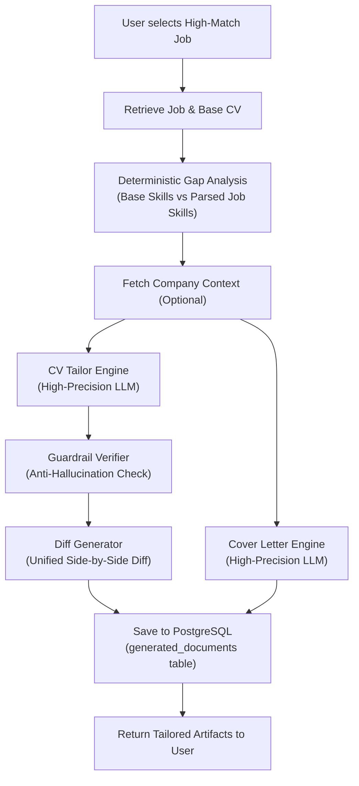

# Phase 3 Implementation Plan: AI Document Tailoring & Generation Engine

This document specifies the technical architecture, data contracts, modular abstractions, and step-by-step implementation roadmap for **Phase 3: AI Document Tailoring & Generation Engine**.

---

## 1. Executive Summary & Objective

In **Phase 2**, we built the discovery and evaluation pipeline that scrapes/fetches jobs, extracts strict JSON metrics, and computes deterministic **Fit Scores** without wasting AI tokens.

In **Phase 3**, we implement the **Conversion Engine**:
When a job is identified as a strong match, the system enables one-click generation of:
1. **A Tailored CV:** Dynamically edits the user's base CV to align with the target job's specific requirements, rephrasing bullet points and emphasizing relevant achievements without fabricating fake experience.
2. **A Targeted Cover Letter / Cold Email:** Writes a high-impact, role-specific letter using both the job description and optional company website background.
3. **An Audit Diff:** Computes a transparent diff showing exactly what changed between the base CV and tailored CV.

---

## 2. Where the LLM is Used (and Where it is NOT)

To maintain strict cost control and zero hallucinations, we draw a clear line between AI tasks and deterministic code:

| Component | Uses LLM? | Model Tier | Purpose |
| :--- | :--- | :--- | :--- |
| **CV Gap Analysis** | ❌ No (Deterministic) | N/A | Compares `ParsedJob.required_skills` against `BaseCV.extracted_skills` using Python sets to create tailoring directives. |
| **CV Tailoring Engine** | ✅ **YES** | High-Precision (e.g. Gemini 1.5 Pro / Claude 3.5 / Ollama Llama-3-70b) | Rewrites specific bullet points, summary, and skill ordering to target the job requirements. |
| **Cover Letter Generator** | ✅ **YES** | High-Precision | Crafts a personalized, engaging cover letter referencing company values, role requirements, and user proof-points. |
| **Company Enrichment Summary** | ✅ Optional (Cheap LLM) | Fast/Cheap (Gemini 1.5 Flash) | Summarizes scraped company "About" page into tone/mission keywords. |
| **Diff & Change Audit** | ❌ No (Deterministic) | N/A | Uses Python `difflib` to produce side-by-side additions and deletions. |
| **Document Rendering (PDF/TeX)** | ❌ No (Deterministic) | N/A | Compiles LaTeX or converts Markdown to final downloadable PDF. |

---

## 3. Data Models & Database Schema

We define typed contracts using `Pydantic` and `SQLModel` for PostgreSQL persistence.

```python
from enum import Enum
from typing import List, Optional, Dict, Any
from datetime import datetime
from pydantic import BaseModel, Field
from sqlmodel import SQLModel, Field as DBField

class DocumentFormat(str, Enum):
    LATEX = "latex"
    MARKDOWN = "markdown"
    TEXT = "text"

class DocumentType(str, Enum):
    TAILORED_CV = "tailored_cv"
    COVER_LETTER = "cover_letter"

# 1. Base CV Representation
class BaseCV(BaseModel):
    user_id: str
    format: DocumentFormat
    raw_content: str  # The raw LaTeX source or Markdown content
    sections: Dict[str, str] = Field(default_factory=dict) # e.g. {"experience": "...", "skills": "..."}

# 2. Company Research Context (Optional Enrichment)
class CompanyContext(BaseModel):
    company_name: str
    website_url: Optional[str] = None
    culture_summary: Optional[str] = None
    detected_tone: str = "Professional & Direct"  # "Startup casual", "Enterprise formal", etc.

# 3. CV Tailoring Request & Result
class CVTailorRequest(BaseModel):
    job_id: str
    base_cv: BaseCV
    strictness_level: str = "moderate"  # "conservative" (minor tweaks), "moderate", "aggressive" (full bullet rephrase)

class CVChangeItem(BaseModel):
    section: str
    original_text: str
    updated_text: str
    rationale: str  # e.g., "Emphasized FastAPI and Docker to match job requirements"

class CVTailorResult(BaseModel):
    job_id: str
    format: DocumentFormat
    tailored_content: str
    changes: List[CVChangeItem] = Field(default_factory=list)
    diff_unified: str

# 4. Cover Letter Request & Result
class CoverLetterRequest(BaseModel):
    job_id: str
    base_cv: BaseCV
    company_context: Optional[CompanyContext] = None
    tone: str = "confident_professional"

class CoverLetterResult(BaseModel):
    job_id: str
    subject_line: str
    body_markdown: str
    key_selling_points: List[str]

# 5. Database Persistence Entity (SQLModel for PostgreSQL)
class GeneratedDocumentDB(SQLModel, table=True):
    __tablename__ = "generated_documents"
    
    id: Optional[int] = DBField(default=None, primary_key=True)
    job_id: str = DBField(index=True)
    user_id: str = DBField(index=True)
    doc_type: str = DBField(...) # "tailored_cv" or "cover_letter"
    doc_format: str = DBField(...) # "latex" or "markdown"
    content: str = DBField(...)
    metadata_json: Optional[str] = DBField(default=None) # Serialized changes, diffs, etc.
    created_at: datetime = DBField(default_factory=datetime.utcnow)
```

---

## 4. Modular Architecture & Extensibility

Following the same SOLID / Plugin pattern established in Phase 2:

```
app/
├── ai/
│   ├── providers/          # Pluggable LLM backends (Gemini, Ollama, OpenAI)
│   │   ├── base.py
│   │   ├── gemini_provider.py
│   │   └── ollama_provider.py
│   ├── formatters/         # Format parsers/renderers (LaTeX, Markdown)
│   │   ├── base.py
│   │   ├── latex_formatter.py
│   │   └── markdown_formatter.py
│   ├── tailor/             # CV Tailoring Engine
│   │   ├── prompts.py
│   │   ├── guardrails.py   # Anti-hallucination verification
│   │   └── tailor_engine.py
│   └── cover_letter/       # Cover Letter Engine
│       ├── prompts.py
│       └── cover_letter_engine.py
```

### 4.1. LLM Provider Abstraction (`BaseLLMProvider`)
Prevents vendor lock-in. Switch seamlessly between cloud APIs (Gemini 1.5 Pro) and local self-hosted models (Ollama):

```python
class BaseLLMProvider(ABC):
    @abstractmethod
    def generate_text(self, prompt: str, system_prompt: Optional[str] = None, temperature: float = 0.2) -> str:
        pass

    @abstractmethod
    def generate_structured(self, prompt: str, schema: BaseModel, system_prompt: Optional[str] = None) -> BaseModel:
        pass
```

### 4.2. CV Formatter Abstraction (`BaseCVFormatter`)
Isolates format parsing from AI logic. Whether a user uploads a LaTeX `.tex` file or a Markdown CV:

```python
class BaseCVFormatter(ABC):
    @abstractmethod
    def parse_sections(self, raw_content: str) -> Dict[str, str]:
        """Splits CV into Experience, Skills, Education, Projects."""
        pass

    @abstractmethod
    def assemble(self, sections: Dict[str, str]) -> str:
        """Reassembles modified sections back into valid LaTeX or Markdown."""
        pass

    @abstractmethod
    def compile_to_pdf(self, content: str) -> bytes:
        """Optionally compiles document to downloadable PDF."""
        pass
```

## 5. Direct Extraction from Legacy JobFinder (`cv_fit_service.py`)

As mandated, the CV Fit module will directly port the battle-tested algorithms, prompts, and compilation engine from JobFinder (`d:\jobfinder\backend\app\domains\intelligence\cv_fit_service.py`):

### 5.1. Exactly What We Port Directly
1. **The 3-Stage Prompt Pipeline:**
   - **Stage 1 (Alignment & Gap Analysis):** Porting `_analysis_prompt` and `CV_FIT_PROMPT_SOURCES[1]`, forcing strict JSON schema (`fit_summary`, `target_keywords`, `changes_to_make`, `evidence_to_preserve`, `risks`).
   - **Stage 2 (LaTeX Rewrite):** Porting `_generation_prompt` and `CV_FIT_PROMPT_SOURCES[0]`, enforcing byte-for-byte visual template preservation, character escaping (`&`, `%`, `$`, `#`, `_`), and negative prompting against fabrication.
   - **Stage 3 (Post-Generation Review):** Porting `_review_prompt` and `CV_FIT_PROMPT_SOURCES[2]` to produce structured review notes and warnings.
2. **Template Preservation & LaTeX Sanitization Engine:**
   - `_split_latex_document`: Regex-based slicing around `\begin{document}` and `\end{document}`.
   - `_preserve_visual_template`: Keeping base preamble and trailing markup identical.
   - `_sanitize_latex_content`: Environment-aware escaping for tabular, align, and matrix blocks.
   - `_keeps_visual_structure`: Token vocabulary validation ensuring the LLM does not inject unauthorized LaTeX packages or macros.
   - `_latex_content_signature`: Comparing content hashes to detect if the LLM made actual changes or returned the base CV unmodified.
3. **Multi-Engine LaTeX Compiler:**
   - `_compile_latex`: Auto-detecting `tectonic`, `pdflatex`, `xelatex`, or `lualatex`.
   - Compatibility patching for Tectonic (handling `glyphtounicode`, `pdfgentounicode`, and `\newline` fixes).
4. **Company Context Crawler:**
   - `_crawl_company_context`: Scraping up to 4 pages on the company domain (`about`, `careers`, `team`, `mission`) to enrich the prompt context.

### 5.2. What We Modernize / Decouple
* **Storage:** Replace legacy `workflow_store` (Supabase / local JSON file) with standard Dockerized PostgreSQL (`GeneratedDocumentDB`).
* **LLM Engine:** Replace hardcoded Vertex AI calls with the modular `BaseLLMProvider` (supporting Vertex AI, Gemini 1.5, and Ollama).
* **Bloat Removal:** Drop legacy admin capability checks, manual workflows, and redundant serialization.

---

## 6. End-to-End Execution Flow



---

## 7. Phased Implementation Roadmap for Phase 3

We will implement Phase 3 in 5 structured steps:

### Step 3.1: Database Schema & Base Contracts
* Create `GeneratedDocumentDB` table in PostgreSQL.
* Set up database migrations and CRUD operations.
* Define `BaseCV`, `CVTailorResult`, and `CoverLetterResult` models.

### Step 3.2: LLM Provider & CV Formatter Plugins
* Implement `BaseLLMProvider` with Gemini / Vertex / Ollama implementations.
* Implement `BaseCVFormatter` with:
  * `MarkdownCVFormatter` (clean, portable text).
  * `LatexCVFormatter` (for high-end academic/engineering resumes, preserving LaTeX commands and macros).

### Step 3.3: The CV Tailoring Engine & Guardrails
* Craft specialized prompt templates ported and refined from the proven JobFinder logic.
* Implement structured diff generation (`CVChangeItem` and unified diff).
* Implement the anti-hallucination verification layer.

### Step 3.4: The Cover Letter & Company Research Engine
* Build the scraper/fetcher helper for company "About" pages.
* Implement the multi-tone cover letter generator (Enterprise, Startup, Direct Outreach).

### Step 3.5: FastAPI API Endpoints & Verification
* Expose endpoints:
  * `POST /api/v1/tailor/cv`
  * `POST /api/v1/tailor/cover-letter`
  * `GET /api/v1/tailor/documents/{job_id}`
* Write automated unit tests for LaTeX preservation and bullet rephrasing.
