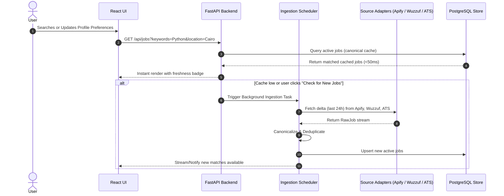

# Story 1 Implementation Plan: The Job Fetcher & Ingestion Engine

This document specifies the technical architecture, data contracts, source integrations, and operational ingestion strategies for **Story 1: The Job Fetcher / Scraper**.

---

## 1. Executive Summary & Story Context

The **Tailored** platform is structured into three foundational product stories:
1. **Story 1: The Job Fetcher & Ingestion Engine** *(This Document)* — Automated, cost-effective, fresh, and multi-source job discovery.
2. **Story 2: CV Fit & Enhancement Engine** — Deterministic multi-metric candidate evaluation and AI-driven LaTeX/Markdown document tailoring.
3. **Story 3: The Job Application Assistant** — Outreach tracking, application status monitoring, and browser-assisted submission support.

```
+-----------------------------------------------------------------------------------+
|                        STORY 1: JOB FETCHER & INGESTION                          |
|                                                                                   |
|  [LinkedIn (Apify)]      [Job Boards (Wuzzuf/API)]      [Company Careers (ATS)]   |
|         │                           │                              │              |
|         ▼                           ▼                              ▼              |
|  +─────────────────────────────────────────────────────────────────────────────+  |
|  │              Ingestion, Deduplication & Canonicalization Layer              │  |
|  +─────────────────────────────────────────────────────────────────────────────+  |
|                                     │                                             |
|                                     ▼                                             |
|  +─────────────────────────────────────────────────────────────────────────────+  |
|  │            Hot Cache & Active Jobs Store (PostgreSQL / Search)             │  |
|  +─────────────────────────────────────────────────────────────────────────────+  |
+--------------------------------------┬--------------------------------------------+
                                       │ RawJob Stream
                                       ▼
+-----------------------------------------------------------------------------------+
|                     STORY 2: CV FIT & ENHANCEMENT PIPELINE                        |
|                                                                                   |
|  Structured LLM Extractor ──► Deterministic Fit Evaluator ──► Tailored CV/Letter  |
+-----------------------------------------------------------------------------------+
```

### Core Mission of Story 1
Deliver a steady, low-latency, and zero-stale stream of high-relevance job postings across:
- **LinkedIn** (via managed Apify actors).
- **Specialized regional/global job boards** (direct HTTP scrapers for open SSR boards like Wuzzuf; fallback APIs for Cloudflare-protected boards like Indeed).
- **Direct Company Careers pages** (via an intelligent ATS direct-API adapter registry, eliminating blind web crawling).

---

## 2. Ingestion Strategy & Freshness Architecture

### 2.1. The Dilemma Analysis

| Strategy | Pros | Critical Pitfalls | Feasibility Verdict |
| :--- | :--- | :--- | :--- |
| **Option A: Hourly Global Crawling** | Always warm; jobs ready in DB. | • High Apify actor and proxy bills ($$$).<br>• DB bloated with 100k irrelevant jobs.<br>• High volume of dead/expired links within days. | ❌ **Rejected** (Wasteful unit economics) |
| **Option B: Pure On-Demand (Per Search)** | Zero storage cost; 100% live. | • 20–45 second response latency per user query.<br>• Horrible UX (user stares at spinners).<br>• Spikes API rate limits if 5 users search simultaneously. | ❌ **Rejected** (Unacceptable latency) |
| **Option C: Fetch Once on Profile Creation** | Instant on Day 1. | • Completely stale by Day 3–5.<br>• No continuous flow of newly posted positions. | ❌ **Rejected** (Incomplete lifecycle) |

---

### 2.2. The Solution: The 4-Tier Smart Hybrid Ingestion Model

To achieve **instant UI responsiveness (<50ms)**, **zero wasted API costs**, and **guaranteed freshness**, Tailored utilizes a **Demand-Driven Tiered Model**:

```
[User Onboarding] ────────► Tier 1: Profile-Triggered Initial Warm-up (Top 30 fresh jobs)
                                  │
[Daily Operation] ────────► Tier 2: Demand-Driven Cluster Sync (1-2x/day, last 24h only)
                                  │
[User Search/Filter] ─────► Tier 3: Instant Cache Read (<50ms) + Optional Background Sync
                                  │
[Job Click / Apply] ──────► Tier 4: JIT Liveness Probe + Automated Expiration Pruning
```

#### Tier 1: Proactive Profile Warm-up (Onboarding)
- When a user signs up and defines their `UserProfile` (target titles, preferred locations, core skills), the backend schedules a high-priority background ingestion task.
- Within 60–90 seconds, the user's dashboard is populated with 30–50 fresh, pre-filtered jobs.

#### Tier 2: Demand-Driven Cluster Ingestion (The Smart Cron)
- Instead of blindly crawling millions of arbitrary job titles, the system aggregates active user preferences into **Search Clusters** (e.g. `Cluster: [Backend Engineer, Python, Cairo/Remote]`).
- A lightweight cron worker runs **twice daily** (08:00 and 18:00 local time) fetching **only postings published in the last 24 hours** (`date_posted="past-24h"`).
- Inactive clusters (no user activity in > 7 days) are automatically paused to conserve compute and API quotas.

#### Tier 3: Cache-First UI with Streaming Background Refresh
- The frontend always reads immediately from the local PostgreSQL hot pool:
  - Response time: **< 50ms**.
  - Shows clear UX metadata: *"Last updated 2 hours ago"*.
- If the cached pool for a specific query has fewer than 10 matches or the user explicitly clicks *"Check for New Jobs"*, the system fires a non-blocking background fetcher and streams newly discovered jobs via SSE / WebSocket or responsive polling.

#### Tier 4: JIT Liveness & Expiration Pruning Engine
- **Time-to-Live (TTL):** Postings older than 14 days without an update are automatically marked `is_active = False`.
- **Just-in-Time (JIT) Liveness Probe:** When a user opens a job modal or clicks *"Tailor CV"*, the backend initiates a lightning-fast HTTP `HEAD` or lightweight `GET` request to the target URL:
  - If the page returns `404`, `301 -> careers/expired`, or contains known closed banners (*"This job has expired"*, *"No longer accepting applications"*), the job is flagged `is_closed = True` and removed from active feeds.
- **Crowdsourced Flagging:** A 1-click *"Report as closed"* action on the UI enables users to immediately mark obsolete listings.

---

## 3. Source Breakdown & Technical Architecture

```
                                  +──────────────────────────+
                                  |    BaseJobSource (ABC)   |
                                  +─────────────┬────────────+
                                                │
         ┌──────────────────────────────────────┼──────────────────────────────────────┐
         ▼                                      ▼                                      ▼
+───────────────────+                  +───────────────────+                  +───────────────────+
| ApifyLinkedInSource|                  |  WuzzufScraper     |                  | CompanyATSSource  |
| (Apify Actor API) |                  |  (httpx / parser) |                  | (Direct JSON APIs)|
+───────────────────+                  +───────────────────+                  +───────────────────+
         │                                      │                                      │
         │ (Fallback API)                       │ (Fallback API)                       │ (Fallback Crawler)
         ▼                                      ▼                                      ▼
+───────────────────+                  +───────────────────+                  +───────────────────+
| RapidAPI / JSearch|                  | RapidAPI / Indeed |                  | CompanyCrawler    |
| (Indeed/Glassdoor)|                  | (Cloudflare bypass|                  | (Deep link scrape)|
+───────────────────+                  +───────────────────+                  +───────────────────+
```

---

### 3.1. Source 1: LinkedIn (via Apify Actor API)

#### Rationale
LinkedIn enforces extreme anti-bot security: TLS fingerprinting, browser challenges, canvas detection, and session-based IP bans. Maintaining in-house headless browsers for LinkedIn creates constant maintenance overhead. Apify's managed actors handle rotating residential proxies, CAPTCHA solutions, and session pools reliably.

#### Integration Architecture
- **Actor Provider:** Apify Actor (e.g. `curious_coder/linkedin-jobs-scraper` or `bebity/linkedin-jobs-scraper`).
- **Communication Pattern:** Asynchronous execution with Webhook callback.
  1. FastAPI triggers actor run via Apify REST API:
     `POST https://api.apify.com/v2/acts/{ACTOR_ID}/runs?token={APIFY_TOKEN}`
  2. Apify processes the run with query constraints:
     - `searchTerms`: e.g. `["Full Stack Developer"]`
     - `location`: e.g. `"Cairo, Egypt"` or `"Remote"`
     - `datePosted`: `"past-24h"` (limits token consumption)
     - `maxItems`: `25 - 50` per cluster
  3. Apify hits our webhook endpoint upon completion:
     `POST /api/v1/webhooks/apify/linkedin`
  4. The webhook worker pulls the dataset items via `datasetId`, transforms them into standardized `RawJob` objects, and inserts them into the pipeline.

#### Cost & Rate Management
- Restricting queries to `past-24h` and `maxItems=30` keeps compute run durations under 30–45 seconds.
- Approximate cost: **~$0.002 to $0.005 per query run**, making twice-daily cluster syncs cost-effective.

---

### 3.2. Source 2: Job-Specialized Websites (Wuzzuf, Indeed & Regional Boards)

We split specialized job boards into **Scrapable** (open SSR / standard HTML) and **Unscrapable** (heavy Cloudflare Turnstile / Bot Guards):

#### A. Scrapable Boards: Wuzzuf & Open Boards (Direct HTTP Engine)
- **Target:** **Wuzzuf** (the primary white-collar job portal in Egypt and Levant) + Remote boards (e.g. RemoteOK, Jobicy).
- **Architecture:** Zero-browser, direct asynchronous HTTP client using `httpx` or `curl_cffi` (impersonating Chrome TLS 1.3 fingerprints) combined with `BeautifulSoup` or `selectolax` (C-based ultra-fast parser).
- **Execution Cost:** **$0.00 (Free)**. Executes in < 400ms per page.
- **Workflow:**
  1. Fetch search page: `https://wuzzuf.net/search/jobs/?q={keywords}&a=hpb`
  2. Parse job cards (`title`, `company`, `location`, `job_url`, `posted_time`).
  3. Fetch raw job description HTML for cards not already cached in DB.
  4. Emit standard `RawJob` instance.

#### B. Unscrapable Boards: Indeed & Glassdoor (API Aggregators)
- **Problem:** Indeed employs Cloudflare Turnstile, browser validation, and aggressive IP rate limiting. Self-hosted scrapers suffer from high failure rates.
- **Solution:** Utilize API aggregators for Indeed data:
  - **Option 1: RapidAPI JSearch API:** Aggregates Indeed, LinkedIn, ZipRecruiter, and Glassdoor in a single unified JSON schema. Cost: Free tier (500 requests/mo), then ~$10/10,000 requests.
  - **Option 2: Apify Indeed Scraper:** Standby actor fallback triggered only when specific location/title coverage is sparse.

---

### 3.3. Source 3: Company Careers Pages (The Anti-Blind Crawling Plan)

> [!IMPORTANT]
> **Why Blind Web Crawling Fails:**
> Blindly querying Google Search or traversing the entire web with open scrapers to locate company job listings is slow, fragile, yields broken sub-links, and consumes unnecessary LLM extraction tokens on arbitrary HTML structures.

#### The 3-Pillar Company Job Strategy

#### Pillar 1: The Modern ATS Direct API Adapter (The 80/20 Superpower)
Over 80% of top tech startups and multinational companies do not build bespoke career portals from scratch. They host their job feeds on standard **Applicant Tracking Systems (ATS)** that expose **public, unauthenticated, zero-cost JSON APIs**:

| ATS Platform | Endpoint Pattern | Response Format |
| :--- | :--- | :--- |
| **Greenhouse** | `https://boards-api.greenhouse.io/v1/boards/{company_token}/jobs?content=true` | Full structured JSON with title, location, content, departments. |
| **Lever** | `https://api.lever.co/v0/postings/{company_token}?mode=json` | Full structured JSON with requirements, categories, descriptions. |
| **Ashby** | `https://api.ashbyhq.com/posting-api/job-board/{company_token}` | Clean JSON API used by modern tech startups. |
| **SmartRecruiters**| `https://api.smartrecruiters.com/v1/companies/{company_token}/postings` | Official public posting API. |
| **Workable** | `https://apply.workable.com/api/v1/widget/accounts/{company_token}` | JSON feed of open roles. |

**Result:** Zero HTML parsing, zero anti-bot challenges, instantaneous data retrieval, and 100% structured career data directly from the employer.

#### Pillar 2: Curated Company & ATS Registry
We maintain a seed table `companies` containing the top 200–500 target employers across the Egypt/MENA ecosystem (e.g. *Instabug, Swvl, Valeo, Fawry, Vodafone, Paymob, Talabat, Noon, Careem*) and top global remote tech companies:

```python
class CompanyRegistry(SQLModel, table=True):
    id: Optional[int] = Field(default=None, primary_key=True)
    name: str = Field(index=True)
    domain: str
    ats_provider: str          # "greenhouse", "lever", "ashby", "workable", "custom"
    ats_identifier: str        # e.g. "instabug", "swvl"
    careers_url: str
    is_active_monitoring: bool = True
    last_synced_at: Optional[datetime] = None
```

- A scheduled worker polls each company's ATS endpoint once every 24–48 hours.
- If a new job matches active search profiles, it is immediately ingested.

#### Pillar 3: On-Demand User "Target Company" Watchlist
- Users can specify custom target companies (e.g. *"I want to watch jobs at Stripe, Fawry, and Bosta"*).
- If the company is already registered in `companies`, their open listings sync immediately.
- If it is a new company, the backend performs **Automated ATS Detection**:
  1. Inspects the target company's domain careers link.
  2. Matches redirect or iframe patterns (`boards.greenhouse.io`, `jobs.lever.co`, `ashbyhq.com`).
  3. Extracts the token and stores it in `CompanyRegistry` for continuous automated monitoring.
  4. If the company uses a custom, non-ATS site, the existing `CompanyCrawler` scrapes the `/careers` page as a fallback.

---

## 4. Normalization, Deduplication & Storage

### 4.1. Cross-Source Deduplication Problem
The exact same job opening (e.g. *"Senior Python Developer at Vodafone"*) is frequently published across LinkedIn, Wuzzuf, and Vodafone's direct career portal simultaneously. Storing redundant copies degrades search quality and wastes user attention.

### 4.2. Canonical Hashing & Similarity Matcher
Before persisting any incoming `RawJob`, the ingestion pipeline computes a **Canonical Deduplication Fingerprint**:

```
normalized_company = clean_name(company_name)   # "Vodafone Egypt S.A.E" -> "vodafone"
normalized_title   = clean_title(title)          # "Sr. Python Dev (Remote)" -> "senior python developer"
normalized_loc     = clean_location(location)    # "Cairo, EG" -> "cairo"

canonical_hash = sha256(f"{normalized_company}:{normalized_title}:{normalized_loc}")
```

#### Deduplication Rules:
1. **Identical Hash Match:**
   - If a record with `canonical_hash` already exists in `jobs`:
   - Append the new source URL to the existing job's `source_links` JSON list (e.g. *View on LinkedIn | View on Wuzzuf*).
   - Update `last_seen_at = now()`.
   - Do **NOT** duplicate the record in the database.
2. **Text Jaccard / Fuzzy Similarity (Optional Fallback):**
   - If titles differ slightly (e.g. *"Python Engineer"* vs *"Software Engineer - Python"* at the same company on the same day), fuzzy token comparison merges them under the primary posting.

---

## 5. Database Schema & Data Models

### 5.1. Domain & Database Models (`backend/app/models/job.py` Extension)

```python
from datetime import datetime, timezone
from typing import List, Optional, Dict, Any
from enum import Enum
from pydantic import BaseModel, Field as PydanticField
from sqlmodel import SQLModel, Field as DBField, Column, JSON

def utc_now() -> datetime:
    return datetime.now(timezone.utc)

class SourceType(str, Enum):
    LINKEDIN_APIFY = "linkedin_apify"
    WUZZUF_SCRAPER = "wuzzuf_scraper"
    INDEED_API = "indeed_api"
    COMPANY_ATS = "company_ats"
    COMPANY_CRAWLER = "company_crawler"

# --- Raw Ingestion Contract ---

class RawJob(BaseModel):
    source_type: SourceType
    source_id: str                      # Identifier from source (e.g. linkedin_1234, wuzzuf_5678)
    title: str
    company_name: str
    location: str
    url: str
    raw_description: str
    posted_at: Optional[datetime] = None
    source_metadata: Dict[str, Any] = PydanticField(default_factory=dict)

# --- Database Tables ---

class JobDB(SQLModel, table=True):
    __tablename__ = "jobs"

    id: Optional[int] = DBField(default=None, primary_key=True)
    canonical_hash: str = DBField(index=True, unique=True)
    primary_source: SourceType = DBField(index=True)
    source_id: str = DBField(index=True)
    
    title: str = DBField(index=True)
    company_name: str = DBField(index=True)
    location: str = DBField(index=True)
    primary_url: str
    
    # Alternative URLs if found across multiple sources (e.g. [{"source": "wuzzuf", "url": "..."}])
    alternate_urls_json: Optional[str] = DBField(default=None)
    
    raw_description: str
    parsed_job_json: Optional[str] = None       # Populated by Phase 2 LLM Extractor
    
    # Freshness & Status Flags
    is_active: bool = DBField(default=True, index=True)
    posted_at: Optional[datetime] = None
    first_seen_at: datetime = DBField(default_factory=utc_now)
    last_verified_at: datetime = DBField(default_factory=utc_now)
    expires_at: Optional[datetime] = None

class SearchClusterDB(SQLModel, table=True):
    """Tracks active keyword/location clusters demanded by active users."""
    __tablename__ = "search_clusters"

    id: Optional[int] = DBField(default=None, primary_key=True)
    query_key: str = DBField(unique=True, index=True)   # e.g. "software engineer:cairo:remote"
    keywords: str                                       # Comma-separated or JSON
    location: str
    active_subscriber_count: int = DBField(default=1)
    last_synced_at: Optional[datetime] = None
    is_active: bool = DBField(default=True, index=True)
```

---

## 6. End-to-End Ingestion Flow



---

## 7. Implementation Roadmap & Milestones

### Milestone 1: Modular Source Adapters (`backend/app/scrapers/`)
- [ ] Implement `ApifyLinkedInSource` using Apify REST API client and webhook listener.
- [ ] Implement `WuzzufScraperSource` using asynchronous `httpx` + `selectolax` parser.
- [ ] Implement `CompanyATSSource` supporting Greenhouse (`boards-api.greenhouse.io`) and Lever (`api.lever.co`) public JSON feeds.
- [ ] Implement canonical hash generator (`compute_canonical_hash(raw_job)`).

### Milestone 2: Demand-Driven Ingestion Worker & Hot Pool
- [ ] Create `SearchClusterDB` management logic (auto-grouping user target titles into distinct clusters).
- [ ] Implement differential sync worker (`sync_cluster_delta(cluster, time_window="24h")`).
- [ ] Add deduplication upsert logic in PostgreSQL.

### Milestone 3: Liveness Verification & Expiration Cleaner
- [ ] Implement background TTL cleaner (deactivates postings older than 14 days).
- [ ] Implement JIT HTTP probe (`verify_job_liveness(url)`):
  - Returns boolean status before document generation or modal expansion.
  - Updates `is_active` and `last_verified_at`.
- [ ] Add `/api/jobs/{id}/report-closed` endpoint for user-driven feedback.

### Milestone 4: Frontend Discovery UI & Real-Time Sync Badges
- [ ] Update Job Finder UI to display source badges (*"LinkedIn"*, *"Wuzzuf"*, *"Direct ATS"*).
- [ ] Add "Last updated X ago" indicator and 1-click *"Refresh Recent Jobs"* button.
- [ ] Display verified freshness status tags (*"Verified Active"*, *"Closing Soon"*).

---

## 8. Summary Comparison of Product Stories

| Aspect | **Story 1: Job Fetcher** | **Story 2: CV Fit & Enhancer** | **Story 3: Application Assistant** |
| :--- | :--- | :--- | :--- |
| **Primary Goal** | Continuous ingestion of fresh, non-duplicate jobs. | Strict metric scoring and tailored document diffs. | Application tracking and submission copilot. |
| **AI Utilization** | **Zero AI** (purely deterministic HTTP/APIs). | **Targeted LLM** (JSON extraction & LaTeX rewriting). | **Contextual LLM** (Cold emails & cover letters). |
| **Latency Target** | < 50ms read / background async ingestion. | 2–5s per CV generation. | Real-time interactive UI. |
| **Output** | High-signal, fresh `JobDB` records. | Tailored `.tex`/`.pdf` CVs and cover letters. | Application logs, outreach messages, and statuses. |
