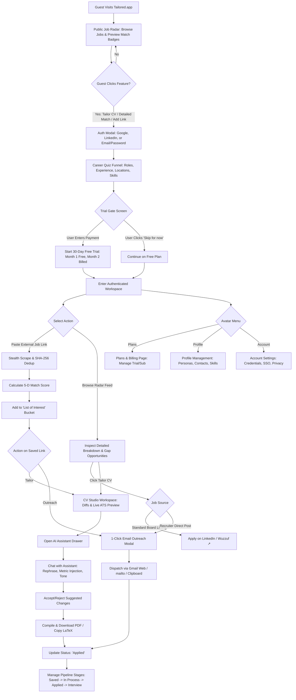

# Tailored — Comprehensive UX Redesign Specification & User Stories
**Document Version:** 2.0.0  
**Target Date:** November 2026  
**Status:** Approved Master Architecture & UX Blueprint  
**System Identity:** Candidate-First Career Copilot & AI ATS Engineering Platform  

---

## 1. Executive Summary & Design Philosophy

**Tailored** is an AI-powered job discovery and application platform built exclusively for **job seekers**. Unlike legacy Applicant Tracking Systems (ATS) or recruiter platforms that optimize for filtering out candidates, Tailored acts as an **intelligent candidate copilot**:
* **Zero Disqualification / Zero Dropped Jobs:** We never eliminate candidates. We rank and score opportunities against the candidate's verified baseline, turning qualification gaps into actionable tailoring strategies.
* **Value-First Discovery (Freemium Public Experience):** Guests can freely explore live jobs and see platform capabilities without friction. High-value actions trigger an intuitive, multi-step onboarding funnel.
* **Frictionless Conversion:** Sign-up is fast (Social OAuth / Email), followed by a focused career quiz funnel, an optional free trial prompt with an explicit **"Skip for now"** escape hatch, and persistent free browsing.
* **AI-Augmented Execution:** The CV Studio features an interactive, conversational AI Assistant to help candidates refine bullets, adapt tone, and guarantee zero-hallucination ATS alignment.

---

## 2. Complete User Stories & Functional Epics

```
┌────────────────────────────────────────────────────────────────────────────────────────────────────────┐
│                                       GLOBAL WORKSPACE NAVIGATION                                      │
├─────────────────────┬───────────────────┬───────────────────┬────────────────────┬─────────────────────┤
│   1. Public Radar   │  2. Interest List │   3. CV Studio    │    4. Pipeline     │ 5. Account/Settings │
│    & Job Search     │  (Pasted Links)   │   (AI Assistant)  │   & Outreach Hub   │  (Plans, Profile)   │
└─────────────────────┴───────────────────┴───────────────────┴────────────────────┴─────────────────────┘
```

---

### Epic 1: Public Job Discovery & Feature Showcase (Guest Experience)

#### User Narrative:
> *"As a curious job seeker, I want to explore live job postings from LinkedIn and Wuzzuf and preview Tailored's features without being blocked by an immediate forced registration, so that I can see the platform's value first."*

#### UX & Interaction Flow:
1. **Public Radar Feed:**
   - Guest visits `https://tailored.app/` or opens the app.
   - Guest sees a curated, live feed of jobs (scraped from LinkedIn and Wuzzuf) filtered by popular roles (e.g., Software Engineering, Data Science, Product).
   - Each job card shows: Job Title, Company Name, Location, Source Badge, and a **Sample Match Badge** (e.g., *"Preview Match: 88%"*).
2. **Feature Showcase Teasers:**
   - Visitors can read full job descriptions, see required technical skills pills, and view mockups of tailored bullet diffs.
3. **The Feature Gate (Triggering Onboarding):**
   - When a guest clicks any high-value interactive action:
     - `[Tailor My CV]`
     - `[View Detailed Fit Breakdown]`
     - `[Paste Job Link / Add to Interest]`
     - `[Send Recruiter Outreach]`
     - `[Save to Pipeline]`
   - The app preserves the user's intent (e.g., target job ID) and seamlessly launches the **Auth & Onboarding Funnel Modal** (Epic 2).

---

### Epic 2: Authenticated Onboarding Funnel & Trial Gate

#### User Narrative:
> *"As a prospective user, I want a frictionless sign-up process that captures my career context and lets me test the premium features with a free trial or continue on a free plan without entering credit card details if I prefer."*

#### Step-by-Step UX Funnel:

```
┌─────────────────┐       ┌─────────────────┐       ┌─────────────────┐       ┌─────────────────┐
│   Step 1: Auth  │ ───►  │  Step 2: Quiz   │ ───►  │ Step 3: 1-Month │ ───►  │ Step 4: Product │
│ (OAuth / Email) │       │  Career Funnel  │       │   Free Trial    │       │  Ready & Scored │
└─────────────────┘       └─────────────────┘       └────────┬────────┘       └─────────────────┘
                                                             │
                                                    [Skip for Now Button]
                                                             │
                                                             ▼
                                                    ┌─────────────────┐
                                                    │ Continue on the │
                                                    │    Free Tier    │
                                                    └─────────────────┘
```

#### Screen 2.1: Essential Credentials & Social Sign-Up
- **Clean Modal / Card Design:** Headline: *"Unlock Your Personal Career Copilot"*.
- **1-Click Social Sign-In:**
  - `[Continue with Google]` (Google OAuth 2.0).
  - `[Continue with LinkedIn]` (LinkedIn OAuth 2.0 — auto-imports name, email, and headline).
- **Email Alternative:**
  - Full Name, Email Address, Password (with real-time strength meter).
- **Terms & Privacy Checkbox:** Pre-selected privacy guarantee (*"Your data is never sold or used for recruiter screening"*).

#### Screen 2.2: The Career Quiz Funnel (Progressive Profile Builder)
A lightweight 4-slide interactive questionnaire designed to take $< 90$ seconds:
1. **Target Roles & Personas:**
   - Candidate inputs primary target job title (e.g., *"Senior Data Scientist"*) and secondary track (e.g., *"Machine Learning Engineer"*).
2. **Experience & Seniority:**
   - Years of experience slider ($0\text{ to }15+\text{ years}$) and seniority radio tags (`Junior`, `Mid-Level`, `Senior`, `Lead / Staff`, `Manager`).
3. **Target Locations & Mobility:**
   - Primary City (e.g., *Cairo*, *Riyadh*, *Dubai*, *London*).
   - Work mode toggles (`Remote`, `Hybrid`, `On-site`).
   - Regional phone numbers registry (`+20 Egypt`, `+966 Saudi Arabia`, `+971 UAE`, `+1 US/Global`).
4. **Core Technical Skills & CV Ingestion:**
   - Option A: Drop zone to upload existing CV (`.pdf`, `.tex`, `.docx`) $\rightarrow$ background parser automatically populates skills and experience.
   - Option B: Interactive skill picker chips categorized by domain (Languages, Frameworks, Cloud/DevOps, Databases).

#### Screen 2.3: Free Trial & Subscription Gate (With Explicit Skip)
- **Value Proposition Card:**
  - *"Start Your 30-Day Free Trial"*
  - *"Month 1: $0.00 (Completely Free) • Month 2: $19.99/mo (Cancel anytime in 1 click)"*
  - Key perks highlighted:
    - Unlimited Surgical CV Tailoring & LaTeX/PDF downloads.
    - Full Conversational AI Assistant in CV Studio.
    - Automated daily sweeps across LinkedIn and Wuzzuf.
    - 1-Click direct Recruiter Outreach via Gmail / mailto.
- **Payment Setup Form:** Stripe / Paddle credit card input with 256-bit encryption badge.
- **The Escape Hatch (Prominent Skip Action):**
  - Text button clearly styled beneath the primary button:  
    👉 **`[Skip for now & continue with Free Plan]`**
  - Clicking `Skip`: Activates the Free Plan (up to 3 tailored CVs/month, public job searches, standard fit scoring), immediately routing the user back to the job they originally clicked.

---

### Epic 3: External Job Link Pasting & "List of Interest"

#### User Narrative:
> *"As a candidate searching for jobs across external sites, I want to paste any job link directly into Tailored so that the system scrapes the details, scores my match, and saves it to my dedicated 'List of Interest' for immediate or future tailoring."*

#### Key Characteristics & UX Flow:
1. **Dedicated "Add to Interest" Omni-Bar / Modal:**
   - Located prominently on the navigation header and on the "List of Interest" page.
   - Input field: *"Paste any job posting URL (LinkedIn, Wuzzuf, Greenhouse, Lever, etc.)"*.
2. **Asynchronous Scraping & Normalization:**
   - Upon submission, a subtle status spinner appears:  
     *"Fetching job specifications and requirements via stealth crawler..."*
   - Calls `POST /api/v1/jobs/ingest-url`.
   - Uses Apify LinkedIn actors or the Wuzzuf deep scraper to capture the full job description.
   - Applies canonical SHA-256 deduplication to prevent double-entry.
3. **Automatic Fit Evaluation:**
   - Evaluates the fetched job against the candidate's active persona.
   - Generates a fit score percentage and extracts mandatory skills.
4. **The "List of Interest" Page / View:**
   - A dedicated tab in the navigation: `List of Interest` (with a badge counter, e.g. `📌 5 Saved`).
   - Visual cards showing:
     - Company Name, Title, and Domain.
     - Source tag (`External Link Paste`).
     - Real-time Match Score badge (`89% High Fit`).
     - Recruiter contact info (if extracted from LinkedIn post).
     - Action buttons:
       - `[⚡ Tailor CV in Studio]` (Routes directly to CV Studio with this job pre-loaded).
       - `[✉ Dispatch Outreach]` (If email exists).
       - `[Move to Active Pipeline]`.
       - `[Remove]`.

---

### Epic 4: Job Match Scoring & Feed Ranking (Candidate Copilot)

#### User Narrative:
> *"As a candidate, I want to understand exactly why I match an opportunity across skills, experience, and projects so that I can prioritize where to spend my application effort."*

#### UX Breakdown:
1. **5-Dimensional Radial Score Card ($0\text{--}100\%$):**
   - **Technical Skills Overlap (35%):** Mandatory vs. nice-to-have skill intersection.
   - **Role & Title Alignment (20%):** Proximity between job title and active persona.
   - **Experience Proximity (20%):** Continuous seniority curve (no binary elimination).
   - **Project Relevance (15%):** Proof-of-work alignment from past achievements.
   - **Location Fit (10%):** Commute / relocation / remote compatibility.
2. **Best-Fit Persona Selector:**
   - When candidate has multiple personas (e.g. *Senior Fullstack* vs. *Backend Engineer*), the UI shows:  
     *"Best Matched with: Backend Systems Track (91%) vs Fullstack Track (76%)"*.
3. **Tailoring Guidance Box:**
   - Actionable framing: Replaces negative rejection notices with strategic guidance:  
     *"Role emphasizes PostgreSQL clustering; highlight your Swvl database scaling project to offset stated years requirement."*

---

### Epic 5: CV Studio with Conversational AI Assistant

#### User Narrative:
> *"As a candidate preparing to apply, I want to inspect surgical ATS diffs of my CV and chat with an interactive AI Assistant in real time to refine my bullet points, adapt my tone, and guarantee zero hallucinations before compiling my PDF."*

#### Layout & Interaction Blueprint:

```
┌──────────────────────────────────────────────────────────────────────────────────────────────────┐
│                                       CV STUDIO WORKSPACE                                        │
├───────────────────────────────┬──────────────────────────────────┬───────────────────────────────┤
│    LEFT: Tailored Documents   │     CENTER: ATS Live Canvas      │     RIGHT: AI CV Assistant    │
│            History            │         & Surgical Diffs         │         Chat Drawer           │
├───────────────────────────────┼──────────────────────────────────┼───────────────────────────────┤
│ • Swvl - Lead Data Scientist  │ [Diffs]  [PDF Preview]  [LaTeX]  │ 🤖 Assistant Active           │
│   (94% Match • Just now)      │ ──────────────────────────────── │ "I tailored 4 bullets for     │
│ • Noon - Senior AI Engineer   │ - Led backend API refactoring    │ Swvl's dynamic pricing stack."│
│   (88% Match • 2 days ago)    │ + Architected Swvl pricing API   │                               │
│ • Vodafone - ML Engineer      │   with FastAPI & PyTorch [NEW]   │ Prompt Chips:                 │
│   (91% Match • 1 week ago)    │ ──────────────────────────────── │ [Make bullet 2 more metric]   │
│                               │ Action Bar:                      │ [Rephrase summary for lead]   │
│ [+ New Tailored Draft]        │ [Download PDF] [Copy TeX Source] │ [Check zero-hallucinations]   │
└───────────────────────────────┴──────────────────────────────────┴───────────────────────────────┘
```

#### Feature Details:
1. **Interactive Center Canvas:**
   - **Tab 1: Surgical Bullet Diffs:** Red strikethroughs for replaced generic phrasing, green highlights for targeted skills and quantified metrics.
   - **Tab 2: ATS Document Live Preview:** High-fidelity document rendering matching standard executive ATS LaTeX templates.
   - **Tab 3: Raw LaTeX Source:** Editable Monaco/code editor with syntax validation.
2. **Conversational AI Assistant (Right Drawer):**
   - **Interactive Chat Interface:** The user can type custom instructions:
     - *"Can you rewrite my Swvl project bullet to emphasize latency reduction under 50ms?"*
     - *"Tone down the executive summary to sound more like a hands-on individual contributor."*
     - *"Add my Docker and PostgreSQL experience into the first achievement."*
   - **One-Click Quick Action Prompt Chips:**
     - `[Quantify Metrics with Numbers]`
     - `[Inject Missing Job Keywords]`
     - `[Condense to 1 ATS Page]`
     - `[Audit for Hallucinations]`
   - **Inline Diff Approvals:** When the assistant proposes changes, it shows a mini-diff with `[Accept]` or `[Discard]` buttons that immediately update the central canvas.
3. **Export Actions:**
   - `[Download ATS PDF]` (triggers server-side tectonic/pdflatex compilation).
   - `[Copy LaTeX Code]` (copies clean, un-nested TeX source to clipboard).

---

### Epic 6: Application Pipeline & Direct Outreach Engine

#### User Narrative:
> *"As a candidate actively applying, I want a unified pipeline to track my applications and dispatch 1-click personalized emails to recruiters with attached tailored documents."*

#### Funnel Status Lifecycle:
1. `saved`: Added from Radar or Interest List for future review.
2. `in_process`: Tailored in CV Studio or cover letter drafted; ready for dispatch.
3. `applied`: Outreach email sent or applied on external site.
4. `interview`: Recruiter responded / screening scheduled.
5. `archived`: Completed cycle.

#### Outreach Dispatch Modal:
- Recruiter email pre-populated.
- Subject line auto-formatted: `Application for {Role} - {Candidate Name}`.
- Body pre-loaded with contextual cover letter pitch.
- Attached ATS CV download verified.
- **Dispatch Buttons:**
  - `[Open in Gmail Web ↗]` (launches formatted Gmail compose window).
  - `[Open in Default Mail Client ✉]` (`mailto:` link).
  - `[Copy Full Email to Clipboard 📋]`.
  - `[Mark as Applied & Advance Stage]`.

---

### Epic 7: Dedicated Plans & Subscription Page (`/plans`)

#### User Narrative:
> *"As a user, I want a transparent view of available plans, my current trial status, and billing intervals so that I can manage my investment in my job search."*

#### UI Layout & Structure:
1. **Trial Countdown Banner (if active):**
   - E.g., *"Free Trial Active — 26 days remaining. Next billing date: December 10, 2026 ($19.99/mo)."*
   - Action: `[Manage Payment Method]` or `[Cancel Subscription]`.
2. **Plan Comparison Grid:**

| Plan Feature | Free Plan ($0/mo) | Pro Copilot ($19.99/mo) | Career Accelerator ($39.99/mo) |
| :--- | :---: | :---: | :---: |
| **Job Search & Radar** | Unlimited LinkedIn/Wuzzuf | Unlimited + Auto-Sweeps | Unlimited + Early Access |
| **Job Link Pasting (Interest List)** | Up to 10 active | Unlimited | Unlimited |
| **CV Tailoring Engine** | 3 documents / month | Unlimited Tailoring | Unlimited Tailoring |
| **CV Studio AI Assistant** | ❌ Not included | ✅ Full Conversational AI | ✅ Priority Ultra Models |
| **Recruiter Email Outreach** | Manual copy only | 1-Click Gmail Dispatch | 1-Click + Follow-up Tracker |
| **Career Personas** | 1 Persona | Up to 5 Personas | Unlimited Personas |
| **Regional Phone Registry** | 1 Country | Multi-Country (`+20`, `+966`, `+971`) | Multi-Country + Virtual SIMs |

3. **Billing Cycle Switcher:** Toggle `Monthly` vs. `Annually (Save 25%)`.
4. **FAQ Section:** Common questions on cancellation, zero recruiter data sharing, and ATS compliance.

---

### Epic 8: Dedicated Profile Management Page (`/profile`)

#### User Narrative:
> *"As a candidate, I want a dedicated dashboard to maintain my career master profile, manage multiple personas, configure regional contacts, and update skills without opening a wizard modal."*

#### UI Layout & Structure:
- **Left Navigation Sub-Tabs:**
  1. `Career Personas` (Manage multiple tracks: Data Scientist, AI Engineer, Backend).
  2. `Personal Info & Links` (Name, emails, LinkedIn, GitHub, Portfolio).
  3. `Regional Contacts` (Registry of phone numbers with country flags and labels).
  4. `Locations & Mobility` (Current residence, relocation preferences, target cities).
  5. `Skills Taxonomy` (Categorized drag-and-drop skills list).
  6. `Experience & Projects` (Chronological history with quantifiable achievements and stack tags).
  7. `Education & Certifications` (Degrees, issuers, credential links).
  8. `Raw CV Re-Upload` (Drop a new PDF/TeX file to update the master record).
- **Persistent Save Bar:** Shows `[Unsaved Changes]` warning and `[Save Changes]` button.

---

### Epic 9: Dedicated Account Management & Security Page (`/account`)

#### User Narrative:
> *"As a registered user, I want to manage my security credentials, connected Google/LinkedIn accounts, notifications, and export or delete my data at will."*

#### UI Layout & Structure:
- **Sub-Sections:**
  1. **Account Credentials:**
     - Change email address.
     - Change password (current password, new password, confirm).
     - Two-Factor Authentication (2FA) toggle.
  2. **Connected Social Accounts:**
     - Google SSO: `Connected as mostafa@gmail.com [Disconnect]`.
     - LinkedIn SSO: `Connected as linkedin.com/in/mostafa [Disconnect]`.
  3. **Notification Preferences:**
     - `Email me when a 90%+ match job is found` (Daily digest vs. Instant).
     - `Follow-up reminders for applications over 7 days old`.
  4. **Data Ownership & Privacy:**
     - `[Export All Data (JSON / TeX)]` (GDPR compliance).
     - `[Delete Account & Erase All Records]` (Irreversible red button).

---

## 3. Global Information Architecture & Navigation

```
┌────────────────────────────────────────────────────────────────────────────────────────┐
│ TOP BAR: [Logo: Tailored]  [Active Persona Pill ▼]  [Omni-Search Bar]  [Upgrade/Trial] │
│ RIGHT:   [📌 Interest (5)]  [⚡ Studio]  [📋 Pipeline (3)]  [👤 Avatar Menu ▼]          │
└────────────────────────────────────────────────────────────────────────────────────────┘
```

### Avatar Menu Dropdown:
- **Profile Management** $\rightarrow$ `/profile`
- **Subscription & Plans** $\rightarrow$ `/plans`
- **Account & Security** $\rightarrow$ `/account`
- *Divider*
- **Sign Out**

---

## 4. End-to-End User Flowchart



---

## 5. Sprint 1 Execution Plan (Prioritization & Scope)

To execute this UX redesign efficiently, work is structured into immediate Sprint 1 deliverables versus subsequent phases:

### Sprint 1 Scope (The Core Value Loop + Gate):
1. **Public Radar & Feature Gate (`App.tsx` & `JobRadarPage.tsx`):**
   - Enable unauthenticated guest browsing on the job radar.
   - Attach feature-gate modal triggers to `[Tailor CV]` and `[Detailed Breakdown]`.
2. **Simplified Auth & Quiz Funnel Modal (`AuthQuizModal.tsx`):**
   - Step 1: Sign up (Google / Email).
   - Step 2: 3-step quick quiz (Target title, seniority, locations, skills).
   - Step 3: Free trial prompt with a clear **`[Skip for now & continue free]`** button.
3. **Dedicated "Add to Interest" Story (`InterestListPage.tsx`):**
   - Independent URL paste input that ingests external links, deduplicates them, and stores them in a dedicated **List of Interest** view.
4. **CV Studio AI Assistant Panel (`CVStudioPage.tsx` & `StudioAIAssistant.tsx`):**
   - Right-side conversational drawer with quick action chips (`[Quantify]`, `[Tailor to Swvl]`, `[Verify Hallucinations]`) wired to Gemini Flash.

### Sprint 2 Scope (Account & Settings Expansion):
1. Dedicated `/plans` page with Stripe/Paddle checkout integration.
2. Dedicated `/profile` management page replacing the heavy modal wizard for existing users.
3. Dedicated `/account` page for security credentials, connected Google/LinkedIn accounts, and data export.
4. Full Application Pipeline Kanban board with multi-country phone number selection.

---

## 6. Verification & Quality Guardrails

1. **Zero Hallucination Standard:**
   - The AI Assistant in CV Studio is strictly bounded by the candidate's verified master profile facts. It may rephrase, reorganize, or emphasize keywords, but must never invent employers, degrees, or unverified skills.
2. **LaTeX Rendering Safety:**
   - Single-line overflow rule: Never wrap summary text in `\text{...}` inside `\begin{justify}`.
   - Clean, escaping of `%`, `&`, and `_` characters in all generated LaTeX outputs.
3. **Conversion Transparency:**
   - The free trial skip button must remain prominent and non-deceptive to maintain user trust and avoid conversion drop-off.

