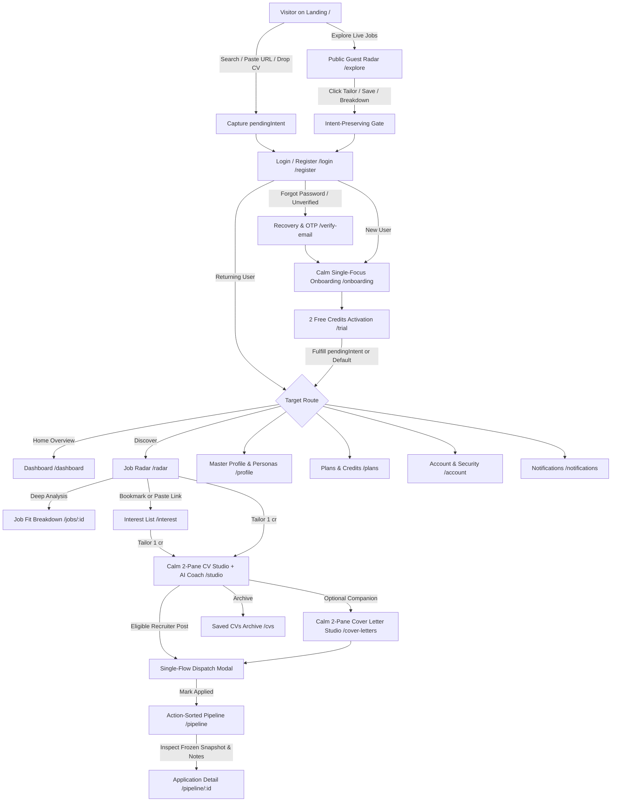

# Tailored — Complete Pure-UX Architecture Library (`frontend/ux_designs`)

**Scope:** Desktop-First Calm UX Blueprints for Every Page & Core Overlay Workflow  
**Viewport Baseline:** `1280px–1920px+` (Desktop-first; graceful structural collapse at `1024px`)  
**Visual Design Constraint:** Strictly pure UX architecture (layout zones, hierarchy, eye-scan ergonomics, click depth, adjustability, keyboard workflows, explicit AI chat shape anatomy, states, and frontend contracts). All hex colors, font families, and CSS styling rules are intentionally excluded so you can layer any UI design system cleanly.

---

## 1. The Six Calm UX Laws (Research-Grounded Standards)

Every blueprint in this directory rejects busy "enterprise cockpit" and legacy carousel patterns in favor of modern calm productivity benchmarks (`ChatGPT Canvas`, `Claude Artifacts`, `Cursor`, `Linear`, `Superhuman`, `Attio`, `FlowCV`, `Lex.page`, `Otta`, `ElevenLabs/Stripe`):

1. **Calm Two-Pane Studio Ceiling:** Creation studios (`/studio`, `/cover-letters`) NEVER stack 3 permanent vertical columns or multi-row toolbars. They provide a **2-Pane Sanctuary** (`62%` Living Document / `38%` AI Chat, swappable `⇄`, collapsible to `0px` chat) with secondary toggles tucked cleanly into on-demand popovers (`[Customize ⚙]`).
2. **Explicit AI Chat Shape (Asymmetric & Quiet):** User inputs sit in compact right-aligned capsules; AI coaching text renders as **100% borderless editorial prose**; model reasoning sits in a collapsible 1-line **Thinking Accordion**; concrete edits render as clean **Proposal Diff Cards** (`[✓ Apply ↵] [Skip Esc] [Refine... R]` with in-place steer morph) that shrink to a **1-line receipt** (`✓ Applied [Undo]`) once resolved.
3. **Zero Eye-Jumping (Anti-Saccade Discipline):** Controls sit immediately adjacent to what they mutate (e.g., 3-action floating micro-bar beside hovered CV bullets/paragraphs, sticky inspector headers beside master lists, single-column native email flow on Dispatch).
4. **No Noisy Card Walls or Permanent Preview Sidebars:** List rows stay strictly 2 clean lines (`Title/Fit` + `Meta`); onboarding & profile stay single/dual-column calm without permanent competing side rails; `/pipeline` defaults to a Linear-inspired **Action-Sorted Focus Split** (Kanban/Table as clean optional switches).
5. **User-Controlled Adjustability:** Single `8px` draggable splitters with min/max clamps, double-click snap-to-default, swappable chat sides (`⇄`), `Cmd/Ctrl + K` Command Palette, `J`/`K` keyboard triage, and `Spacebar` Quick-Peek drawers.
6. **Zero-Drop & Honest Credit Transparency:** Discovery, scraping, 5-D fit scoring, and iterative AI chat refinements on unlocked documents are always **Free**. Pay-As-You-Go Credit Packs charge only on net-new document generation (`1 cr` per Tailored CV or Cover Letter, `2 cr` per Full Package), starting with `2 Free Credits` and zero monthly lock-in.

---

## 2. Pay-As-You-Go Credit Cost & Pack Reference

| Action / Package | Credit Impact / Price | UX Rule |
| :--- | :--- | :--- |
| **Job Discovery, Scraping, 5-D Fit Scoring & Gap Analysis** | **Free (`0` Credits)** | Never gated by credits; always calculates match transparently. |
| **Tailored CV Generation (New Target Job)** | **1 Credit** | Pre-labeled `[Tailor CV · 1 cr]`. Iterative AI chat edits on that unlocked CV cost `0` extra credits. |
| **Tailored Cover Letter Generation** | **1 Credit** | Pre-labeled `[Draft Cover Letter · 1 cr]`. Iterative AI tone polish turns cost `0` extra credits. |
| **Complete Application Package (CV + Cover Letter + PDF)** | **2 Credits** | Combined 1-click flow or sequential unlocks. |
| **Starter Allocation (Every New User)** | **2 Free Credits** (`0 EGP`) | Equivalent to 1 complete tailored application; zero payment card required. |
| **Egypt Local Packs (Paymob / Meeza / Fawry / Cards)** | Starter `5 cr / 49 EGP` • Job Hunter `25 cr / 179 EGP` *(Popular)* • Career Sprint `70 cr / 399 EGP` | Credits never expire; zero monthly auto-renewal. |
| **GCC & Global Packs (Stripe / Apple Pay / Cards)** | Single Shot `10 cr / $4.99` *(~19 SAR / ~18 AED)* • Pro Hunter `50 cr / $14.99` *(~56 SAR / ~55 AED)* | Region currency toggle visible before checkout. |

---

## 3. Complete Page & Workflow Catalog (22 Core Specs)

| # | UX Blueprint | Route | Current Codebase Status | Backend API Coverage | Build Priority |
| :---: | :--- | :--- | :--- | :--- | :--- |
| `00` | [00_global_ux_foundation_and_ai_chat_pattern.md](./00_global_ux_foundation_and_ai_chat_pattern.md) | Global Shell + Overlay | Partially implemented (`AtelierSidebar.tsx` only; missing `Cmd+K`, Credit Pill, Calm Anti-Clutter Laws, Full AI Chat Shape) | Profile + Credits `[New Endpoint Needed]` | **Phase 0 (Foundation)** |
| `01` | [01_landing_command_center.md](./01_landing_command_center.md) | `/` | Implemented (`LandingPage.tsx`) — Redesigned to 4-Mode Omni-Bar + Interactive 3-Tab Proof Sandbox (no auto-spin carousel) | `POST /jobs/ingest-url`, `/extract-description`, `POST /profiles/parse-latex` | Phase 1 |
| `02` | [02_public_guest_radar_and_feature_gate.md](./02_public_guest_radar_and_feature_gate.md) | `/explore` | **Never Implemented** | `GET /jobs` (public preview feed) `[Verify Public Guard]` | Phase 1 |
| `03` | [03_auth_login_and_register.md](./03_auth_login_and_register.md) | `/login`, `/register` | Implemented (`AuthPage.tsx`) — Intent-preserving upgrade | Auth endpoints `[New Endpoint Needed]` | Phase 1 |
| `04` | [04_auth_recovery_and_verification.md](./04_auth_recovery_and_verification.md) | `/forgot-password`, `/reset-password`, `/verify-email` | **Never Implemented** | Auth recovery/OTP endpoints `[New Endpoint Needed]` | Phase 1 |
| `05` | [05_onboarding_wizard_6_steps.md](./05_onboarding_wizard_6_steps.md) | `/onboarding` | Partially Implemented (`AtelierOnboardingWizard.tsx` lacks Step 4) — Redesigned to Single-Column Focus + 30s CV-Drop Verification | `POST /profiles`, `PUT /profiles/{id}`, `POST /profiles/parse-latex` | Phase 1 |
| `06` | [06_credits_activation_and_topup_gate.md](./06_credits_activation_and_topup_gate.md) | `/trial` & Top-Up Modal | Implemented as legacy subscription modal (`FreeTrialGateModal.tsx`) — Redesigned to Credits | Credits & Checkout `[New Endpoint Needed]` | Phase 1 |
| `07` | [07_authenticated_dashboard.md](./07_authenticated_dashboard.md) | `/dashboard` | **Never Implemented** — Calm Centered Action Feed (`880px`) | Aggregates `/jobs`, `/cv-fit`, `/pipeline`, Credits | Phase 2 |
| `08` | [08_job_radar_discovery_feed.md](./08_job_radar_discovery_feed.md) | `/radar` | Implemented (`AtelierRadarPage.tsx`) — Otta/Linear 2-line cards + 1-line Why Matched + `X` Hide triage | `POST /jobs/auto-search`, `GET /jobs`, `GET /jobs/{job_id}` | Phase 2 |
| `09` | [09_job_detail_and_fit_breakdown.md](./09_job_detail_and_fit_breakdown.md) | `/jobs/:id` | **Never Implemented** | `GET /jobs/{job_id}` + 5-D Multi-Persona Breakdown `[Enhance Endpoint]` | Phase 2 |
| `10` | [10_interest_list.md](./10_interest_list.md) | `/interest` | Merged (`AtelierInterestAndCvsPage.tsx`) — Split into quiet 2-line queue + `Ctrl+V` capture + `Spacebar` Quick-Peek | `POST /jobs/ingest-url`, `/extract-description` + Screenshot/Interest DB `[New]` | Phase 2 |
| `11` | [11_saved_cvs_and_document_archive.md](./11_saved_cvs_and_document_archive.md) | `/cvs` | Merged (`AtelierInterestAndCvsPage.tsx`) — Split into Base Templates + Tailored Archive + Diff Inspector | `GET /cv-fit`, `GET /cv-fit/{id}`, `GET /cv-fit/{id}/download/{kind}` | Phase 2 |
| `12` | [12_cv_studio_workbench.md](./12_cv_studio_workbench.md) | `/studio` | Implemented (`CVStudioWorkbench.tsx`) — **Calm 2-Pane Sanctuary + Explicit AI Chat Shape Overhaul** | `POST/GET /cv-fit` + `PATCH/chat` & Screenshot `[New Endpoints Needed]` | **Phase 3 (Flagship)** |
| `13` | [13_cover_letter_studio.md](./13_cover_letter_studio.md) | `/cover-letters` | **Never Implemented** — **Calm 2-Pane Sanctuary + Pre-Flight Brief + AI Writing Coach** | `POST/GET /cover-letter` + `PATCH/chat` `[New Endpoints Needed]` | Phase 3 |
| `14` | [14_dispatch_application_modal.md](./14_dispatch_application_modal.md) | Overlay Modal | Implemented (`DispatchApplicationModal.tsx`) — Redesigned to Single-Column Superhuman Compose Flow | `GET /pipeline/{id}/outreach`, `POST /cover-letter`, `PATCH /pipeline/{id}` | Phase 3 |
| `15` | [15_application_pipeline_crm.md](./15_application_pipeline_crm.md) | `/pipeline` | Implemented (`AtelierPipelinePage.tsx`) — Redesigned to Low-Strain Action-Sorted Split (+ Kanban/Table parity) | `GET/POST/PATCH/DELETE /pipeline`, `/metrics`, `/{id}/tailor-cv`, `/{id}/cover-letter` | Phase 4 |
| `16` | [16_application_detail_and_interview_hub.md](./16_application_detail_and_interview_hub.md) | `/pipeline/:id` | **Never Implemented** | `GET/PATCH /pipeline/{id}` + Frozen Asset & Prep Notes `[Enhance]` | Phase 4 |
| `17` | [17_master_profile_and_personas.md](./17_master_profile_and_personas.md) | `/profile` | Implemented (`AtelierProfilePage.tsx`) — Calm 2-Column Linear Settings + Safe CV Merge Diff | `GET/PUT /profiles/{id}`, `POST /profiles/{id}/personas`, `PATCH .../primary`, `/parse-latex` | Phase 4 |
| `18` | [18_plans_credits_and_billing.md](./18_plans_credits_and_billing.md) | `/plans` | Merged (`AtelierAccountAndPlansPage.tsx`) — Split & redesigned to Credit Wallet, EGP/GCC Packs & Ledger | Credits Wallet, Pack Purchase, Ledger `[New Endpoint Needed]` | Phase 5 |
| `19` | [19_account_security_and_preferences.md](./19_account_security_and_preferences.md) | `/account` | Merged (`AtelierAccountAndPlansPage.tsx`) — Split & expanded with Ergonomics & GDPR Export | Auth Security, 2FA, GDPR Export, Workspace Prefs `[New Endpoint Needed]` | Phase 5 |
| `20` | [20_notifications_and_alerts_center.md](./20_notifications_and_alerts_center.md) | `/notifications` + Drawer | **Never Implemented** | Notifications feed, Mark read, Snooze `[New Endpoint Needed]` | Phase 5 |
| `21` | [21_system_error_empty_and_legal_pages.md](./21_system_error_empty_and_legal_pages.md) | `/404`, `/500`, `/maintenance`, `/offline`, `/privacy`, `/terms` | **Never Implemented** | Client resilience + Static/CMS Legal docs | Phase 5 |

---

## 4. End-to-End User Journey & Intent Flow

---

## 5. Recommended Frontend Implementation Order

1. **Build `00` Calm Foundation Primitives First:** `AppShell` (collapsible left rail + Identity Drawer + Credit Pill + Bell), `CommandPalette` (`Cmd/Ctrl + K`), `ResizableSplitPane` (`8px` splitter + double-click reset), `CalmAiCoachSidecar` (User Capsule + Borderless AI Prose + Thinking Accordion + `✓ Applied` collapsible diff receipts + Inline `Refine...` morph + Floating Composer Dock + `⇄` side swap), and `QuickPeekDrawer` (`Spacebar`).
2. **Build Entry, Auth & Calm Onboarding (`01`–`06`):** Wire `pendingIntent` state before `/login` or `/explore` and ship the 30-second CV-Drop Fast-Track alongside single-column onboarding + 2-Free-Credits activation.
3. **Build Discovery & Triage Loop (`07`–`11`):** Ship centered `/dashboard`, quiet 2-line `/radar` with "Why You Matched" + `X` hide triage, dedicated `/interest`, `/cvs`, and `/jobs/:id`.
4. **Build the Calm 2-Pane Studios & Single-Flow Dispatch (`12`–`14`):** Ship `/studio`, `/cover-letters`, and the single-column `DispatchApplicationModal`.
5. **Build Low-Strain CRM, Identity & Account Expansion (`15`–`21`):** Ship Action-Sorted `/pipeline`, `/pipeline/:id`, calm 2-column `/profile`, `/plans` (Credit Packs + Ledger), `/account`, `/notifications`, and error/legal routes.
